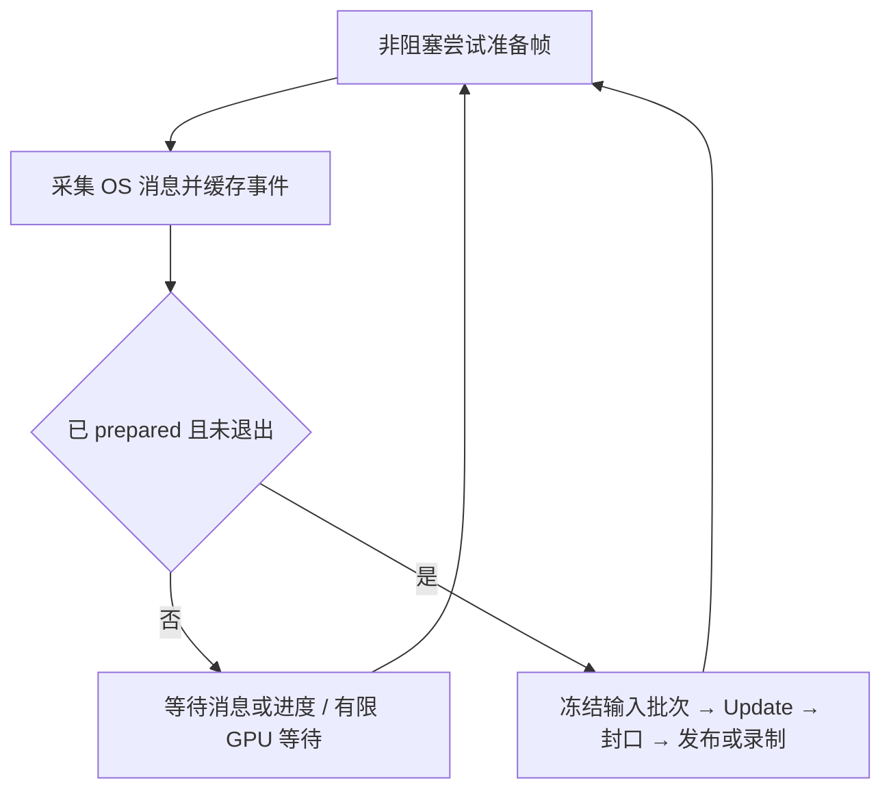

> - 适用: 追溯 2026-10-16 帧循环、窗口事件和关停重构的输入设计
> - 权威: 经用户确认的实施计划与重构前快照；不作为当前契约
> - 锚点: `modules/window/src/win32/win32_window.cpp`, `docs/history/2026-10-21-runtime-archive.md`
归档维护注（2026-10-21）：本记录的原基线、结果及当时语义不变；下列源码锚点已随 runtime 移除，按原基线或归档说明查阅：`modules/runtime/src/application.cpp`, `modules/runtime/src/gpu_system.cpp`。
正文中指向 runtime 的“当前”说明现仅为历史快照，不代表主线能力。

# 帧循环重构计划与原设计快照

初始状态：已确认、未实施（在替换旧实现前记录）。记录日期：2026-10-16。
实施状态：已完成；实际范围、回归、性能数据和已知限制见[实施验收](2026-10-16-frame-loop-refactor-validation.md)。下文保留确认时的设计语义。
后续调整：用户要求先删除 Win32 ModalVBlank、验证现有 modal loop；删除及追加验证记录在同一实施验收中，下文第 8 项保留原计划语义。
范围：Windows、D3D12/Vulkan、单/双线程、CPU-only 和无窗口 Application。
基线：`93a81176a3bdc728cc0572c13deebba047a69251`。开始实施时工作树已有
`modules/runtime/include/radray/runtime/app_render_context.h` 修改：移除 `<cstdint>`，改为引入
`<radray/types.h>`；这份用户修改保留，Git 基线本身不包含它。

实施前验证补记：本次在该基线上执行 Debug 的 RuntimeFoundation、WindowOperationsTest、
ApplicationSystems 与 FrameTimeline 回归，49/49 通过（37.70 s）。本机 Vulkan 验证层 1.4.363.0
低于既有多交换链用例要求的 1.4.364；保留原门槛。完整命令与后续结果见实施验收记录。

## 重构前快照

依赖为 window → core、render → shader/core、runtime → render/window/shader/core。
GT 拥有窗口、游戏逻辑、FrameTimeline、完成通知与框架资源释放；可选 RT 顺序消费已发布的
Scene 包，录制、提交、Present，再发布 CPU 完成计数。GpuSystem 拥有设备、队列、fence 和
flight；FrameTimeline 借给它，FrameSerial 标识每次槽位使用。单线程模式 GT 同时承担 RT。

`SingleThreadRunner`、`ThreadedRunner`、`CpuRunner` 均位于旧 `application.cpp`。
S0 先处理固定窗口维护批次和最旧槽位背压，再消费完成、释放 owner、服务帧等待、资产和
scheduler；BeginFrameTiming 后派发输入，再执行 Update/World、封口和发布。RT 只能在
ready 交接后访问已发布包；GT 只能在 CPU 完成计数的 acquire 观察后读取对应提交态。
资源必须等待真实 final fence，空帧和跳过绘制帧仍需交付、完成和回收。

旧 `DispatchWindowWaitMessages` 在等待中只派发 sent messages；posted 输入留在 OS 队列。
`CompleteRunnerFlight` 以 1 ms fence 等待片段泵 sent messages，30 秒未完成终止；
`RetireRunnerFlights` 随后仍同步执行 queue idle。CPU 等待、RT join、VBlank join 分散。
原生窗口信号直接在 WndProc 发出；`_ticking` 仅挡住帧重入，不能隔离所有游戏回调。
`CompleteFlight` 为按队列顺序退休而扫描所有槽位的 Signal，存在读到 RT 尚未交付槽位的风险。

窗口维护冻结操作截止序号，等待最后已发布包和 queue idle 后 FIFO 修改，整批修改后恢复
操作续体。关停先消费已发布包并停止 RT，再停止生产者、真实 GPU drain、消费完成、放弃
未发布域、OnShutdown，最后按 owner 依赖顺序拆除。维护不能等待 GT 尚未发布的帧。

这是平台允许形成的等待环，不能据此声称已经捕获某驱动的真实死锁堆栈。普通 GPU 等待
不必然死锁；回归测试通过 GPU gate 与同步消息构造依赖。依据为
[DXGI 多线程约束](https://learn.microsoft.com/en-us/windows/win32/direct3darticles/dxgi-best-practices#multithreading-and-dxgi)、
[Vulkan Win32 WSI](https://docs.vulkan.org/spec/latest/chapters/VK_KHR_surface/wsi.html#_win32_platform)；
消息等待与采集分离参考 [SDL 3.2.0](https://github.com/libsdl-org/SDL/blob/release-3.2.0/src/video/windows/SDL_windowsevents.c#L2158)。
旧源码可用 `git show 93a81176a3bdc728cc0572c13deebba047a69251:modules/runtime/src/application.cpp` 查阅。

## 确认后的实现契约

1. Application 持有内部 ApplicationLoop，按同名 .h/.cpp 组织。正常、维护、模态和停止
   共用非阻塞状态推进；单线程直接录制，双线程交付 RT。仅等待最旧待复用槽，保留 GT/RT 重叠。
2. 每个 prepared 帧有唯一身份，S0、输入、Update、发布各一次。保持
   ServiceFrameBoundaryGT → BeginFrameTiming → 原生消息采集 → 冻结输入派发 → Update。
   完成回调中投递的消息可进入紧接着的 Update；保留 DeltaTime/LastFrameLatency 语义。
3. RT 在提交、Present 和全部提交态写完后 release 发布，GT acquire 后才读槽位。
   新增 RetireSubmittedFlights，只访问明确交付的连续 FlightIndex/FrameSerial 范围，返回
   实际退休数量，按真实 fence 完成退休前缀。GT 独占 retire；通知、CPU 交付和超时都不算 GPU 完成。
4. NativeEventPump 新增显式延迟模式、原生采集、冻结派发、等待及 Wake；独立窗口和
   WindowManager 默认即时模式，只有 Application 启用延迟模式且由帧阶段检查派发。
   Cocoa 保留即时模式，拒绝尚未实现的延迟配置。RHI 不依赖 window，也不导出窗口等待句柄。
5. WndProc 立即完成 OS 回复和状态变化，业务通知排入可增长 FIFO。保留键鼠边沿、重复、文本、
   滚轮、焦点、捕获、移动、尺寸和显示变化；不覆盖、不额外合并。文本保存自有副本。
   以不复用的注册身份寻址；注销取消旧事件。冻结批次，回调新事件留到下一批。
   EventBeforeSurfaceChange 与模态 tick 保持同步控制入口，不进入输入队列。
6. Win32 用 MsgWaitForMultipleObjectsEx 等待进度、线程实际退出与 QS_ALLINPUT。
   CPU 交付、排空和退出均唤醒；通知仅提示重查，允许合并、提前和虚假唤醒。
   GPU 外层有限休眠复用 WaitFor(value, 1)，保持 30 秒 fence 截止时间且消息不重置截止时间。
   每轮原生采集最多 256 条，随后检查进度。运行中的框架输入不丢，OS 已合并的移动不在保证范围。
7. 维护冻结操作批次和已发布帧号、停止发布、非阻塞确认 RT 交付，然后临时线程独占
   等待 final fence 与一次 Queue::Wait。它不 retire、不释放 owner、不调用游戏 hook。
   GT 泵消息并确认线程实际退出后 join、retire，再执行固定操作批次；保持 FIFO 和续体边界。
8. 模态 tick 未就绪立即返回；保留丢弃过期非模态绘制但消费 Scene 包的规则，最多一个模态
   CPU 包在途。S0、输入、Update、录制、维护和交付禁止重入。VBlank 停止改成请求停止、
   观察真实退出再 join。最终销毁必须回到外层，不能在嵌套消息栈销毁 Application/消息泵。
9. 退出立即停止新帧及普通输入派发、取消积压输入、继续泵原生消息。关闭操作入口，RT 消费
   已发布包后退出，再 BeginStopping、排空 GPU、GT 释放完成 owner、放弃未发布域并拆除。
   真实主窗口关闭在安全关停点通知一次，再 OnShutdown；RequestExit 不伪造关闭通知。
   析构兜底不派发延迟游戏事件、不调用派生 OnShutdown。所有线程早于借用对象销毁。
10. 保持公开 Application hook、flight 数、Scene 与 Acquire/Present 语义；普通帧不增加线程。
    不承诺能打断同步 OnRender 或驱动自身阻塞；不强制释放在飞资源。

## 实施顺序与验收

先保存本快照、固定基线；再建立窗口和 GPU 接口并测试但不切换 Application；完成普通帧、
模态、维护及关停后整体切换、删除旧等待路径；最后回归、性能核查、同步长期文档与验收归档。
采用 radray-doc；历史授权覆盖本次计划、原设计和实施验收，不要求另一次确认。

| 验收项 | 要求 |
|---|---|
| CPU 等待环 | RT 同步消息，覆盖正常背压、维护、退出，GT 能响应 |
| GPU gate | 不提前派发输入、Update、回收或窗口修改，真实释放后恢复 |
| 队列 idle | final fence 完成但队列尚未 idle 时仍不能修改/拆除 |
| 输入 | down/up、重复、UTF-8/代理对、滚轮、焦点/捕获；FIFO、冻结和窗口身份失效 |
| 帧与 owner | 两后端、单/双线程、F=1/2/3/4；重叠、一次完成和一次 owner 释放 |
| 模态 | 等待中拖动、连续 tick、回调触发 tick、退出，无重复帧/消息栈最终析构 |
| 维护/停止 | resize、最小化恢复、多窗口、维护时关闭、停顿时退出、OnInit 退出、析构兜底 |
| 通知/兼容 | 提前与合并唤醒、退出竞态、消息洪泛、即时窗口、CPU-only/headless |

fixture 自持有 gate、事件记录和生命周期探针，不添加生产测试字段；阻塞用例有超时和释放兜底。
window 测试为一个模块 GTest executable；runtime 扩展现有目标。桌面测试串行，先构建后测试；
Debug/Release 相关回归和完整回归，保留已有 Vulkan validation layer 版本门槛，不扩大 skip。
使用既有 Tracy 场景检查 CPU 占用、GT/RT 重叠和帧间空洞；稳定回退须定位。
旧测试记录不算本次验证，实际执行结果、偏差和限制在验收记录中填写。

验收记录为同目录 `YYYY-MM-DD-frame-loop-refactor-validation.md`（使用实际记录日期）；
必要附件使用所属记录日期和主题。实现后更新[帧与 GPU](2026-10-21-runtime-frame-and-gpu-snapshot.md)、
[Runtime 宿主](2026-10-21-runtime-render-framework-snapshot.md)、测试指南与 overview 历史入口，
历史保留原语义；执行 `python tools/check_docs.py` 和 `git diff --check`。
