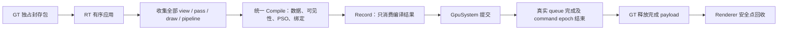

> - 适用: 查阅 runtime 移除前的 render-framework 设计与操作
> - 权威: 2026-10-21 归档快照；不是当前契约或本次验证结果
> - 锚点: `docs/history/2026-10-21-runtime-archive.md`

状态：已归档。日期为本次归档日期。基线：`751aca4e6a70203e6a62f9de67893b33463b94fc`，文件树等同原 HEAD `ed23aef93b779082d3efab221bbe52d9f30051f0`。
原文件（相对 docs 根）：`architecture/render-framework.md`。正文中的“当前”、命令、测试与能力均限定于此基线；共享说明保留上下文，不覆盖当前长期文档。
原源码锚点（通过归档基线查阅）：`modules/runtime/include/radray/runtime/application.h`, `modules/runtime/src/application.cpp`, `modules/runtime/src/application_loop.h`, `modules/runtime/src/application_loop.cpp`, `modules/runtime/include/radray/runtime/world_manager.h`, `modules/runtime/src/world_manager.cpp`, `modules/runtime/include/radray/runtime/render_system.h`, `modules/runtime/src/render_system.cpp`, `modules/runtime/include/radray/runtime/render_framework/scene_manager.h`, `modules/runtime/src/render_framework/scene_manager.cpp`, `modules/runtime/include/radray/runtime/components/scene_view_capture.h`, `modules/runtime/include/radray/runtime/game_framework/`, `modules/runtime/include/radray/runtime/components/`, `modules/runtime/include/radray/runtime/render_framework/`

# Runtime 宿主、World 与渲染场景

runtime 采用立即创建、延迟销毁、统一 Tick 轮次与类型化增量交付。每个 Scene 只有一份 RT CPU 数据；
flight 保存独占更新包、按值视图请求和必要 owner。SceneManager 交付 CPU 场景，Renderer 集中拥有 GPU 镜像、材质版本、绑定及帧计划，RenderSystem 提供 shader program 与 PSO 缓存。
应用收集全部 pipeline 和输出，通过一个 FrameBuilder 编译，SceneDraw 提供场景适配。RasterGraph 提供单 graphics queue 的显式资源合成，没有完整 Forward 或完整场景快照。
旧渲染器设计见[历史快照](2026-09-14-render-framework-design.md)。

runtime 按职责区分底层服务、通用资产与可选渲染框架，框架依赖底层服务。

| 归属 | 文件与职责 |
|---|---|
| runtime 根目录：底层渲染服务 | `gpu_system`、`render_system`、`gpu_cmd_allocator`、`gpu_resource`、`gpu_frame_resources`、`shader_jit`、`shader_program`、`graphics_pipeline_cache`、`vertex_layout`；不依赖场景、Material 或 Pipeline |
| runtime 根目录：通用资产与数据 | `image_asset`、`texture_asset`、`static_mesh`、`vertex_data`、`gpu_mesh`、`local_transform`；持有 GPU 资源不等于属于渲染框架 |
| `render_framework/` | Renderer、BindingRegistry、RendererResources、SceneManager、SceneWriter/RenderScene、场景 GPU 镜像、场景交付与资产退休、视图、Material、输出、Pipeline 与 SceneDraw |
| 上层装配 | Application 组合可选服务；`game_framework/` 保存 Actor/World 与 WorldRenderBridge，`components/` 保存组件及相机捕获适配 |

公共头通过 `<radray/runtime/...>` 引用，框架头使用 `<radray/runtime/render_framework/...>`。
同名 `.h/.cpp` 保持对应，仍使用一个 `radrayruntime` 构建目标。
应用可以关闭 Scene 和 World，直接使用底层服务录制 RHI。
`GpuMesh` 是独立几何数据，`LocalTransform` 是通用 TRS 值；更新包、TransformId 和 SceneTransform 属于框架。
`AppRenderContext` 是独立帧值类型，GpuSystem 与 WindowManager 不需要包含 Application 头。

## Application 与驱动边界

`Application::Run` 按 `ApplicationRuntimeDescriptor` 的可选系统创建服务。Window、Gpu、Render、Scene、World、Asset 默认都启用；某个 `std::optional` 设为 `nullopt` 即关闭该系统。字段只放在所属选项里：后端、验证、多线程、交换链和帧 profiler 属于 `GpuOptions`，shader 根属于 `RenderOptions`，`SceneOptions` 控制场景服务，资产根属于 `AssetOptions`。`FlightDataCount` 是时间线槽位数，必须大于 0。必要时初始化窗口，然后调用 OnInit；默认不创建默认 World。各 getter 对未启用的系统返回空。`GetFrameTimeline()` 在初始化成功后始终有效。
`RequestExit()` 可跨线程请求结束并唤醒消息循环；调用者必须在宿主拆除前结束，在没有窗口时同样有效。启动失败写在 `GetStartupResult()`，OnInit 之前返回。OnInit 返回后以 bootstrap S1
收束连接和销毁请求；初始数据等首个 writable flight 封包，不伪造发布或 GPU 完成。

| 正常入口 | 责任 |
|---|---|
| S0 `ServiceFrameBoundaryGT` | 完成事实、框架 owner 释放、等待通知、资产结果与 scheduler；ApplicationLoop 的 PrepareFrame 在此前非阻塞检查窗口维护与 writable 背压 |
| S1 `FinalizeWorldAndSealGT` | Tick/World CPU 借用结束后，冻结生命周期请求、注销和连接，Collect 场景最终值、OnCollectRenderViews，再 Seal |
| S2 `ApplySceneUpdatesRT` | BeginFrameRecord 后、OnRender 前，有序 Apply；先结束上一轮 CPU Scene 读者 |

输入与 OnUpdate 后，WorldManager 开始全局 TickEpoch。S1 不等待 GPU。RT 跳过绘制仍消费已发布包。
Application 持有内部 ApplicationLoop，统一普通帧、模态、维护与关停；未就绪时返回原生消息采集，只有准备完成的唯一帧身份可派发冻结输入并执行 Update。OnInit 尚未返回时不允许模态入口提前推进。
GPU 单线程直接录制，双线程交给 RT；ready 交接、CPU 提交完成计数与真实 GPU fence 是实际同步权威。只等待复用的最旧槽位，保留 GT/RT 重叠。
不启用 Gpu 时，同一协调器使用 FrameTimeline 和同一条完成路径。它按 `FlightDataCount` 轮转槽位，泵可选资产和 scheduler，如有 SceneManager 则在 Update 后同步发布并消费场景包，再发布 `OutputsExecuted` 为 false 的完成。该模式不调用 OnRender，但会调用 `OnRenderFrameComplete`。等待恢复时机与延迟见[帧序](2026-10-21-runtime-frame-and-gpu-snapshot.md#帧序)。多线程模式要求 Gpu。
普通组件不得自行驱动这些入口或调用 WaitIdle；未使用 Application runner 的 CPU 测试显式调用 World 的
`Tick`、`FinalizeWorldGT`、`CollectRenderUpdates`、`ShutdownWorld`，或对应 WorldManager 驱动。
托管 World 不能自行 Tick/Finalize。析构只做末端资源释放，已注册对象必须先显式 teardown。

## 立即创建与 Tick

`SpawnActor`、`AddComponent` 返回已经存在的对象。顺序为验证目标 → 分配身份/owner → 容器追加 →
同步注册/创建通知；回调前所有权和查询已成立。独占 draft 可以先配置，加入 World 时才获得 Tick 资格。

WorldManager 维护唯一 TickEpoch；独立 World 的显式驱动维护自己的轮次。World/Actor/Component 加入调度域时
记录 `FirstTickEpoch = CurrentTickEpoch + 1`。输入和 OnUpdate 创建者可以参加紧接着的轮次；Tick 中创建者
从下一轮开始，与目标 World/Actor 是否已经遍历无关。暂停不阻止 S1、Ready 或渲染同步，恢复不补跑历史 Tick。

WorldManager、Actor/Component 的调度数组均固定入口长度，按索引逐项取 ID 或对象地址，
回调后不保留数组元素引用。Tick 回调只允许追加，既有条目到 S1 才能移除；因此 WorldManager 不复制 WorldId 列表，
SparseSet 或数组扩容也不会使已取得的独立 World/Actor/Component 对象地址失效。
`Actor::Tick` 是业务 hook；框架 dispatcher 在其返回后仍负责组件 Tick，派生不需要调用基类来驱动组件。
`Actor::Tick` 与 `ActorComponent::TickComponent` 默认不进入调度。`SetTickEnabled(true)` 后才加入 World 的 ticking 列表；
空闲 World 的 Tick 只遍历该列表，不扫描全部 Actor。覆盖 Tick / TickComponent 的派生必须自行启用。
组件启用不等于调用未启用的 `Actor::Tick`。`World::SetTickEnabled` 仍是整 World 暂停。
每个 hook 返回和下一组件派发前都检查 Live/epoch。递归 Tick、提交或跨线程修改会诊断。
公开 span 是只读借用，调用者持有期间不能触发导致数组扩容的创建。

## 身份、注册与延迟销毁

WorldId 在所属 manager 内有效；ActorId 包含 WorldId，ComponentId 包含 ActorId，均含槽位和 generation。
独立 World 的 ActorId 只在该 World 内有效。跨 S1 保存非拥有引用使用身份；裸指针不保证跨 S1 有效。
槽位 generation、TickEpoch 和交付序号耗尽时拒绝回绕。

对象寿命为 Initializing / Live / PendingDestroy / Destroying。组件另有
Unregistered / Registering / Registered / Unregistering，不与渲染连接混成一套状态。
注册前写 Registering，建立渲染关联，再 OnRegister，返回后写 Registered；OnRegister 中 IsRegistered 为 false。
新加兄弟组件由 Add 自己注册，外层固定长度遍历不重复注册。初始化期间自销毁仍完成当前注册序列，
随后停止尚未开始的注册和 OnSpawned；创建函数可能返回仍占有内存的 Pending 对象。
只有实际进入过 OnSpawned 的 Actor 才派发配对 OnDestroyed。

Destroy/Remove 首次返回 Accepted，重复返回 AlreadyPending，无效目标返回 Invalid。请求立即影响 Live 查询
和后续 Tick，但不当场注销、取消任务、解除层级或释放引用。父 Pending 自动使子对象不可调度，不必扫描全部子对象。
Pending 不可取消或复活，且不能向 Pending/Destroying/Stopping owner 新增对象。

S1 先冻结所有 World 的本批销毁、层级和连接请求，再处理父覆盖子、身份失效与受影响 owner 数组的稳定压缩，
最后派发注销/销毁通知。幸存对象顺序保持；没有请求时不扫描 Actor 寻找 pending。有删除时成本包含受影响容器
的线性压缩及请求排序，不能当成 O(删除数)。单 Actor 请求只遍历 owner 指针定位并稳定移除，不读取其他 Actor 的生命周期。
OnUnregister 时 owner/world 上下文仍有效；清理后才释放内存。
WorldManager 在任何回调前移交本批 World owner、失效身份并清空销毁请求，后续回调只追加下一批请求，
无需另存执行中的 WorldId 列表。Actor/Component 的 Destroying 标记在准备阶段写一次，通知阶段不重复遍历标记。

销毁回调可以立即向其他存活 Actor 或存活 World 新增对象。本次通知新提交的销毁/重挂接/连接请求留下一次 S1，
但 Pending 立即生效；新建后立即 Pending 的源不会发布空 primitive。Stopping 阶段禁止新业务创建。
`Clear` 是空闲 manager 的显式批量关闭，之后仍可创建；`Shutdown` 进入不可恢复的 Stopping。

## 层级与渲染连接

未注册 draft 的 AttachTo、DetachFromParent、SetRootComponent 立即生效。AddSceneComponent 的初始 parent 在
对外注册通知前建立，仅新增节点和边。已注册节点改用 RequestReparent / RequestSetRootComponent，S1 前查询仍见旧关系。
KeepLocal 保留局部 TRS；KeepWorld 要求新局部矩阵可以精确表达为 TRS，自身/后代、跨 World、奇异矩阵和 shear
在修改前拒绝，提交时重新验证。删除父组件会解除其他 Actor 的幸存 child，采用 KeepLocal，不误删别人的 owner。
注册组件的 local TRS 存在 WorldTransformStore 的连续紧凑数组中，组件缓存内部数据指针，数组扩容时
由存储修正全部存活组件的缓存指针；该修正只发生在容量增长时，成本为 O(槽位数)。draft 与注销后的
组件使用自身的 local 值。WorldTransformId 只在所属 World 内有效，注销递增 generation，重连不改变身份。
GetRelativeLocation/Rotation/Scale 与 GetRelativeTransform 返回按值快照，不提供跨存储扩容的引用。
变换 setter 对完全相同的值短路；有变化时立即更新本地 TRS、递增 World 的变换版本，并在连接存在时
登记所属 64 槽位块的 dirty bit 与紧凑变化槽位索引。同一槽位和块只登记一次，写入不检查祖先、不访问后代、不合成矩阵。
World::SetLocalTransforms 批量写入同一存储；先验证整批句柄仍指向存活组件，再依次合并最终值。
无效批次不产生部分修改；句柄必须来自调用的 World，跨 World 传递不属于接口契约。
World 不保留 local-to-world 矩阵，也不缓存查询结果；`GetWorldTransform` 与 `GetWorldMatrix` 均返回按值
快照，每次从当前节点向根迭代合成局部 TRS 并相乘。查询为 O(深度)，额外空间 O(1)，不要求先 Collect
或派发通知；解除层级后的查询立即看到新关系。该接口适合查询较少的业务。

业务通知通过 SetTransformNotificationEnabled 显式启用，默认关闭；覆盖 OnTransformChanged 的派生也必须启用。
开关本身不补发历史变化。组件维护子树订阅数量，切换开关或重挂接时沿祖先更新；没有订阅者且没有兼容
渲染来源的修改不登记通知根。`FinalizeWorldGT` 在处理完生命周期后，从本批直接修改的候选节点中
排除有存活脏祖先的节点，再迭代遍历受影响子树派发 `OnTransformChanged`。候选过滤可能沿父链检查，
无订阅者子树不入遍历栈；有订阅者的父节点仍需枚举直接孩子筛选分支。只有启用通知的组件执行回调。
没有 renderer 的 World 同样派发订阅者，draft 的订阅者仍立即通知。
通知批在回调前摘下并推进 epoch，使旧登记整体失效，无需逐节点重置队列下标；
回调再次修改产生下一批通知，但本帧 Collect 读取修改后的最终局部值。
重挂接和解除层级在改变 parent 前移除原队列登记，再重新登记该节点。World 的 child 数组使用下标和
交换末项实现 O(1) 摘链，不保证 child 枚举顺序；父链防环校验和业务通知的遍历成本仍然存在。

连接中的 World 为 SceneComponent 建立独立 TransformId，包含普通空间节点和中间祖先。
变化数少于槽位池的 1/16 时，Collect 按紧凑变化索引一次性提取 local；更密集时遍历变化块内的连续范围，
其中实际变化块至少为 256 时先排序块索引。两种路径都直接将紧凑 local 数据交给 SceneWriter；
不再排序或解引用变化组件来提取 TRS，也不扫描没有变化的块。SceneWriter 合并同次 Seal 前的重复更新。
设变化槽位数为 k、变化块数为 b，提取成本为 O(k + b log b)，不随静止槽位总数线性增长。
parent 仅在重挂接与解除层级时单独更新，创建仍带初始 parent；RT 按值接收独立更新包，不借用 World 存储。
该布局减少密集更新的组件访问、排序与空通知遍历，但不减少实际变化条数；稀疏写入、同值读写与生命周期
负载不保证加速。本机对照、接口迁移项和回退场景见[变换存储实验](2026-09-24-world-transform-store-benchmark.md)。
内置 StaticMesh/Light 绑定 TransformId；祖先移动不需要捕获后代渲染组件。自定义 RenderComponent 默认保留
显式世界矩阵捕获，可通过 `UsesSceneTransform` 选择层级绑定；仅存在这类兼容来源时，World 才维护渲染脏根
并遍历捕获其最终值。捕获 epoch 保证重叠子树只输出一次，独立 Collect 不提前派发业务通知。

Pending 来源不执行通知或业务捕获。Scene 的层级依赖保留到实际注销，期间已排队的局部值继续同步，
保证跨 Actor 的存活子节点与即时世界坐标查询一致。注销父节点后，幸存子节点按 KeepLocal 脱离。
新建后立即 Pending 的来源不会发布空 primitive，但可能先发布没有 Shape 的 Transform 节点，下一次 S1
真正注销时删除。未 Seal 的 Transform 创建和删除可以相消。

World 指针在组件加入 World 时缓存；draft Actor 加入时在任何注册回调前给其全部组件写入上下文，
因此子组件先注册时也能观察到尚未注册的祖先变化。

普通 SceneComponent 只负责空间层级与变换。需要渲染连接的组件继承 `RenderComponent`；Primitive 和 Light
均继承它。框架的 final 变换捕获入口合并 Transform 与其他渲染 dirty，派生 `OnTransformChanged` 只处理业务副作用，
不需要调基类。公开 MarkRender* 仍先 CheckCanModify；内部标记只更新 bridge 登记表。
`World::CheckCanModify` 的拥有线程检查只在 Debug 执行；Release 仍拒绝 Collect 期间的修改。

World/manager 通过 `RequestRenderConnection` 请求连接，显式 `RequestReconnect` 强制新连接。
请求目标与已提交 SceneId 可分别查询，不能把请求 Accepted 当作连接已完成。
已连接的 renderer 由 WorldRenderBridge 持有，World 从 bridge 查询，不保存第二份连接指针。
WorldRenderBridge 的 Disconnected / Connecting / Connected / Disconnecting 状态独立于游戏注册。
连接回调请求切换只排队，不能 reset 执行中的 bridge。Connecting 中立即创建者接入一次；Disconnecting 中创建
游戏对象仍成功，但不接回正在拆除的 Scene。重连从最终游戏值建立新 SceneId，旧 Scene 可以继续退休。
注销先写 Unregistering，再拆 render state，最后 OnUnregister；不依赖派生 hook 调基类。

## 增量捕获与 RT 数据

| 对象 | 职责 |
|---|---|
| WorldManager / World | GT 游戏对象、身份、统一调度、生命周期请求 |
| WorldRenderBridge | GT 内部适配器、渲染源登记与 dirty 队列的唯一管理者 |
| SceneWriter | Scene 唯一 GT producer、Shape/Light/Transform 身份、局部变换与几何增量、光源参数快照、资产 owner |
| RenderScene | 单份 RT 数据、Apply、只读借用与 CPU reader lease |
| SceneManager | GT/RT 分离的 CPU 登记表、独占 flight 交付与资产退出握手 |
| Renderer | 类型化 GPU 登记、场景镜像、帧编译、完整组复用和真实完成后的回收 |
| RenderSystem | 独立于场景的 shader/program/PSO 服务 |

RenderComponent 分类 State/Transform/DynamicData dirty；同来源只排队一次。bridge 维护来源上的登记下标、
dirty 队列下标与 dirty 位，连接身份从 World 查询；普通 SceneComponent 不保存这些字段。
登记表和 dirty 队列直接存来源指针。Collect 先提交局部变换，再处理兼容来源的世界矩阵捕获与其他
State/DynamicData/显式 Transform dirty。内置 StaticMesh 的 State 只更新几何绑定及 TransformId，
空间变化无需重新输出 MeshState。Collect 外 dirty 位为空表示未排队；删除时交换末项并修复下标。
断开连接遍历已登记的来源和 Transform。Collect 跳过 Pending 来源的业务捕获，且禁止游戏修改、
生命周期请求、重入封包和所属 Application 的 asset/scheduler Pump。派生 setter 必须先 CheckCanModify。
World/WorldManager 负责游戏侧 Collect 禁令，SceneManager 维护自身收集与封包状态。Application 和 WorldRenderBridge 控制宿主 scheduler 与资产操作保护，退出收集时恢复进入前的状态；SceneManager 不回调 Application，AssetManager 只保存通用操作禁用状态。
PrimitiveComponent 的 final 入口负责 ShapeId 创建/注销，CollectPrimitiveUpdates 接收 ShapeCapture，
只输出自身最终的 mesh 状态或 transform（至多一条，也可以不输出以保留 bare shape）。
一般 RenderComponent 接收 SceneCapture，可以登记和捕获多个 ShapeId/LightId；一个身份在同轮 Collect 中
由其来源捕获一次。SceneCapture 可为当前来源批量创建/移除 Shape；只登记当前来源拥有的身份，不提供修改 World 的操作。
LightComponent 捕获类型化光源值，使用独立的 LightId。ShapeId、LightId、TransformId 是不可隐式互转的强类型，
均包含 Index/Generation，只在所属 SceneId 内有效；三种独立身份池允许使用相同数值的槽位与代次。

独立工具由 CreateSceneGT/GetSceneWriterGT 获得 writer，遵守同样的绑定和交付契约。
World 独占的 writer 不向外提供；独立 writer 在 DestroySceneGT 后不可继续使用。
Shape 在 Seal 前的 Create/Remove 可以相消，已 Seal 的创建只能由后续 Remove 有序退出。
独立 writer 的 State 覆盖最终世界矩阵，transform-only 更新不重建 mesh。绑定层级的 State 与局部变换独立合并。
更新数组复用容量，工作与唯一 dirty 源有关。
SceneWriter 直接构建本批 SceneUpdateBatch。存活 Shape 只保存资产使用身份、是否已发布与是否有 mesh 状态；
不常驻矩阵、mesh 描述或更新下标。World 通过 SceneCapture/ShapeCapture 将去重后的最终值直接追加到变化包；
常规 Shape Flush 只标记创建已发送，不遍历 mesh/显式 transform 记录重组矩阵。Transform 状态另外保存 parent、
创建/局部/重挂接记录的下标。局部与重挂接下标按 writer epoch 懒失效，Flush 无需逐个清理变换更新，
只完成创建状态并推进 epoch，再把变化包与 flight 的空包交换。

独立 writer 的反复编辑使用单独的 ShapeEdit 槽，保存创建/更新下标与更新种类。SetTransform 覆盖已有记录；
SetStaticMesh 吸收同一身份的 Transform，取消时交换末项并修复下标。World 在同次 Seal 前再次 Collect、
捕获后删除身份，或通过生命周期入口直接编辑 writer 时，也按需建立这些定位信息，继续保证最终值合并；
World 的下一批恢复直接提取。编辑槽按 ShapeId.Index 索引，代次仍由 ShapeState 的身份池验证。
独立 writer 在 CreateShape 时入队创建；World 先保留身份，最终 CaptureShape 才入队，未捕获便删除的源
不会发布默认几何。显式空 mesh 也满足后续 SetTransform 的前置条件。
Shape 的可选资产使用身份对应 RenderAssetLifetime 中一次计数；是否持有使用与 AssetId 是否为空无关。

内置层级变换协议为 `LocalTransformUpdate`：8 B TransformId + 40 B 紧凑 TRS，共 48 B。
创建记录另带 Parent，共 56 B；重挂接只增发 16 B 的身份对；删除为 8 B 身份。TRS 的 quaternion 顺序为
x/y/z/w，不受 Eigen SIMD 对齐配置影响。新节点在首次 Seal 前的局部编辑直接并入创建记录。

RT 的 `SceneTransform` 用整数行索引维护 parent/first-child/next/previous，并分列保存局部 Matrix4f、
世界 Matrix4f 与状态。局部 TRS 只在收到修改时 compose，祖先移动重算后代时复用局部矩阵。
子树入口直接求值，只有后代进入临时栈，独立叶节点无需入栈出栈；父子合成保留 Eigen 矩阵乘法。
物理行在存活期间不移动，删除行由 free-list 复用；重挂接只改整数链接，无须重排整片子树。
连续矩阵列有利于相邻节点访问，但频繁复用后不保证子树连续，也没有后台重排或分页压缩。

Apply 先应用本批全部局部值与拓扑，再计算变换。修改节点按 epoch 去重；当 seed 至少为 256 且占行池
至少 1/8 时，顺序扫描行池重建 seed 顺序，扫描行数有 8k 的上界，避免密集随机访问；稀疏更新不扫描行池。
单个 seed 或所有 seed 均无父节点时
直接遍历。其他情况先按 epoch 标记受影响子树，从 seed 中筛出没有受影响父节点的根，再按父先子后顺序计算。
每个受影响世界矩阵只乘一次，一般路径会额外访问一遍受影响节点的整数元数据；不会扫描全部 Scene。
设直接变化节点为 k，最终受影响节点为 a，稳态标记与求值为 O(k+a)，重挂接本身 O(1)，删除还需访问直接子节点。
临时数组复用容量；空间随节点数及历史容量峰值增长，当前实现不主动收缩。

已评估并回退“冻结 World 后由 RT 直接导入变化 local”和“Scene 全量求值”两项实验。
直接导入省去逐项值包，但输入握手及来源清理会压缩 GT/RT 的重叠，多个重点双线程负载出现性能回退；
全量求值还会扩大 bounds/光源更新范围，在稀疏负载下代价明显增加。因此继续采用按值交付 local 与增量求值，
不保留实验开关，也不新增仅按 dirty 数量/比例切换同步或求值方式的阈值。
测量范围、收益例外与完整数据见 [实验及回退结论](2026-09-23-scene-direct-import-benchmark.md)。

兼容捕获与独立 writer 仍可发送 `ShapeTransformUpdate`：8 B ShapeId + 列主序 3×4 AffineTransform，共 56 B，
隐含齐次行 (0,0,0,1)，保留负缩放和仿射 shear。RT 为这类 Shape 分配无父节点的变换行。
绑定 TransformId 的 Shape 不接受显式世界矩阵更新，必须修改对应局部节点。非仿射输入在压缩时、
非有限渲染变换在更新 bounds 时做 Debug 校验。

SceneWriter 分别维护 Shape 状态、Light 身份池与 LightSceneData 最终值；Light 槽只存当前表种类和行号，
Light 没有逐项 dirty/删除队列。CreateLight 只保留 GT 身份，首次 SetLight 后才进入光源集合。
任一 SetLight 或已有数据的 RemoveLight 直接设置待提交包的 LightsChanged，不另存 dirty 标志；
Flush 按此标志把完整的四类光源表按值封存到 flight，交换空包后自然恢复未变更状态；
未改变的光源也包含在内，但不重新调用其组件捕获。
未捕获便删除的组件不会发布默认光源；独立 writer 在同次封包前 SetLight 再 RemoveLight，允许交付最终空集合。
SceneUpdateBatch 的 LightsChanged=false 表示保留 RT 光源，true 表示全量替换，空列表明确清除所有光源。
无参数 dirty 时不复制光源快照。内置光源的 Common 带 TransformId，GT/flight 中的位置与方向为占位值，
RT Apply 后的类型化表提供最终世界位置与方向。祖先移动只发送局部变换，无需重新捕获光源参数。
当前 RT 在参数替换或任意变换更新后扫描光源表。参数替换时，同一行的身份及 Transform 不变、矩阵未更新的
光源保留 RT 姿态；其他行重新求值。纯变换帧只为实际受影响的光源求位置与旋转，没有逐节点光源链表。
自定义光源可覆盖 UsesSceneTransform 返回 false，继续由 GetLightPosition/GetLightDirection 捕获显式世界姿态。
已 Seal 的列表不受后续修改、删除、身份复用影响。

StaticMesh 在构造时验证 CPU mesh/bounds 并补全默认 sections 一次，之后数据不可变。
StaticMesh 拥有一份 StaticMeshRenderData，集中存放 GPU mesh、sections 与局部 bounds。
StaticMeshDescription 只保存 AssetId 和指向该渲染数据的只读借用；所有实例与 Scene 共享资产中的同一份数据，
每个实例只保存自己的绑定、矩阵、世界 bounds 与 ReverseCulling。借用由 GT 资产 owner 保护，RT 不参与引用计数。
Loading、失败或无效 mesh 产生空几何，空几何的世界 bounds 退化到变换原点。
组件 Ready 通知检查 Live、注册、SceneId、ShapeId 和 mesh 请求身份；改绑/注销停止旧等待而不取消共享加载。

RenderScene 按 Shape 删除 → Transform 删除/创建/改父/局部值 → Shape 创建/绑定 → 显式世界矩阵
→ 层级求值/bounds → 光源参数与姿态的顺序应用。ShapeSlot 保存身份、稠密 mesh 行号、Transform 行号
以及同一 Transform 上的 Shape 双向链。受影响 Transform 只更新其绑定 Shape 的 bounds；纯几何改绑也会刷新 bounds。
StaticMeshTable 拥有身份、几何绑定、TransformRows、bounds 四个稠密列，bounds 包含 ReverseCulling。
删除一起交换末项并修复 ShapeSlot；实例不逐个堆分配。Matrix4f 只由 SceneTransform 持有，多个 Shape 可以绑定同一节点。
`GetStaticMeshColumns().Transforms` 是整个变换行池，必须以 `TransformRows[meshRow]` 索引，不能用 meshRow
直接索引，也不保证长度等于 Shape 数；`Columns::Get` 已做此映射。剔除仍可只顺序读取稠密 Bounds 列。
GetStaticMeshes 保留身份枚举，包含资产未就绪的已登记 mesh。行号不表示身份，所有列与单项借用在下次 Apply
或销毁时失效，跨线程 CPU 读取需要相同的 reader lease。GetStaticMeshTransform 只借用已登记 mesh 的世界矩阵，GPU packing 不必构造包含几何、bounds 和材质的完整 view；借用合同相同。CPU 列布局不等同于 GPU buffer packing。
LightSceneData 直接拥有四种类型的 LightTable，GT 最终值、flight 快照与 RT 数据均使用同一紧凑布局。
每张表是 Ids 与 Data 两列，Ids[row] 拥有 Data[row]，两列长度始终相等：

| 表的 Data 元素 | 保存的数据 |
|---|---|
| DirectionalLightData | Common、世界方向 |
| PointLightData | Common、PointLightParameters |
| SpotLightData | Common、PointLightParameters、内外半锥角 |
| RectLightData | Common、世界位置/方向、衰减半径与衰减模式/指数 |

Common 只保存种类无关参数：颜色/强度与影响世界/投影开关。身份在 Ids 列，不嵌在记录里，因此按身份查找只
扫描 8 字节连续的 id 列，不跨步走过整条记录。阴影 bias 归产出它的类型：PointLightParameters 保存世界位置/
方向、衰减参数、光源半径/软半径/长度与阴影 depth/normal bias，Point 的方向仍用于非零长度光源；
DirectionalLightComponent 的 CSM 配置（级联、阴影距离/分辨率、bias、PCF 模式）尚未接入 scene，
方向光记录当前不携带阴影参数。位置使用 Vector3f，不保存恒为 1 的齐次分量。这些是 CPU 数据，不与 GPU buffer
的对齐和 packing 绑定。Rect 仍是预留数据能力，尚无 RectLightComponent 和面积几何参数，不代表已实现完整
面积光渲染。

表的类型决定光源类型，每条记录不再保存 Type 标签、身份或其他类型专属字段。LightData 是只在单灯捕获与
SetLight 调用时使用的 variant，身份由调用方另行传入；不保存 vector<variant>，因此持久数据不按最大光源记录
尺寸占位。组件侧由叶子直接构造自己的类型化记录，不再基类造 variant 再逐层 visit 改写。SceneWriter::SetLight 通过身份槽直接定位类型和行号，O(1) 原位替换；类型改变时从旧表移除并加入新表。
RemoveLight 两列一起交换末项填补空位，并修复被移动身份的行号。类型变化保留
LightId，行号与顺序不表示身份。GetLights 返回只读分类数据及类型化查找；GetLight 仅借用 Common 参数。
LightsChanged 时复制完整分类表并复用容量，RT 不再逐条按 Type 分组。快照中的身份必须有效且唯一，两列长度必须一致。
LightSceneData 自身的 Set/Remove 保留线性查找便利接口，不用于 SceneWriter 的逐灯热更新。
RT 不维护 Light 槽位映射或代次墓碑；GetLight/ContainsLight 线性扫描少量光源并匹配完整 LightId，
仅在 GT 保留但没有参数的身份在 RT 不可见。旧 ID 更新由 writer 校验拒绝，旧快照由交付序号阻止重复/乱序消费。
RT 或停止后的检查可借用数据，普通借用截止到下一 Apply。并行 CPU 读者在 RT 派发前获取 AcquireRead lease，
在任务结束时释放；Apply 和 Scene 析构等待已有 lease，不等 GPU。RT 必须先停止派发旧 Scene 的新读者。
RenderScene 不可复制/移动；不能把 reader lease 持到依赖下一次 Apply 才能结束的工作中。

## 对象 GPU 参数与当帧视图

`RenderScene::Apply(batch, changes)` 可选输出 `SceneApplyChanges::Updated/Removed`，每次调用清空长度并复用容量。
Updated 是求值和 bounds 更新后最终受影响的完整 ShapeId：祖先移动、共享 Transform、重挂接、显式世界矩阵
和 mesh 改绑均进入集合，同一身份只出现一次。Removed 保留删除前的 generation。bare Shape 不产生对象参数；
登记 mesh 后，即使资产尚未 Ready，也有矩阵记录，绘制仍必须跳过空几何。稠密行 swap-remove 不标脏被搬移对象。
不传 changes 的纯 CPU 路径不创建 GPU dirty 集合，也不增加全 Scene 扫描。

`Renderer::GetScenes().Prepare(...)` 在帧编译时准备 `SceneGpuView`；SceneManager 必须已消费当前 flight。
SceneGpuData 元数据归 RendererScenes，实际 buffer、range 与生命周期归 RendererResources。RenderScene 只拥有 CPU 数据。
帧构建器验证 Renderer、flight 和 serial，不能拿另一个宿主的完成替代当前使用。
每 Scene、每 flight 各有一个持久 device-local object buffer，记录为 64 字节列主序 `SceneObjectGpuData::LocalToWorld`。
槽位为 `ShapeId.Index`，与 CPU mesh/Transform 行无关；CPU 查询与重试始终验证完整 generation。
空槽不清零、不绘制。buffer 只按最高所需槽位几何扩容，不缩容；当帧准备后不会更换，多个 view 复用相同绑定。
device-local buffer 分配失败返回空并保留变化，本帧跳过该 Scene；下一 flight 轮次可以重试。
返回绑定借用截至该 flight 完成，消费者必须将资源留在 ShaderRead 状态。
Pending、必要工作接纳与退休协议见[帧与 GPU](2026-10-21-runtime-frame-and-gpu-snapshot.md#对象参数上传与必要工作)。

`Application::OnCollectRenderViews(SceneViewCollector&)` 在 World S1 与场景收集后、Seal 前运行。
该阶段禁止修改 World/WorldManager 或 Pump scheduler/asset；CameraComponent 的投影 setter 同样检查。
collector 接收已构造的 `SceneViewRequest`；组件侧 `CaptureSceneView` 从存活 CameraComponent 捕获当前 SceneId、View、透视或正交参数。
捕获返回可空请求，框架不读取 CameraComponent 或 World。请求包含相对于目标的归一化 viewport，按值存入当前 flight。每帧重新提交，零请求明确表示零视图。
Camera 销毁或 World 重连不改变已封存请求；RT 只通过 `GetFrameViewsRT` 读请求，不访问组件。
`ResolveSceneView` 用实际目标及视口像素尺寸计算后端无关的 Projection，并统一生成 D3D12/Vulkan viewport/scissor；
Vulkan 使用负 viewport 高度处理 Y 方向。正交高度与实际 viewport aspect 决定宽度。非法参数、零尺寸和舍入后的空视口返回空。
SceneViewRequest 可携带 EvaluatedProjection；此时不读取 lens 参数。RasterView 接受已求值矩阵、像素 viewport/scissor 与 depth convention，
ResolveRasterView 是唯一后端 viewport 转换入口。MinusOneToOne 转为零到一深度，ReverseZeroToOne 保持矩阵并返回反深度标记；材质仍显式声明 compare/write。

RasterGraph 的 Raster/Fullscreen/Copy/Clear 节点声明 whole-texture Read/Write/ReadWrite 与所需状态。
Compile 只排序 RAW/WAR/WAW 与显式 After 依赖，拒绝 cycle、同节点反馈、同 texture 重复资源和未初始化读取，不分配或录制 GPU 命令。
CompiledRasterGraph::Record 使用调用方已经分配的 command，执行每节点状态转换、body 和最终 Exit。
节点 body 不管理图内 texture 状态；RenderOutput 只用于图外入口/出口，不能对同附件再次负责内部转换。
暂不支持 alias、自动裁剪和跨队列。中间 target 由每 flight 的调用方拥有，直到最终 GPU fence；可借用 GpuFrameResources 的 typed texture/view pool，view 退出由 Vulkan 原生缓存同步清退其闲置 framebuffer。

## Pipeline、材质与绘制

Application 独占 `Renderer`，后者借用 GpuSystem 和 RenderSystem；独立宿主也可显式构造。
框架没有共享智能指针所有权链。TemplateId、MaterialId、ResourceId、DescriptorBlockId、RendererFrameId
包含 Renderer 身份、槽位与 generation；复制 ID 不保活，跨 Renderer 和过期 ID 被拒绝。GPU 资源集中在登记表中，
持久依赖和已经接纳的帧使用分别登记，替换产生新版本，不修改已有帧的版本。

`FrameBuilder` 是非拥有构建能力。先 `BeginFrame`，用 `AddView/AddPass/AddDraw` 提交独占值快照；
或把 `RenderPipeline::Collect` 返回的 `FramePreparationId` 保留给录制。pipeline 的 Plan 由 Renderer 帧存储独占，
Collect 不上传 Scene 数据或创建参数集，`Compile` 一次性执行全部准备工作、统一解析数据和完整绑定组。
不能递归 Compile 或在编译期间追加准备任务。直接 producer 可在准备阶段调用 StoreData、UseResource 和 AddBindings。
AddBindings 是原生服务接入口：layout 必须由活过 Renderer 的服务拥有，dependencies 必须列出所有资源；独立 RHI 调用方可自行拥有参数集并登记完成依赖。
Record/RecordPass/Bind 只验证并消费结果，不创建参数集、上传材质常量、反射或执行内容去重。
取消、丢弃或编译失败仍保留已经接纳的资源和必要上传，直到宿主结束相应工作域。

`Compile` 按域选择组的解析路径，避免每个 draw 重算稳定布局事实：
模板注册时为每个组预派生元素下标与预制 dynamic offset，没有 runtime 输入的 immutable 组把完整 block 直接缓存在模板上；
Material/Sampler 组在 `RegisterMaterial` 时按 `[template][group]` 预建 writes 与 dependencies，帧内只用数组下标取非拥有 block，
失效（LRU 淘汰或资源退出）才用存好的 writes 重建；
其余组（Scene/Frame、View/Pass 及有对应 override 的组）在帧内按模板、组号和该组实际读取的有序 ResourceId 列表做备忘，
命中与未命中都先比较完整 key，等价输入（如同一视图上的多个 pass、同值 override）共享一次 Resolve，未命中才展开 writes 并校验。
`Requests` 只服务原生 `AddBindings`。
帧使用清单是四个 vector，靠各 Entry 上的单调帧戳去重；
组备忘用帧级扁平开放寻址索引，桶数组跨帧保留容量，清空只归零上一帧占用的桶，帧收集期间不分配节点。

`PipelineContext` 提供 Renderer、同一 FrameBuilder、frame 信息、IGpuCmdAllocator、IRequiredGpuWork、
GpuFrameResources 和可空 SceneManager。`MakePipelineContext(renderer, builder, frame, scenes)` 不要求 World。
多个 pipeline/输出必须先全部 Collect，再统一 Compile，最后按依赖顺序 Record。

`RenderOutput` 保留有序 color views、可选 depth view 和 Enter/Exit 状态。输出 owner 必须活过完成点；
窗口由 acquired target 协议保活，独立输出由宿主保留。实际 view 决定尺寸/格式/采样；拒绝空附件、同子资源别名和未知状态。
`RecordRenderPipeline` 在 NoWork、可恢复失败及编译失败时仍补齐合法输出的 exit transition，保留已返回命令。
结果按顺序合并交给 `RegisterClosedCommandBuffers`；外层负责 Present，输出状态不构成 GPU 完成证明。

Material 资产只拥有 CPU 描述、默认 bytes、sampler 描述与资产依赖，不拥有 GPU 参数集、常量 arena 或惰性 plan。
`MaterialTemplateDescriptor` 是可复制值；输入程序为源码请求或 `ShaderProgramId`，二者互斥。
RenderSystem 验证 ID 所属服务；重建服务使旧 ID 失效。已验证外部 program 可由 AdoptShaderProgram 转移给服务。
模板注册复制定义并编译；等价模板按完整定义复用。Material 注册建立不可变 GPU 表示，ReplaceMaterial 创建新 ID，
UnregisterMaterial 拒绝新使用而保留已接纳使用。Shader/PSO 服务必须活过 Renderer 最后使用。

模板按输入来源验证四个绑定域，组号仍来自 artifact，不能根据固定数字推断：

| 域 | 输入 |
|---|---|
| Scene/Frame | SceneObjects、InstanceParameters、FrameConstants |
| View/Pass | ViewConstants、VisibleInstanceSlots |
| Material | MaterialConstants、Texture |
| Sampler | Sampler，包括 artifact 中的 immutable sampler |

所有 active 非 immutable binding 必须有输入来源，数组由 ValueIndex 起连续取值；反射大小、schema、stride 和类型都须匹配。
一个实际组混合不同域时注册失败并给出诊断，作者需迁移 shader ABI。没有 runtime 输入的 immutable sampler 组也参与编译。
ObjectIndexPushConstant 仅接受 direct addressing 的四字节 uint；通用 PushConstant 支持反射大小及 SceneIndexField，二者互斥。
ScenePushValues 必须覆盖完整 push block，未提供时归零。stencil 与动态 blend constant 缺少 RHI setter，当前明确拒绝。

BindingRegistry 独占封存的完整 ShaderParameterSet。查找键由后端兼容布局和规范化最终值组成，hash 命中后完整比较。
后端兼容布局先驻留成 Renderer 本地的小整数 id，模板注册时算一次，命中路径不再调用后端 `GetParameterGroupCompatibility`；
最终值在 Entry 里用连续数组加偏移保存，不再是逐元素的嵌套 vector。
驻留的兼容布局 id 只增不回收，数量以出现过的不同布局数为上界（热重载会累积），当前按不可变布局处理。
Material/Pass/View/Flight 的业务 ID 不进入 descriptor 身份；资源版本、buffer base/range/stride、数组元素、texture view、
sampler 原生状态参与比较。dynamic offset 属于绑定时数据，descriptor base/range 仍属于身份。
RHI 从 resolved layout 派生不透明兼容性描述，不建立第二套可重建布局；布局专属 BindingHandle 不能跨 layout 写入。
本实现复用整个组，不共享不同完整组中偶然相同的局部 D3D12 table。
帧编译先按域合并稳定组：Material/Sampler 组取自材质版本缓存，其余组取自按输入资源列表的帧备忘，
只有原生 `AddBindings` 才逐次展开，
再交给登记表做跨布局的完整值判等，避免每个 draw 重复解析相同组。SceneDraw 的资产登记查询也按当前准备批次中的唯一材质合并；这些临时索引不拥有资产。
相同 PSO 输入在整帧中只解析一次。连续绘制的 Record 重载根据已编译的 descriptor ID、dynamic offset 和原生状态省去重复命令，
每次调用从未知 encoder 状态开始；这一步不做绑定内容哈希、资源查找去重或存储创建。

RendererResources 先比较 CPU bytes，再分配唯一不可变 GPU 切片；同值 override、相同视图数据及可见列表复用默认/既有数据。
不同可见顺序产生不同切片。常量 arena 独占页和范围 allocation，回收显式归还范围并释放空页，不能把 flight allocator 的
可重写切片交给跨帧缓存。Scene 对象和实例流的每 flight buffer 由 Renderer 管理，扩容旧版本等待真实完成。

闲置 BindingRegistry 默认预算为 4096 个 resource descriptor、128 个 sampler descriptor 和 4096 个完整组。
D3D12 按实际 table 槽位（含空洞）计费；Vulkan 按对应 descriptor 类型数量计费，不声称驱动字节数。
活跃组不被淘汰；闲置 LRU 超预算即清理，分配压力先清闲置再重试。`TrimIdleBindings` 是生产显式清理入口。
外部资源退出会清除相关闲置绑定，缓存不延长资产驻留；活跃绑定仍受真实完成保护。
登记表按资源维护活跃依赖计数，资源退出检查为 O(1)，不再扫描全部 block。

SceneDraw 按 mask、world bounds、pass 及 schema 形成候选，再按 SortGroup/Order 稳定排序及兼容条件合批。
BatchKey 区分几何流、材质版本、section range、winding 和显式 domain。仅 opt-in 且无 Blend/PreserveOrder 时自动重排；
透明 A/B/A 不跨 B 合并，严格顺序只合并相邻兼容项。VisibleSlots 通过 VisibleBase + SV_InstanceID 寻址，FirstInstance 为 0。
相同可见结果跨 pass 的 bytes 由 Renderer 复用；不同结果保持分离。缺失材质/pass 可跳过，所需参数缺失则准备失败。
显式实例集合使用 DirectObject 会报告 ExplicitUnsupported，避免绘制重叠副本。

GraphicsPipelineCache 仍按 program、完整顶点布局、primitive、depth/stencil、blend/write mask、输出格式及采样解析 PSO；
负行列式选择反绕序。indexed/non-indexed、多流顶点、UNORM8X4/SNORM8X4 输入及独立 depth compare/write 均走统一 FrameBuilder。
`UnlitRenderPipeline` 是参考 Scene 适配，选择 DepthOnly 可运行深度路径；缺失 material/pass 不隐式替换 shader，fallback 必须显式登记。
scene_sync/framework_stress 均使用此入口，旧 legacy-draw 路径已删除。实例作者指南见[实例绘制](2026-10-21-runtime-instancing-snapshot.md)。

## 交付、退出与资产保活

flight 严格经过 Writable → Sealed → Published → Consumed → completion 后 Writable。
这些状态直接属于 SceneManager 的 flight 包；每个入口在修改 payload/owner 前校验一次，处理成功后提交状态，
不另设返回错误码的交付状态机或重复验证层。非法次序仍按不变量违反诊断。
Seal 分配单调 UpdateSequence，Publish 验证顺序；Consume 在 Apply 前验证 Published、下一序号与新的 FrameSerial。
即使同 generation 的合法 transform 也不能乱序或重复消费。completion 必须匹配当前 Consumed 包的 FrameSerial。
F 与 backbuffer count 无关；功能测试覆盖 F=1/2/3/8 的单/双线程 runner。

GT 场景记录按值保存在 SparseSet 中，只有对外借用的 SceneWriter 独立分配以保持地址稳定。
封包直接遍历场景记录，从 writer 取得 SceneId；不维护另一份 ID 列表，场景间不依赖封包中的排列顺序。
writer 的 closing 状态同时表示待封包的 Scene 删除，不再维护另一份 DestroyPending。

SceneWriter 的 RenderAssetLifetime 在 GT 以 AssetId 去重持有绑定 owner。最后解绑进入候选，封包前重新绑定可以
撤销候选；最终零使用 owner 随封存包发送带 token 的退出请求。附着 Renderer 时，必须同时收到真实 completion 和 Renderer 的退出确认才释放；
GPU 先完成时 owner 移到独立待确认队列，flight 可以复用。重绑产生新 token，旧确认不能释放新使用。CPU-only 保留有序 flight 退休。
多 Scene 各有 owner；RT 仅借用，不复制或析构 StreamingAssetRef。Scene 删除在 RT Apply 后移除 CPU 记录，
GT SceneId 与 writer 保留到删除包完成且全部退出确认已收到。Actor 在 S1 析构，不受 GPU 在途影响。

手工 draw 或 raw RHI owner 在 writable 阶段交给 `GpuSystem::RetainForFrameGT`，独立于用户任务取消。
真实完成通过匹配 FrameSerial 释放；未发布 owner 只允许终止模式 abandon。覆盖当前有序主队列，增加独立队列前
需要扩展完成依赖。StaticMesh 与 TextureAsset 均在使用者保活结束、零引用后直接卸载；默认材质纹理、override 与手工 SRV 的责任见[资产系统](2026-10-21-runtime-asset-system-snapshot.md#gpu-使用者保活)。

关停先停止新帧和普通输入，关闭窗口操作，让 RT 消费已发布包并退出，然后系统进入 Stopping。临时线程排空 GPU/队列，GT 消费真实 completion，再 terminal abandon 未发布包。
普通窗口维护 drain 不执行 abandon。终止后禁止恢复发布。显式拆除顺序为
Renderer::Shutdown 清理 GPU 表示并确认退出 → OnShutdown → WorldManager → SceneManager → Renderer 对象 → GPU 帧资源 → AssetManager → RenderSystem → FrameTimeline → AssetDatabase → GpuSystem。
初始化失败使用同一显式 teardown，但没有提交时不等不存在的 fence。

生命周期与变换通知的验收计数由测试 probe 持有；场景更新量直接检查已封存的更新包，资产准备检查
共享描述和实际内容。World、SceneWriter、SceneManager、StaticMesh 与 AssetManager 不保存专供测试的累计统计。
性能测试自行记录阶段耗时、分配器统计和更新包大小；内部遍历与 owner 搬移次数不由运行时维护。
真实 GPU 验收见 GpuSceneLifetime，CPU/runner 验收见 WorldLifecycle、SceneDelivery、FrameScenarios、SceneAssets、StaticMeshScene、LightScene。

## Shader program 与参数

ShaderProgram 保留 artifact、native pipeline layout、stage shaders、真实 entry name。
`GetStage(shader::ShaderStage)` 返回借用的 RHI ShaderEntry；不存在的 stage 返回空，借用内容随 program 销毁而失效。
调用方通过 RHI device 创建和持有 graphics/compute PSO；ShaderProgram 不再提供 PSO 创建入口或缓存。
ShaderProgramCache 的 artifact/program 复用与源码失效机制保留，详见 [Shader pipeline](2026-10-21-runtime-shader-pipeline-snapshot.md)。

`GpuMesh::DrawData` 保留实际上传的多流 vertex/index views、topology 与拥有 semantic 字符串的
`GeometryVertexLayout`。上传前校验 stride、offset、范围、语义唯一性，同一源 bin 映射到一致的连续 binding。
匹配按 shader artifact 的 semantic、semantic index、component type/count 和 location 完成，不能猜 POSITION/12B。
当前上传与匹配支持 32 位 float/sint/uint 1–4 分量，以及 UNORM8X4/SNORM8X4 到 float4 的正规化输入；不兼容输入在准备阶段拒绝。

## Application 直接装配

底层系统的依赖关系集中在 `Application::InitializeRuntime`，由显式构造和 setter 调用建立。
系统只保存所需的借用引用；新增依赖时直接修改这里的接线和 `DestroyRuntime` 的拆除顺序。

| 消费者 | 借用的对象或接口 | 接线方式 |
|---|---|---|
| `WindowManager` | `GpuSystem`、`RenderSystem` | `SetGpuSystem`、`SetRenderSystem` |
| `GpuSystem` | `FrameTimeline`、`WindowManager` | `TryCreate` 借用、`SetWindowManager` |
| `RenderSystem` | `Device` 与 shader 配置 | 显式构造参数 |
| `Renderer` | GpuSystem、RenderSystem | 显式构造，Application 独占 |
| `SceneManager` | flight 数量；可选 Renderer | 构造参数与 AttachRenderer（发布前） |
| `AssetManager` | 可选 `IAssetSource` | `SetAssetSource`；不再注入 frame waiter |
| `WorldManager` | 可空 `Application`、可空 `SceneManager` | 构造参数 |
| `World` | 可空 `Application`；连接期间借用 `SceneManager` 的 SceneWriter | 构造参数与 `WorldRenderBridge` |

Application 先创建 FrameTimeline，再按选项构造 WindowManager、GpuSystem（包含 device）、RenderSystem、Renderer、SceneManager、WorldManager、AssetManager 和
可选 AssetDatabase；World 由应用在 `OnInit` 或后续 GT 更新阶段通过 WorldManager 显式创建。
Window 单独启用时只有原生主窗口，Window 与 Gpu 同时启用时再挂接主交换链；Scene 可独立交付 CPU 场景；Render 启用时必须同时启用 Gpu，缺失时在创建设备前返回 InvalidDescriptor。
默认 importer 只保留登记与明确失败的加载入口，不借用上传调度器。全部对象就位后直接接线；AssetDatabase
提供可选资产来源；未配置资产根或数据库打开失败时，资产来源为空。
WindowManager 与 GpuSystem 的双向引用在启动渲染线程前建立。

启用 Render 时调用 `RenderSystem::OnInitialize()` 创建 shader/program、graphics pipeline cache。
随后构造 Renderer，并在发布前连接 SceneManager。SceneManager 未连接 Renderer 时仍独立交付 CPU 场景。
Application 使用 `GpuSystem::TryCreate` 创建 GPU 系统，借用已有的 FrameTimeline，并逐步检查后端、adapter、验证层、device、队列及 profiler。
独立宿主也可用 `TryAttachDevice` 借用外部设备环境，接入前提见[帧与 GPU](2026-10-21-runtime-frame-and-gpu-snapshot.md#gpusystem-的线程约定)。
`GetStartupResult()` 报告启动状态，未编译后端、无 adapter、缺验证层与真实初始化失败可区分。`FlightDataCount` 为 0 在构造前失败；
初始化失败和窗口或交换链创建失败均走 `DestroyRuntime` 清理路径。
RenderSystem 的析构接受部分初始化状态，通过 `OnShutdown` 幂等释放缓存。

正常关停持续泵原生消息，观察 RT 与临时排空线程实际退出后才 join；安全点交付真实关闭通知一次，再调用 OnShutdown、取消应用调度任务，由 `DestroyRuntime`
回到外层循环按固定顺序释放对象，禁止在嵌套消息栈内最终拆除。停止派发会取消托管窗口的系统模态状态；Run 的作用域清理保证调用栈展开前先排空借用线程。WindowManager 借用的 RenderSystem 引用在后者销毁前清空；AssetManager
销毁并收束加载协程后才销毁 AssetDatabase；交换链释放后才断开窗口与 GPU 的双向引用并销毁 device。
借用引用的提供者必须活过消费者的清理，完整时序见[帧与 GPU](2026-10-21-runtime-frame-and-gpu-snapshot.md#关停顺序)。

## 独立实例参数

InstanceParameterLayout 持有流名称、stride 与字段名称/类型/offset/size，ReflectInstanceParameterLayout 从 compiler-published 常量 payload 提取 schema。structured element 没有类型反射的绑定必须显式提供同一共享 HLSL 声明生成的 padded schema；作者负责 CB 与 structured 布局相同，不能将任意 cbuffer packing 当成 structured packing。材料 InstanceParameters 输入引用完整 schema，准备时核验 schema 与 StructureByteStride，拒绝大小/字段/绑定种类不符。
SceneWriter::SetInstanceParameters 与 StaticMeshComponent::SetInstanceParameters 共用 typed update，ShapeCapture 同样交付。
writer 独占 schema，封存包用 InstanceSchemaId 登记定义；参数 bytes 连续存入包，更新项保存 offset/size。
材质列表同样用 SceneMaterialListId 引用包拥有的数组；ID 带 packet 身份，跨包和 Clear 后失效。GT 封存后不修改，RT 复制为自身表示，不跨帧借用旧包。
更新按 ShapeId+流 coalesce，删除取消尚未发布的值。RenderScene 每流保存一份 schema、含 generation 的 slot 元数据及按需 16 KiB CPU 字节页；空页可回收，不为每行创建 vector。
值变化走 SceneApplyChanges::Parameters，不进入矩阵 Updated。SceneGpuData 复用排序/打包 scratch，将相邻 global slot 合并为上传范围。
SceneGpuData 使用 frame resources 的 ResourceUploader，每 flight/每流跟踪 Pending；关闭的上传通过 RequiredWork 接纳后清 Pending、推进初始化。输出跳过不撤销必要更新。容量增长重新填充活跃行，稀疏 slot 不假定连续；首次或扩容未初始化版本不能供材质读取。暖机后静止矩阵和参数零上传，多 view 同 FrameSerial 复用相同 SceneGpuView。

## 批量生产者与手动实例集合

SceneWriter/SceneCapture 提供 span 创建、删除、mesh、transform、material、draw state 与参数更新。
批量路径一次解析共享资产、按最终变化追加，保留未 Seal 的净变化和 generation 协议；不是公开单对象 setter 的循环包装。
pending 数组与集合容量按几何增长，单对象调用批量入口也保持摊销追加成本；不以精确 reserve(size+count) 让普通 capture 反复搬移已有 payload。
MaterialBindings 是值数组，writer 按完整 binding 内容复用自身独占节点和包登记 ID；mesh/material 的资产 use 批量计数。
第一次使用登记 owner，最后一个 use 沿原退休协议退出；尚未发布的短命资产也保守保活到已有完成点。

InstancedStaticMeshComponent 继承 RenderComponent，一份 mesh/material、一组连续 local 矩阵/参数和 dirty handle 队列。
AddInstances 立即返回组件局部的代际 InstanceHandle；删除可压缩 dense row，存活 handle 不变。
ShapeId 在 capture 时为存活实例批量建立；capture 前删除者不创建 Shape。断连仅拆 Shape 映射，重连以旧业务 handle 连接新 Shape。
只改一个实例输出该实例 delta；父变换变化需要重算集合全部最终矩阵，仍只有一个业务 Actor/Component。
每次连接从 writer 获取独立非零 batch domain；默认不跨集合或与普通组件合并，内部照常按 section/winding/顺序/可见性拆批。

不使用 World 的持久 producer 直接使用 writer 批量接口。帧内 producer 用 FrameBuilder::StoreData
复制 CPU 矩阵/参数，AddView 保存可见 slot，RendererDrawValues 用 ResourceId 和 InstanceParameterLayout 指定输入。
外部 buffer 先 ImportBuffer/CreateBufferRange，并由宿主保持 owner，退出时等待 RequestResourceExit 的确认。
AddDraw 保存几何、push 与值快照，Compile 后只按 FrameDrawId 录制；没有独立的旧实例准备或材质执行路径。

## Runtime geometry、候选与持久记录

AllocateRuntimeMesh 校验 MeshResource，按原 CPU bin 字节布局在已有 RHI buffer 中建立通用 DrawData。TryUploadRuntimeMesh 通过同一 ResourceUploader staging/flight 服务上传，不另建 importer 或 submitter；AddReady 本身不表示 GPU 上传执行或完成。
StaticMeshSection::SortGroups 声明不可拆 primitive/group 的 index range、double center 和排序域，SortRasterIndices 在连续域内按距离稳定排序并完整保留每组索引，不读取顶点布局。不解决任意全场景相交透明。
SceneDraw 从 ResolveSceneView 已归一化的完整 world-to-clip 矩阵提取零到一深度的六个平面，直接测试 world bounds。
独立 double/camera-relative RasterBoundsVisible 重载先减 camera，调用方须提供相应 view rotation；不能在完整 view 矩阵路径重复减 camera。
SplitRasterPosition 生成独立 high/low float4 流，应用 shader 在每 view 减对应 camera high/low 后再加局部几何；矩阵主路径仍是 float，不能把接入 Scene 当成自动的大坐标支持。
ShapeDrawState 独立交付 view visibility mask、sort group 与 order，不进入 GPU 矩阵 dirty。RenderScene 为 geometry/material/transform/parameter/order 分别保存 revision。
RenderScene::Apply 局部维护 view 无关的 DrawPrimitive 模板，按不可变 mesh version 与 MaterialBindings version 共享。mesh/material/remove 只更新受影响 Shape 的模板引用，同轮反复编辑读取最终绑定；transform、参数、order 及 view 可见性独立读取。Shape 索引列直接借用共享表节点，和变换更新频繁访问的 ShapeSlot 分开放置；rehash 不移动节点，热路径无需再次查键。删除 Shape 时先清该列引用，最后一个使用者退出时移除节点，身份复用不继承旧引用。GetDrawPrimitives 的 span 借用到下一次 Apply，遵守已有 CPU read 隔离。
无 native draw 或 section 的几何不建立空模板；Shape 模板索引在首次出现可绘制几何时分配，纯 CPU Scene 不承担该列存储。绑定变为空几何时清除旧模板，后续恢复及 Shape 身份复用仍按相同局部规则处理。

SceneDraw 只消费这些稳定模板，再进行当前 view 的 mask/frustum、顺序、batching、visible slots 与参数准备；它没有 Scene 旁路缓存、结构 revision 全表修复或场景清扫接口。PSO 继续按完整固定状态、附件签名及 program generation 解析。
