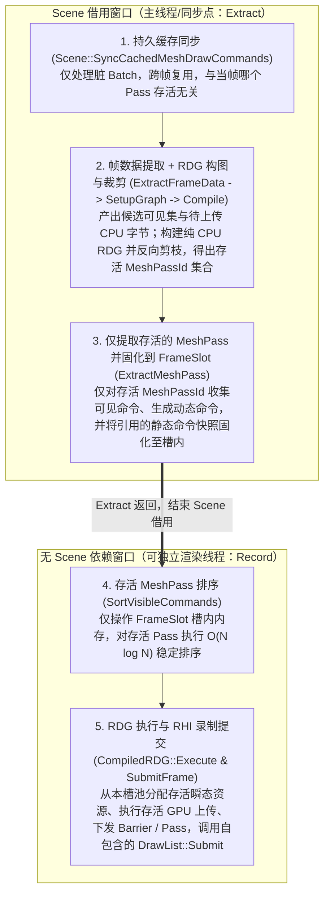

> - 适用: 理解 `RadRay::runtime` 引入 RDG 与可自定义 RenderPipeline 前的接口拆分原因、跨线程 `Extract`/`Record` 边界设计、最小可用 RDG 规范及分阶段实施计划
> - 权威: 经用户确认的问题分析与演进计划；阶段一已实现，阶段二/三尚未作为当前契约，当前已实现行为见 [Rendering runtime](../architecture/runtime.md)
> - 锚点: `modules/runtime/include/radray/runtime/frame_pipeline.h`, `modules/runtime/include/radray/runtime/frame_scheduler.h`, `modules/runtime/src/frame_scheduler.cpp`, `modules/runtime/include/radray/runtime/frame_slot.h`, `modules/runtime/src/frame_slot.cpp`, `modules/runtime/include/radray/runtime/scene.h`, `modules/runtime/src/scene.cpp`, `modules/runtime/include/radray/runtime/mesh_draw_command.h`, `examples/mesh_drawing_pipeline/pipeline.cpp`

# Runtime RDG 接入与 FramePipeline 跨线程接口拆分计划

## 状态、基线与范围

- 记录日期：2026-11-05
- 源码基线：`e443cef0e7f9766a1756c0e483ceacdd4eac1060`
- 状态：阶段一（拆分现有 `FramePipeline` / `FrameSlot` / `MeshPassFrameDrawList` 接口，切断 `Record` 对 `Scene` 的借用）已完成；阶段二（最小可用 RDG 与 `RenderGraphFramePipeline` 模板基类详细设计）已确认，待实施。
- 范围：`modules/runtime/`（`frame_pipeline`、`frame_scheduler`、`frame_slot`、`scene`、`mesh_draw_command`、新增 `rdg` 及其测试）与教学样例 `examples/mesh_drawing_pipeline/`，不向 `modules/render/`（RHI 层）外溢改动。

---

## 一、问题起因

在推进 `RadRay::runtime` 接入 RDG（Render Dependency Graph）、`RenderPass` 与可自定义 `RenderPipeline` 时，基线 `FramePipeline` 与 `FrameScheduler` 的阶段划分暴露出两个相互交织的核心矛盾：

### 1. 起因一：MeshPass 可见性收集/排序与 RDG 编译裁剪的时序倒置（CPU 无效工作）

在基线实现（如 `examples/mesh_drawing_pipeline/pipeline.cpp` 的 `MeshDrawingFramePipeline::Extract`）中：
- `Extract(const Scene& source, FrameSlot& slot)` 盲目遍历管线登记的**全部** `MeshPassId`，对每个 Pass 立即执行 `Scene::GatherVisibleMeshDrawCommands`、当帧动态命令构建以及 $O(N \log N)$ 的 `MeshPassFrameDrawList::SortVisibleCommands()`。
- 若在 `Record(FrameSlot& slot)` 阶段才构建并编译 RDG，当某个 `MeshPassId` 对应的 RDG Pass 未被添加，或因其输出资源无人消费而在 `RDG::Compile()` 死节点裁剪（Dead-Pass Culling）中被剔除（例如按需开启的 Outline、Velocity、Debug Pass 或未生效的阴影级联）时，CPU 在 `Extract` 阶段为该 Pass 付出的可见性收集、命令快照拷贝、动态构建与排序开销全部浪费。

### 2. 起因二：`Record` 阶段仍隐式借用 `Scene`，阻碍未来 `Extract` 与 `Record` 跨线程分离

虽然 `FramePipeline::Extract(const Scene& source, FrameSlot& slot)` 与 `FramePipeline::Record(FrameSlot& slot)` 在函数签名上看似区分了“读取 `Scene`”与“仅操作 `FrameSlot`”，但基线实现并未真正切断 `Record` 对 `Scene` 的依赖：
1. `FrameScheduler::RunFrameImpl` 将 `slot._sourceScene = &source` 一直维持到 `Record(slot)` 返回之后才置空；
2. `FrameSlot::RetireResource` 依赖 `_sourceScene != nullptr` 判断当前是否处于合法的帧回调区间；
3. `MeshPassFrameDrawList::Submit` 在 `Record` 阶段必须由调用方传入 `source->GetCachedDrawList(passId)`，因为 `VisibleMeshDrawCommand` 仅保存 `SparseSetHandle CommandHandle`，录制时（`SubmitMeshDrawCommands`）必须实时回查 `Scene::CachedDrawLists[pass].Commands`（`SparseSet<MeshDrawCommand>`）。

一旦未来将 `Extract`（主线程 / Game Thread 同步提取窗口）与 `Record`（独立渲染线程 / Render Thread 录制窗口）跨线程分离——即 `Extract` 结束后主线程立即恢复并修改下一帧的 `Scene`（如 `RemoveMeshBatch` 销毁 `CachedDrawLists` 中的条目、触发容器扩容或修改 `Primitives`/`Meshes`）：
- 若把 RDG 编译后的 `GatherVisibleMeshDrawCommands` 直接移入 `Record(slot)`，渲染线程会并发读取主线程正在修改的 `Scene`；
- 即便 `GatherVisibleMeshDrawCommands` 留在 `Extract`，渲染线程在 `Record(slot)` 中调用 `SubmitMeshDrawCommands` 解引用 `Scene::CachedDrawLists` 也会与主线程发生**跨线程数据竞争（Data Race）或悬垂引用**。

---

## 二、核心解决方案

要**同时**达成以下两个架构目标：
1. **RDG 剔除零浪费**：被 RDG 裁剪掉的 `MeshPassId` 绝不执行 per-Pass 的命令收集、快照拷贝、动态命令生成、帧内关联上传与排序；
2. **`Extract` 与 `Record` 跨线程安全解耦**：`Extract` 结束后立即解除对 `Scene` 的借用（`FrameSlot` 不保存 `Scene` 指针），且将耗时的 $O(N \log N)$ 排序、瞬态 GPU 资源获取、GPU 上传执行与 RHI 录制全部移入不依赖 `Scene` 的 `Record` 阶段；

解决方案是将原有的“粗粒度视图可见性”与“细粒度 Pass 收集/排序”拆开，并按**是否访问 `Scene`** 重组为以下 **5 步帧内流水线**：



### 关键设计依据

1. **为什么把 RDG 的 `SetupGraph` + `Compile` 放在 `Extract` 内（按需收集之前），而把 `Sort` + `Execute` 放在 `Record` 内？**
   - **复杂度不对称性**：RDG 的图声明与编译裁剪（`SetupGraph` + `Compile`）仅处理十几个至几十个 Pass 节点与资源句柄，是纯内存小图反向可达性遍历，耗时仅**微秒级（~10 µs）**，且完全不触碰底层 RHI；而 `GatherVisibleMeshDrawCommands` 需要访问 `Scene` 并拷贝命令快照，`SortVisibleCommands`（$O(N \log N)$）、GPU 资源创建/上传与 RHI 命令录制（毫秒级）则是耗时大头。
   - 在 `Extract` 阶段先用微秒级的 RDG 拓扑裁剪算出**本帧真正存活的 `MeshPassId` 集合（`aliveMeshPasses`）**，即可精准指导 `Extract` 只从 `Scene` 提取存活 Pass 的命令；随后立即释放 `Scene`，把重度的 `SortVisibleCommands` 和 `CompiledRDG::Execute` 留给 `Record(slot)` 在无 `Scene` 依赖的状态下执行。
2. **如何彻底切断 `Record` 对 `Scene::CachedDrawLists` 的依赖？**
   - 让 `FrameSlot` 中的 `MeshPassFrameDrawList` 成为**自包含（Self-Contained）**的当帧绘制列表：在 `Extract` 阶段为存活 `MeshPassId` 收集可见命令时，将本帧引用的缓存 `MeshDrawCommand` 固化（Snapshot）到 `MeshPassFrameDrawList::CachedCommands` 内部存储中。
   - 被 RDG 剔除的 Pass 不执行提取，零拷贝开销；存活的 Pass 在 `Extract` 结束后已拥有完整的当帧命令副本，`Record(slot)` 只需调用 `slot.GetPassDrawList(passId).Submit(encoder, submitArgs)`，无需再访问 `Scene`。

---

## 三、阶段一：拆分现有接口，切断 `Record` 对 `Scene` 的依赖（已完成）

阶段一已在不引入 RDG 的前提下改造了 `FrameScheduler`、`FrameSlot`、`MeshPassFrameDrawList`、`Scene` 与教学样例，确立了 **“Extract 独占 Scene 借用并提取命令快照，Record 零 Scene 依赖完成排序与录制”** 的契约：

| 文件路径 | 阶段一已落地改动 |
|---|---|
| `modules/runtime/include/radray/runtime/frame_pipeline.h` | 更新 `Extract` / `Record` 契约注释：明确 `source` 仅通过 `Extract` 参数借用，`Record` 不借用 `Scene` |
| `modules/runtime/include/radray/runtime/frame_scheduler.h`、`src/frame_scheduler.cpp` | `FrameSlot` 移除 `_sourceScene` 与 `GetScene()`；`RADRAY_IS_DEBUG` 下用 `_inFrameCallback` 检查 `Extract`/`Record` 期间的 `RetireResource` 调用窗口 |
| `modules/runtime/include/radray/runtime/frame_slot.h`、`src/frame_slot.cpp` | `MeshPassFrameDrawList` 新增 `vector<MeshDrawCommand> CachedCommands` 与自包含的 `Submit(encoder, submitArgs)` 重载 |
| `modules/runtime/include/radray/runtime/mesh_draw_command.h`、`src/mesh_draw_command.cpp` | 新增接收 `std::span<const MeshDrawCommand> cachedCommands` 的 `ResolveVisibleMeshDrawCommand` 与 `SubmitMeshDrawCommands` 重载 |
| `modules/runtime/include/radray/runtime/scene.h`、`src/scene.cpp` | 新增直接写入 `MeshPassFrameDrawList&` 的 `GatherVisibleMeshDrawCommands` 与 `GatherVisiblePrimitives` 重载，将命中的缓存命令快照复制到槽内并支持失败回滚 |
| `examples/mesh_drawing_pipeline/pipeline.cpp` | `Extract` 仅收集可见命令并固化到槽；`SortVisibleCommands()` 下沉至 `RecordPass`；调用自包含 `drawList.Submit(encoder, submitArgs)` |
| `modules/runtime/tests/test_frame_scheduler.cpp`、`test_frame_slot.cpp`、`test_scene.cpp`、`test_mesh_draw_command.cpp` | 覆盖帧内命令快照解析、移动重绑定、失败回滚，以及 `Scene::Clear()` / `RemoveMeshBatch()` 后 `Record` 独立排序并提交 |

---

## 四、阶段二：最小可用 RDG（Minimal Viable RDG）与防呆管线设计（待实施）

### 1. 为什么要通过框架机制而非口头约定消灭时序倒置？（4 个潜在陷阱与防呆对策）

阶段一完成后，`Gather + Snapshot` 必须在 `Extract` 内完成。若仅靠口头约定“在 `Extract` 里先写 RDG `Compile` 再写 `Gather`”，其他开发者自行实现 `FramePipeline` 时极易踩入以下 **4 个陷阱**：

| 潜在陷阱 | 产生原因 | 框架级防呆对策 |
|---|---|---|
| **陷阱 1：RDG Pass 闭包误捕获 `const Scene&` 或 `Extract` 局部变量** | 若在 `Extract(const Scene& source, FrameSlot& slot)` 中直接注册 RDG Pass Lambda，`source` 处于当前词法作用域，手写 `[&]` 会将 `source` 捕获到 `Record` 期（未来在渲染线程）才执行的回调中，引发数据竞争或悬垂引用。 | 提供 `RenderGraphFramePipeline` 基类，将构图拆为独立钩子 `SetupGraph(RDGBuilder& graph, FrameSlot& slot)`——**函数签名不包含 `const Scene&`**，从语法作用域上杜绝 Pass Lambda 捕获 `Scene`。 |
| **陷阱 2：子类习惯性写反 `Gather` 与 RDG `Compile` 的顺序** | `FramePipeline` 仅有宽泛的 `Extract` / `Record` 虚函数，实现者容易在 `Extract` 中手写 `for (auto pass : _passes) Gather(...)`，或把 RDG 构图写进 `Record`，导致被裁剪 Pass 依然白跑 `Gather` 与快照深拷贝。 | `RenderGraphFramePipeline` 将 `Extract` 与 `Record` 声明为 **`final`**，子类只实现单 Pass 钩子 `ExtractMeshPass(MeshPassId pass, ...)`；基类在 `Compile()` 后**仅遍历 `GetAliveMeshPasses()`** 调用该钩子与后续排序。 |
| **陷阱 3：`Extract` 构图期过早调用 RHI 创建资源或上传数据** | 若在 `SetupGraph`（属于 `Extract` 期）直接调用 `device.CreateTexture` 或操作 RHI，既拖慢主线程 `Scene` 借用窗口、破坏跨线程 RHI 串行契约，又会为被裁剪的死 Pass 浪费显存。 | `RDGBuilder` 与 `Compile()` 在 `Extract` 期是 **100% 纯 CPU 描述记录**（存入 `slot.GetArena()`，零 RHI 调用）；瞬态资源实例化、Staging/Upload 写入、Barrier 与命令录制全部推迟到 `Record` 期的 `CompiledRDG::Execute`。 |
| **陷阱 4：Pass 被裁剪后资源状态链断裂或漏发 Vulkan 同状态写屏障** | RHI 要求显式 `Before -> After` 状态转换，且 Vulkan 要求连续写/读写同一附件时插入 `DepthWrite -> DepthWrite`、`RenderTarget -> RenderTarget` 屏障。若中间 Pass（如 `Outline`）被动态剔除，手写固定屏障会因前置状态改变而失配。 | RDG 仅按**存活 Pass 序列**动态推导每个资源的 `(currentState, hasPendingWrite)`，自动桥接被裁剪 Pass 留下的状态缺口，并在末尾按 `finalState` 自动补齐收尾（Epilogue）屏障。 |

---

### 2. 最小可用 RDG 核心契约与接口设计（`radray/runtime/rdg.h`）

#### 2.1 资源模型：覆盖外部导入资源、描述符瞬态资源与统一 GPU 上传

1. **整资源状态追踪边界（MVP 范围）**：
   - 阶段二 MVP 明确按**整资源（Whole-Resource，`SubresourceRange::AllSub()`）**追踪状态与依赖，不在 Pass Builder 上暴露子资源范围参数，避免同一 Pass 对同一纹理不同 mip/layer 请求不同状态时与整资源状态机产生冲突；逐 mip/layer 子资源追踪留待后续扩展。
2. **外部导入资源（`ImportTexture` / `ImportBuffer`）**：
   - 接收已存在的 `render::Texture*` / `render::Buffer*`、进入本帧图时的 `initialState` 以及可选的帧末回退状态 `finalState`（例如每槽上传缓冲在帧末恢复为 `HostWrite`，或交换链纹理在帧末转为 `Present`）。
3. **按描述符分配的瞬态资源（`CreateTexture` / `CreateBuffer`）与跨帧物理状态保留**：
   - 在 `SetupGraph` 期仅接收 `render::TextureDescriptor` / `render::BufferDescriptor` 并在 `slot.GetArena()` 记录元数据，不调用 RHI；
   - 在 `Record` 期（`CompiledRDG::Execute`），**仅对裁剪后存活的瞬态资源**从当前槽的 `RDGTransientResourcePool` 按完整描述符匹配借出（未命中时调用 `device.CreateTexture` / `CreateBuffer` 并存入本槽池；因进入本槽前 `WaitSlot` 已确保上一轮 GPU 执行完成，本槽池内资源可直接无锁安全复用）；
   - **关键约束（保留池内物理资源的真实终态）**：D3D12 纹理在命令列表结束或 Fence 等待完成后**不会**自动退化回 `COMMON`（`TextureState::Undefined`）。因此 `RDGTransientResourcePool` 为每个池化对象记录其上一次执行结束时的物理状态 `LastState`（新建纹理初始为 `TextureState::Undefined`，新建 `Device` 缓冲为 `BufferState::Undefined`，`Upload` 缓冲为 `BufferState::HostWrite`）。`Execute` 借出物理资源时将其 `LastState` 作为本帧首次 Barrier 的 `Before` 状态，并在本帧图执行结束时将资源的最终状态写回池条目的 `LastState`。
   - 若消费某个瞬态资源的所有 Pass 均被裁剪，该瞬态资源在本帧**不向池借出、不新建、不占用显存**。
4. **统一接管 GPU 资源上传（`UploadBuffer`，含新增静态网格 VB/IB 与帧内 Buffer 更新）**：
   - **与 `Scene::AddMeshBatch` 的协同机制**：
     [`Scene::ValidateBatch`](../../modules/runtime/src/scene.cpp) 与 `SyncCachedMeshDrawCommands` 仅校验 `MeshBatch` 引用的 `render::Buffer*` 指针非空且 `GetDesc().Size / Usage` 合法，不要求 GPU 显存已完成数据写入。因此新增静态网格时，应用只需先用 `device.CreateBuffer` 创建出目标 `render::Buffer` 空壳并正常注册 `Scene::AddMeshBatch`，将待上传的顶点/索引字节交给 RDG 在图内完成上传与状态转换。
   - **`graph.UploadBuffer(RDGBufferHandle dst, uint64_t dstOffset, std::span<const byte> data)` 内部行为与依赖规则**：
     - `SetupGraph` 期：将 `data` 字节复制到 `slot.GetArena()`（保证跨阶段/跨线程生命周期安全），并在图中自动生成一个隐式上传 Pass 节点；
     - **分段上传保留规则（WAW 链式依赖）**：因 `dstOffset` 允许局部更新（如分两次上传同一缓冲的前半段和后半段），`UploadBuffer` 节点若发现 `dst` 已有前序写入节点 `lastWriterPassIndex`，会先向该前序写入节点建立一条依赖边，再将 `lastWriterPassIndex` 更新为自身，确保下游读取或 `MarkOutput(dst)` 时保留全部前序分段上传；
     - **`MemoryType::Upload` 直接映射的顺序约束**：CPU `Map -> memcpy` 发生在 `Queue::Submit` 之前，无法为同一地址保存多个时间点的快照。因此当 `dst` 为 `MemoryType::Upload` 导入缓冲时，`Compile()` 强制校验：**所有 `UploadBuffer` 必须位于该缓冲首次被 GPU Pass 读取之前，且同一缓冲的多次 `UploadBuffer` 字节区间 `[dstOffset, dstOffset + data.size())` 严禁重叠**；违反时 `Compile()` 记录错误并失败返回。需要在中途改写同一缓冲内容的多版本场景必须使用不同缓冲或 `MemoryType::Device` 缓冲（走 GPU 命令流中的 Staging `CopyBufferToBuffer`）；
     - `Execute` 期（仅当该上传节点在 `Compile()` 后存活时执行）：
       - **路径 A（目标 `dst` 为 `MemoryType::Device` 缓冲，如静态网格 VB/IB）**：从当前槽的 `RDGTransientResourcePool` 借出足够大小的 `MemoryType::Upload`（`BufferUse::CopySource | BufferUse::MapWrite`）Staging Buffer，`Map -> memcpy -> FlushMappedRange -> Unmap` 后，先将 `dst` 转换到 `BufferState::CopyDestination`，再录制 `cmd.CopyBufferToBuffer(dst, dstOffset, staging, 0, size)`；后续读取 `dst` 的 Pass 由 RDG 自动插入 `CopyDestination -> Vertex / Index / CBuffer / ShaderRead` 屏障；
       - **路径 B（目标 `dst` 为 `MemoryType::Upload` 缓冲，如每槽 `InstanceBuffer`、`PassBuffers`）**：直接对 `dst` 执行 `Map(dstOffset, size) -> memcpy -> FlushMappedRange -> Unmap`，并将 `dst` 的状态标记为已发生 `BufferState::HostWrite` 写入；后续读取 `dst` 的 Pass 由 RDG 自动插入 `HostWrite -> Vertex / Index / CBuffer` 屏障。
   - **区分“帧内按需上传”与“持久资产首次上传”**：
     - **帧内按需上传**（如仅供 `Outline Pass` 使用的 `PassBuffers[1]`）：仅调用 `graph.UploadBuffer(passUbo1, 0, bytes)`，不标记 `MarkOutput`。一旦 `Outline Pass` 被 RDG 裁剪，**连同 `passUbo1` 的上传节点（CPU `Map/memcpy` 与屏障）也会被自动裁剪跳过**；
     - **持久资产首次上传**（如新增静态网格的 `VertexBuffer` / `IndexBuffer`）：调用 `auto vb = graph.ImportBuffer(meshVb, BufferState::Undefined, BufferState::Vertex)` + `graph.UploadBuffer(vb, 0, vertexBytes)` + **`graph.MarkOutput(vb)`**。`MarkOutput(vb)` 将该网格缓冲标记为保留根，确保即使当帧没有任何存活 Pass 绘制该网格，RDG 也会执行此次上传并在图末将其转换到 `BufferState::Vertex` 终态；后续帧该网格即为已就绪状态。

#### 2.2 C++ 接口声明草案

```cpp
#pragma once

#include <limits>
#include <optional>
#include <span>
#include <string_view>

#include <radray/object_arena.h>
#include <radray/render/rhi.h>
#include <radray/runtime/frame_slot.h>

namespace radray {

struct RDGTextureHandle {
    uint32_t Index{std::numeric_limits<uint32_t>::max()};
    constexpr bool IsValid() const noexcept { return Index != std::numeric_limits<uint32_t>::max(); }
    friend constexpr bool operator==(RDGTextureHandle, RDGTextureHandle) = default;
};

struct RDGBufferHandle {
    uint32_t Index{std::numeric_limits<uint32_t>::max()};
    constexpr bool IsValid() const noexcept { return Index != std::numeric_limits<uint32_t>::max(); }
    friend constexpr bool operator==(RDGBufferHandle, RDGBufferHandle) = default;
};

struct RDGTransientTextureAllocation {
    Nullable<render::Texture*> Texture{nullptr};
    render::TextureState LastState{render::TextureState::Undefined};
};

struct RDGTransientBufferAllocation {
    Nullable<render::Buffer*> Buffer{nullptr};
    render::BufferState LastState{render::BufferState::Undefined};
};

// 每槽独占的瞬态资源池：进入当前槽前 WaitSlot 已完成，池内资源可直接无锁按描述符复用，并保留上一次执行结束时的物理状态
class RDGTransientResourcePool final {
public:
    explicit RDGTransientResourcePool(render::Device& device) noexcept;
    ~RDGTransientResourcePool() noexcept;

    RDGTransientResourcePool(const RDGTransientResourcePool&) = delete;
    RDGTransientResourcePool& operator=(const RDGTransientResourcePool&) = delete;

    // 帧开始复用当前槽时调用，将本槽所有已缓存的瞬态 Texture/Buffer/TextureView 标记为可借出（保留各自的 LastState）
    void BeginFrame() noexcept;
    // 清空并销毁池内全部 GPU 对象（WaitIdle 或析构时调用）
    void Clear() noexcept;

    RDGTransientTextureAllocation AcquireTexture(const render::TextureDescriptor& desc);
    void CommitTextureState(render::Texture* texture, render::TextureState finalState) noexcept;

    RDGTransientBufferAllocation AcquireBuffer(const render::BufferDescriptor& desc);
    void CommitBufferState(render::Buffer* buffer, render::BufferState finalState) noexcept;

    Nullable<render::TextureView*> AcquireTextureView(const render::TextureViewDescriptor& desc);
};

// Pass 执行期上下文：提供 Encoder / CommandBuffer 与 FrameSlot，并将 RDG 句柄解析为已实例化的 RHI 资源
class RDGRasterPassContext final {
public:
    render::GraphicsCommandEncoder& GetEncoder() noexcept;
    FrameSlot& GetSlot() noexcept;
    render::Texture& Resolve(RDGTextureHandle handle) const noexcept;
    render::Buffer& Resolve(RDGBufferHandle handle) const noexcept;
    Nullable<render::TextureView*> ResolveView(RDGTextureHandle handle, render::TextureViewUsage usage) const noexcept;
};

class RDGComputePassContext final {
public:
    render::ComputeCommandEncoder& GetEncoder() noexcept;
    FrameSlot& GetSlot() noexcept;
    render::Texture& Resolve(RDGTextureHandle handle) const noexcept;
    render::Buffer& Resolve(RDGBufferHandle handle) const noexcept;
    Nullable<render::TextureView*> ResolveView(RDGTextureHandle handle, render::TextureViewUsage usage) const noexcept;
};

class RDGCopyPassContext final {
public:
    render::CommandBuffer& GetCommandBuffer() noexcept;
    FrameSlot& GetSlot() noexcept;
    render::Texture& Resolve(RDGTextureHandle handle) const noexcept;
    render::Buffer& Resolve(RDGBufferHandle handle) const noexcept;
};

class RDGRasterPassBuilder final {
public:
    // 声明本光栅 Pass 消费的 MeshPassId；仅当本 Pass 存活时，对应的 MeshPassId 才会触发 ExtractMeshPass 与 Sort
    RDGRasterPassBuilder& UseMeshPass(MeshPassId pass);

    RDGRasterPassBuilder& ReadBuffer(RDGBufferHandle buffer, render::BufferState state);
    RDGRasterPassBuilder& WriteBuffer(RDGBufferHandle buffer, render::BufferState state = render::BufferState::UnorderedAccess);
    RDGRasterPassBuilder& ReadWriteBuffer(RDGBufferHandle buffer, render::BufferState state = render::BufferState::UnorderedAccess);

    RDGRasterPassBuilder& ReadTexture(RDGTextureHandle texture, render::TextureState state = render::TextureState::ShaderRead);
    RDGRasterPassBuilder& WriteTexture(RDGTextureHandle texture, render::TextureState state = render::TextureState::UnorderedAccess);
    RDGRasterPassBuilder& ReadWriteTexture(RDGTextureHandle texture, render::TextureState state = render::TextureState::UnorderedAccess);

    // 颜色附件：LoadAction::Load 自动建立对前序 Writer 的读依赖；可直接传 RDGTextureHandle 或显式传入外部 TextureView*
    RDGRasterPassBuilder& WriteColor(uint32_t slot, RDGTextureHandle texture,
                                     render::LoadAction load, render::StoreAction store,
                                     render::ColorClearValue clear = {},
                                     Nullable<render::TextureView*> explicitView = nullptr);

    // 深度/模板附件：state 取 DepthWrite / DepthRead / DepthReadStencilWrite / DepthWriteStencilRead
    RDGRasterPassBuilder& SetDepthStencil(RDGTextureHandle texture, render::TextureState state,
                                          render::LoadAction depthLoad, render::StoreAction depthStore,
                                          render::LoadAction stencilLoad = render::LoadAction::DontCare,
                                          render::StoreAction stencilStore = render::StoreAction::DontCare,
                                          render::DepthStencilClearValue clear = {},
                                          Nullable<render::TextureView*> explicitView = nullptr);

    RDGRasterPassBuilder& NeverCull() noexcept;
};

class RDGComputePassBuilder final {
public:
    RDGComputePassBuilder& ReadBuffer(RDGBufferHandle buffer, render::BufferState state = render::BufferState::ShaderRead);
    RDGComputePassBuilder& WriteBuffer(RDGBufferHandle buffer, render::BufferState state = render::BufferState::UnorderedAccess);
    // 原地修改（In-Place UAV 读写）：先依赖进入本 Pass 前的最后 Writer，再将自身登记为新 Writer
    RDGComputePassBuilder& ReadWriteBuffer(RDGBufferHandle buffer, render::BufferState state = render::BufferState::UnorderedAccess);

    RDGComputePassBuilder& ReadTexture(RDGTextureHandle texture, render::TextureState state = render::TextureState::ShaderRead);
    RDGComputePassBuilder& WriteTexture(RDGTextureHandle texture, render::TextureState state = render::TextureState::UnorderedAccess);
    // 原地修改（In-Place UAV 读写）：先依赖进入本 Pass 前的最后 Writer，再将自身登记为新 Writer
    RDGComputePassBuilder& ReadWriteTexture(RDGTextureHandle texture, render::TextureState state = render::TextureState::UnorderedAccess);

    RDGComputePassBuilder& NeverCull() noexcept;
};

class RDGCopyPassBuilder final {
public:
    RDGCopyPassBuilder& ReadTexture(RDGTextureHandle texture);
    RDGCopyPassBuilder& WriteTexture(RDGTextureHandle texture);
    RDGCopyPassBuilder& ReadBuffer(RDGBufferHandle buffer);
    RDGCopyPassBuilder& WriteBuffer(RDGBufferHandle buffer);
    RDGCopyPassBuilder& NeverCull() noexcept;
};

class CompiledRDG final {
public:
    // 按声明顺序返回去重后的存活 MeshPassId 列表
    std::span<const MeshPassId> GetAliveMeshPasses() const noexcept;

    // 在 Record 阶段执行：
    // 1. 从 transientPool 借出存活的瞬态 Texture/Buffer（取得其真实物理 LastState）及附件 View；
    // 2. 按存活 Pass 顺序根据动态状态机下发前置 Barrier，执行上传/Copy/Compute/Raster Pass 回调；
    // 3. 下发导入资源的收尾（Epilogue）Barrier，并将瞬态资源的最终状态写回 transientPool。
    bool Execute(FrameSlot& slot, RDGTransientResourcePool& transientPool,
                 render::CommandBuffer& commandBuffer) noexcept;
};

class RDGBuilder final {
public:
    explicit RDGBuilder(ObjectArena& arena) noexcept;

    // 1. 导入外部/按槽持久资源（finalState 非空时在图末自动补发收尾 Barrier）
    RDGTextureHandle ImportTexture(render::Texture* texture, render::TextureState initialState,
                                   std::optional<render::TextureState> finalState = std::nullopt);
    RDGBufferHandle ImportBuffer(render::Buffer* buffer, render::BufferState initialState,
                                 std::optional<render::BufferState> finalState = std::nullopt);

    // 2. 按描述符声明帧内瞬态资源（SetupGraph 期仅记录描述符，Execute 期仅对存活资源从本槽池分配）
    RDGTextureHandle CreateTexture(const render::TextureDescriptor& desc);
    RDGBufferHandle CreateBuffer(const render::BufferDescriptor& desc);

    // 3. 统一 GPU 缓冲上传（复制 data 到 Arena 并插入上传节点；支持 Device 缓冲 Staging Copy 与 Upload 缓冲首次读取前直接 Map）
    void UploadBuffer(RDGBufferHandle dst, uint64_t dstOffset, std::span<const byte> data);

    // 4. 标记图输出资源：最后写入该资源的 Pass（含 UploadBuffer 节点链）将作为反向可达性裁剪的保留根
    void MarkOutput(RDGTextureHandle texture);
    void MarkOutput(RDGBufferHandle buffer);

    // 5. 添加 Raster / Compute / Copy Pass
    // SetupFn: void(RDGRasterPassBuilder&), ExecuteFn: bool(RDGRasterPassContext&)
    template <typename SetupFn, typename ExecuteFn>
    void AddRasterPass(std::string_view name, SetupFn&& setup, ExecuteFn&& execute);

    // SetupFn: void(RDGComputePassBuilder&), ExecuteFn: bool(RDGComputePassContext&)
    template <typename SetupFn, typename ExecuteFn>
    void AddComputePass(std::string_view name, SetupFn&& setup, ExecuteFn&& execute);

    // SetupFn: void(RDGCopyPassBuilder&), ExecuteFn: bool(RDGCopyPassContext&)
    template <typename SetupFn, typename ExecuteFn>
    void AddCopyPass(std::string_view name, SetupFn&& setup, ExecuteFn&& execute);

    // 纯 CPU 编译：校验访问合法性 -> 反向可达性裁剪 -> 汇总存活 MeshPassId 与存活资源生命期
    Nullable<CompiledRDG*> Compile();
};

}  // namespace radray
```

#### 2.3 编译期依赖裁剪与执行期 Barrier 推导规则（D3D12 + Vulkan 双后端一致）

1. **读写依赖与反向可达性裁剪（Dead-Pass & Dead-Resource Culling）**：
   - 每个资源记录当前的 `lastWriterPassIndex`：
     - **纯读取**（`ReadBuffer`、`ReadTexture`、只读 `DepthRead` 附件）：若 `lastWriterPassIndex` 有效，当前 Pass 向 `lastWriterPassIndex` 建立一条有向依赖边；
     - **读写 / 局部修改 / 链式写入**（`ReadWriteBuffer`、`ReadWriteTexture`、`UploadBuffer`、带 `LoadAction::Load` 的颜色/深度/模板附件，以及默认不做覆盖写消除的 `WriteBuffer` / `WriteTexture`）：若 `lastWriterPassIndex` 有效，当前 Pass **先向旧 `lastWriterPassIndex` 建立一条依赖边**（防止原地后处理或分段 `UploadBuffer` 误把前序生成 Pass 裁掉），随后将 `lastWriterPassIndex` 更新为当前 Pass；
     - **纯覆盖初始化写**（带 `LoadAction::Clear` 或 `LoadAction::DontCare` 的附件写）：直接将 `lastWriterPassIndex` 更新为当前 Pass（若此前存在未消费的写入则不依赖它）。
   - 从所有 `MarkOutput` 资源的最终 `lastWriterPassIndex` 以及所有标记了 `NeverCull()` 的 Pass 出发，沿依赖边反向遍历标记 `alive = true`。
   - 仅收集 `alive == true` 的 Pass 所声明的 `.UseMeshPass(passId)`（保持首次出现顺序并去重），写入 `CompiledRDG::GetAliveMeshPasses()`。
   - 仅被 `alive == false` 的死 Pass 引用的瞬态资源（`CreateTexture` / `CreateBuffer`）标记为死资源，`Execute` 期跳过借出与分配；仅被死 Pass 读取且未标记 `MarkOutput` 的 `UploadBuffer` 节点同样被剔除。
2. **资源状态追踪与同状态写屏障**：
   - 导入资源的初始状态为 `initialState`；存活瞬态资源的初始状态取自 `RDGTransientResourcePool` 借出条目的 `LastState`（从而在槽首次使用时为 `Undefined`，同槽第二次及后续复用时精确匹配上一轮结束时的物理状态，如 `DepthWrite` 或 `CopySource`，杜绝 D3D12 `StateBefore` 不匹配报错）。
   - 按声明顺序遍历**存活 Pass**，对每个资源维护 `(currentState, hasPendingWrite)`：
     - **连续只读且状态相同**（`!hasPendingWrite && !nextAccess.isWrite && currentState == nextAccess.state`）：不生成屏障；
     - **连续 UAV 访问且存在写依赖**（`currentState == UnorderedAccess && nextAccess.state == UnorderedAccess && (hasPendingWrite || nextAccess.isWrite)`）：生成 `render::BarrierUavDescriptor{target}`；
     - **状态转换或同状态写后同步**（`currentState != nextAccess.state || hasPendingWrite`，例如 Vulkan 必需的 `DepthWrite -> DepthWrite`、`RenderTarget -> RenderTarget`）：生成 `BarrierTextureDescriptor` / `BarrierBufferDescriptor`（`before = currentState, after = nextAccess.state`）。
   - **每次访问完成后统一更新状态**：无论上述分支是否生成屏障（包括连续只读和 UAV 分支），都在进入下一次访问前执行 `currentState = nextAccess.state`、`hasPendingWrite = nextAccess.isWrite`。状态更新不属于任何单个屏障分支，确保 UAV 写入后的读取获得同步，并在读取后清除待同步写入标记，避免后续连续只读产生多余屏障。
   - 所有存活 Pass 遍历结束后：
     - 对声明了 `finalState` 的导入资源：若 `currentState != *finalState || hasPendingWrite`，追加一条 `currentState -> *finalState` 的收尾（Epilogue）屏障；
     - 对本帧借出的瞬态资源：调用 `transientPool.CommitTextureState` / `CommitBufferState` 记录其 `currentState`，供该槽下一轮复用时作为真实初始物理状态。

---

### 3. `RenderGraphFramePipeline` 模板基类：从接口层锁死正确时序

```cpp
// 位于 radray/runtime/render_graph_pipeline.h
class RenderGraphFramePipeline : public FramePipeline {
public:
    explicit RenderGraphFramePipeline(DeviceContext& device, uint32_t slotCount);
    ~RenderGraphFramePipeline() noexcept override;

    // final 锁定 Extract 内部顺序：ExtractFrameData -> SetupGraph(无 Scene) -> Compile -> ExtractMeshPass(仅存活 Pass)
    void Extract(const Scene& source, FrameSlot& slot) noexcept final {
        const uint32_t slotIndex = slot.GetIndex();
        RADRAY_ASSERT(slotIndex < _slotStates.size());

        // 步骤 1：提取帧级视图数据与粗粒度可见候选（不做 per-Pass Gather）
        ExtractFrameData(source, slot);

        // 步骤 2：构建并编译 RDG（SetupGraph 签名不含 Scene，杜绝 Pass 回调捕获 Scene）
        RDGBuilder graph{slot.GetArena()};
        SetupGraph(graph, slot);
        auto compiled = graph.Compile();
        if (!compiled) RADRAY_ABORT("RenderGraphFramePipeline: RDG compile failed");
        _slotStates[slotIndex].CompiledGraph = compiled.Get();

        // 步骤 3：仅对 RDG 裁剪后存活的 MeshPassId 提取并固化当帧命令快照
        for (const MeshPassId pass : compiled->GetAliveMeshPasses()) {
            ExtractMeshPass(pass, source, slot, slot.GetPassDrawList(pass));
        }
    }

    // final 锁定 Record 内部顺序：Sort(仅存活 Pass) -> Execute RDG -> SubmitFrame
    void Record(FrameSlot& slot) noexcept final {
        const uint32_t slotIndex = slot.GetIndex();
        auto& state = _slotStates[slotIndex];
        RADRAY_ASSERT(state.CompiledGraph != nullptr);

        // 步骤 4：仅对存活的 MeshPassId 执行 O(N log N) 稳定排序（零 Scene 依赖）
        for (const MeshPassId pass : state.CompiledGraph->GetAliveMeshPasses()) {
            slot.GetPassDrawList(pass).SortVisibleCommands();
        }

        // 步骤 5：重置本槽瞬态池借出标记，申请命令缓冲并执行 RDG
        state.TransientPool.BeginFrame();
        auto cmd = slot.AcquireCommandBuffer();
        if (!cmd) RADRAY_ABORT("RenderGraphFramePipeline: cannot acquire command buffer");
        cmd->Begin();
        if (!state.CompiledGraph->Execute(slot, state.TransientPool, *cmd)) {
            RADRAY_ABORT("RenderGraphFramePipeline: RDG execute failed");
        }
        cmd->End();

        // 步骤 6：交由子类提交命令缓冲并 Signal 本槽 Fence
        SubmitFrame(slot, *cmd);
        state.CompiledGraph = nullptr;
    }

protected:
    // 子类仅需实现以下 4 个职责单一的钩子，无法写反时序：
    virtual void ExtractFrameData(const Scene& source, FrameSlot& slot) noexcept = 0;
    virtual void SetupGraph(RDGBuilder& graph, FrameSlot& slot) noexcept = 0;
    virtual void ExtractMeshPass(MeshPassId pass, const Scene& source, FrameSlot& slot,
                                 MeshPassFrameDrawList& drawList) noexcept = 0;
    virtual void SubmitFrame(FrameSlot& slot, render::CommandBuffer& commandBuffer) noexcept = 0;

private:
    struct SlotState {
        explicit SlotState(render::Device& device) noexcept : TransientPool(device) {}
        RDGTransientResourcePool TransientPool;
        Nullable<CompiledRDG*> CompiledGraph{nullptr};
    };
    vector<SlotState> _slotStates;
};
```

---

### 4. 完整使用样例：用 RDG 接管静态网格上传、瞬态附件、Compute/Raster/Copy 与按需裁剪

下面展示业务管线如何继承 `RenderGraphFramePipeline`，将**新增静态网格的 GPU 上传**、**每帧实例/常量缓冲上传**、**瞬态深度/颜色纹理分配**以及 **Depth / Color / Outline / Transparent / 原地 Compute 后处理 / Readback Copy** 全部统一纳入 RDG：

```cpp
// 待由 RDG 异步上传的静态网格请求（CPU 侧已通过 device.CreateBuffer 创建空 Buffer 壳并注册到 Scene）
struct PendingStaticMeshUpload {
    render::Buffer* TargetBuffer{nullptr};
    uint64_t Offset{0};
    vector<byte> Bytes;
    render::BufferState FinalState{render::BufferState::Vertex}; // Vertex 或 Index
};

class MeshDrawingRDGPipeline final : public RenderGraphFramePipeline {
public:
    // 业务层新增静态网格时：创建 Device Buffer 空壳 -> 注册 Scene::AddMeshBatch -> 入队待上传字节（支持分段 Offset）
    void QueueStaticMeshUpload(render::Buffer& targetBuffer, uint64_t offset,
                               std::span<const byte> bytes, render::BufferState finalState) {
        _pendingMeshUploads.push_back({&targetBuffer, offset, vector<byte>(bytes.begin(), bytes.end()), finalState});
    }

protected:
    // 钩子 1：仅从 Scene 提取变换矩阵与待上传的 CPU 常量到槽内 Arena，不直接做 GPU Map，也不做 per-Pass Gather
    void ExtractFrameData(const Scene& source, FrameSlot& slot) noexcept override {
        auto& frameData = *slot.GetArena().Emplace<ExtractedFramePayload>();
        frameData.Instances.reserve(_candidates.size());
        for (const auto handle : _candidates) {
            const Eigen::Matrix4f m = source.Primitives.Get(handle).LocalToWorld.ToMatrix();
            InstanceData inst{};
            std::memcpy(inst.LocalToWorld.data(), m.data(), sizeof(InstanceData));
            frameData.Instances.push_back(inst);
        }
        std::memcpy(frameData.NormalPassConstants.ViewProjection.data(), _view.ViewProjection.data(), 64);
        frameData.NormalPassConstants.LocalScale = 1.0f;
        frameData.OutlinePassConstants = frameData.NormalPassConstants;
        frameData.OutlinePassConstants.LocalScale = 1.12f;

        // 取出本帧前积压的静态网格上传任务，交由本帧 RDG 执行
        frameData.MeshUploads = std::move(_pendingMeshUploads);
        _pendingMeshUploads.clear();
        _extractedPayload[slot.GetIndex()] = &frameData;
    }

    // 钩子 2：声明 RDG（无 Scene 参数，绝无可能误捕获 Scene）
    void SetupGraph(RDGBuilder& graph, FrameSlot& slot) noexcept override {
        auto& res = *_frames[slot.GetIndex()];
        const auto& payload = *_extractedPayload[slot.GetIndex()];
        const bool firstUse = (res.CompletionValue == 0);

        // (A) 接管新增静态网格的首次 GPU 上传（Device Buffer Staging Copy + 分段 WAW 链 + MarkOutput 保活）
        for (const auto& upload : payload.MeshUploads) {
            auto meshBuf = graph.ImportBuffer(upload.TargetBuffer, render::BufferState::Undefined, upload.FinalState);
            graph.UploadBuffer(meshBuf, upload.Offset, upload.Bytes);
            // 标记为 Output：即使本帧没有任何 Pass 绘制该新网格，RDG 也会保留全部链式分段上传并在帧末转为 Vertex/Index 状态
            graph.MarkOutput(meshBuf);
        }

        // (B) 导入已就绪的共享网格缓冲与本槽可写缓冲，并由 RDG 统一接管帧内首次读取前的初始化上传
        auto vb = graph.ImportBuffer(_gpu.VertexBuffer.Get(), render::BufferState::Vertex);
        auto ib = graph.ImportBuffer(_gpu.IndexBuffer.Get(), render::BufferState::Index);

        auto instanceBuf = graph.ImportBuffer(res.InstanceBuffer.Get(),
            render::BufferState::HostWrite, render::BufferState::HostWrite);
        graph.UploadBuffer(instanceBuf, 0, std::as_bytes(std::span{payload.Instances}));

        auto passUbo0 = graph.ImportBuffer(res.PassBuffers[0].Get(),
            render::BufferState::HostWrite, render::BufferState::HostWrite);
        graph.UploadBuffer(passUbo0, 0, std::as_bytes(std::span{&payload.NormalPassConstants, 1}));

        auto passUbo1 = graph.ImportBuffer(res.PassBuffers[1].Get(),
            render::BufferState::HostWrite, render::BufferState::HostWrite);
        // 注意：passUbo1 未标记 MarkOutput！若下方 Outline Pass 未启用或被裁剪，连 passUbo1 的上传也会被 RDG 自动跳过！
        graph.UploadBuffer(passUbo1, 0, std::as_bytes(std::span{&payload.OutlinePassConstants, 1}));

        // (C) 按描述符声明帧内瞬态附件纹理（Execute 时从本槽 RDGTransientResourcePool 复用，并沿用池内记录的真实物理状态 LastState）
        auto depthTex = graph.CreateTexture({
            .Dim = render::TextureDimension::Dim2D,
            .Width = res.Width,
            .Height = res.Height,
            .DepthOrArraySize = 1,
            .MipLevels = 1,
            .SampleCount = 1,
            .Format = render::TextureFormat::D32_FLOAT_S8_UINT,
            .Memory = render::MemoryType::Device,
            .Usage = render::TextureUse::DepthStencilWrite});

        auto colorTex = graph.CreateTexture({
            .Dim = render::TextureDimension::Dim2D,
            .Width = res.Width,
            .Height = res.Height,
            .DepthOrArraySize = 1,
            .MipLevels = 1,
            .SampleCount = 1,
            .Format = render::TextureFormat::RGBA8_UNORM,
            .Memory = render::MemoryType::Device,
            .Usage = render::TextureUse::RenderTarget | render::TextureUse::CopySource | render::TextureUse::UnorderedAccess});

        auto readbackBuf = graph.ImportBuffer(res.Readback.Get(),
            firstUse ? render::BufferState::Undefined : render::BufferState::HostRead,
            render::BufferState::HostRead);

        // (D) Depth Pass（消费 MeshPassId{0}）
        graph.AddRasterPass("Tutorial Depth",
            [&](RDGRasterPassBuilder& pass) {
                pass.UseMeshPass(MeshPassId{0})
                    .ReadBuffer(vb, render::BufferState::Vertex)
                    .ReadBuffer(ib, render::BufferState::Index)
                    .ReadBuffer(instanceBuf, render::BufferState::Vertex)
                    .ReadBuffer(passUbo0, render::BufferState::CBuffer)
                    .SetDepthStencil(depthTex, render::TextureState::DepthWrite,
                                     render::LoadAction::Clear, render::StoreAction::Store,
                                     render::LoadAction::Clear, render::StoreAction::Store, {1.0f, 0});
            },
            [this, &res](RDGRasterPassContext& ctx) {
                return SubmitPassDrawList(ctx.GetEncoder(), ctx.GetSlot(), MeshPassId{0}, res);
            });

        // (E) Color Pass（消费 MeshPassId{1}）
        graph.AddRasterPass("Tutorial Color",
            [&](RDGRasterPassBuilder& pass) {
                pass.UseMeshPass(MeshPassId{1})
                    .ReadBuffer(vb, render::BufferState::Vertex)
                    .ReadBuffer(ib, render::BufferState::Index)
                    .ReadBuffer(instanceBuf, render::BufferState::Vertex)
                    .ReadBuffer(passUbo0, render::BufferState::CBuffer)
                    .WriteColor(0, colorTex, render::LoadAction::Clear, render::StoreAction::Store,
                                {{0.035f, 0.055f, 0.085f, 1.0f}})
                    .SetDepthStencil(depthTex, render::TextureState::DepthWrite,
                                     render::LoadAction::Load, render::StoreAction::Store,
                                     render::LoadAction::Load, render::StoreAction::Store);
            },
            [this, &res](RDGRasterPassContext& ctx) {
                return SubmitPassDrawList(ctx.GetEncoder(), ctx.GetSlot(), MeshPassId{1}, res);
            });

        // (F) Outline Pass（消费 MeshPassId{2}：若 _enableOutline == false，MeshPassId{2} 的 Gather/Sort 与 passUbo1 上传全部零开销跳过）
        if (_enableOutline) {
            graph.AddRasterPass("Tutorial Outline",
                [&](RDGRasterPassBuilder& pass) {
                    pass.UseMeshPass(MeshPassId{2})
                        .ReadBuffer(vb, render::BufferState::Vertex)
                        .ReadBuffer(ib, render::BufferState::Index)
                        .ReadBuffer(instanceBuf, render::BufferState::Vertex)
                        .ReadBuffer(passUbo1, render::BufferState::CBuffer)
                        .WriteColor(0, colorTex, render::LoadAction::Load, render::StoreAction::Store)
                        .SetDepthStencil(depthTex, render::TextureState::DepthWrite,
                                         render::LoadAction::Load, render::StoreAction::Store,
                                         render::LoadAction::Load, render::StoreAction::Store);
                },
                [this, &res](RDGRasterPassContext& ctx) {
                    return SubmitPassDrawList(ctx.GetEncoder(), ctx.GetSlot(), MeshPassId{2}, res);
                });
        }

        // (G) Transparent Pass（消费 MeshPassId{3}）
        graph.AddRasterPass("Tutorial Transparent",
            [&](RDGRasterPassBuilder& pass) {
                pass.UseMeshPass(MeshPassId{3})
                    .ReadBuffer(vb, render::BufferState::Vertex)
                    .ReadBuffer(ib, render::BufferState::Index)
                    .ReadBuffer(instanceBuf, render::BufferState::Vertex)
                    .ReadBuffer(passUbo0, render::BufferState::CBuffer)
                    .WriteColor(0, colorTex, render::LoadAction::Load, render::StoreAction::Store)
                    .SetDepthStencil(depthTex, render::TextureState::DepthWrite,
                                     render::LoadAction::Load, render::StoreAction::Store,
                                     render::LoadAction::Load, render::StoreAction::Store);
            },
            [this, &res](RDGRasterPassContext& ctx) {
                return SubmitPassDrawList(ctx.GetEncoder(), ctx.GetSlot(), MeshPassId{3}, res);
            });

        // (H) 可选原地后处理 Compute Pass 示例（使用 ReadWriteTexture 声明依赖前序颜色写入并原地修改，RDG 自动插入 RenderTarget -> UnorderedAccess -> CopySource 屏障）
        if (_enablePostProcessCompute) {
            graph.AddComputePass("PostProcess Compute",
                [&](RDGComputePassBuilder& pass) {
                    pass.ReadWriteTexture(colorTex, render::TextureState::UnorderedAccess);
                },
                [this, colorTex](RDGComputePassContext& ctx) {
                    return DispatchPostProcess(ctx.GetEncoder(), ctx.ResolveView(colorTex, render::TextureViewUsage::UnorderedAccess));
                });
        }

        // (I) Readback Copy Pass 并标记 readbackBuf 为图输出根
        graph.AddCopyPass("Readback Copy",
            [&](RDGCopyPassBuilder& pass) {
                pass.ReadTexture(colorTex)
                    .WriteBuffer(readbackBuf);
            },
            [colorTex, readbackBuf](RDGCopyPassContext& ctx) {
                ctx.GetCommandBuffer().CopyTextureToBuffer(
                    &ctx.Resolve(readbackBuf), 0, &ctx.Resolve(colorTex), {0, 1, 0, 1});
                return true;
            });
        graph.MarkOutput(readbackBuf);
    }

    // 钩子 3：仅当某个 MeshPassId 在 RDG Compile 后存活时，基类才会调用本函数！
    void ExtractMeshPass(MeshPassId pass, const Scene& source, FrameSlot&,
                         MeshPassFrameDrawList& drawList) noexcept override {
        if (!PreparePassDrawCommands(pass, source, _candidates, _policies, drawList)) {
            RADRAY_ABORT("Cannot prepare pass {}", pass.Value);
        }
    }

    // 钩子 4：提交录制完毕的 CommandBuffer 并更新本槽 Fence
    void SubmitFrame(FrameSlot& slot, render::CommandBuffer& cmd) noexcept override {
        auto& res = *_frames[slot.GetIndex()];
        array submitted{&cmd};
        array fences{res.CompletionFence.Get()};
        array values{res.CompletionValue + 1};
        slot.GetQueue().Submit({.CmdBuffers = submitted, .SignalFences = fences, .SignalValues = values});
        res.CompletionValue = values[0];
    }
};
```

---

## 五、阶段二实施文件清单与验收标准

| 文件路径 | 阶段二拟改动内容 |
|---|---|
| `modules/runtime/include/radray/runtime/rdg.h`、`src/rdg.cpp` | 实现 `RDGBuilder`、`CompiledRDG`、`RDGTransientResourcePool`、`RDGRasterPassBuilder/Context`、`RDGComputePassBuilder/Context`、`RDGCopyPassBuilder/Context` 及 `UploadBuffer` |
| `modules/runtime/include/radray/runtime/render_graph_pipeline.h`、`src/render_graph_pipeline.cpp` | 实现 `RenderGraphFramePipeline` 模板基类，以 `final` 锁定 5 步流水线与每槽瞬态资源池管理 |
| `examples/mesh_drawing_pipeline/pipeline.h`、`pipeline.cpp`、`gpu_support.h`、`gpu_support.cpp` | 迁移至 `RenderGraphFramePipeline` + `RDGBuilder`，由 RDG 统一接管几何/帧参数上传、瞬态附件与四个 Pass 的录制及屏障 |
| `modules/runtime/tests/test_rdg.cpp` | 单元测试覆盖：死 Pass 与未引用瞬态资源裁剪、`GetAliveMeshPasses()` 过滤、`ExtractMeshPass` 仅对存活 Pass 调用、同槽瞬态纹理第二次复用保留物理终态 `LastState`、同一缓冲多次分段 `UploadBuffer` 链式保留、`MemoryType::Upload` 缓冲在 GPU 读取后再次 `UploadBuffer` 或区间重叠被拒绝、原地 `ReadWriteTexture` Compute 后处理保留上游 Pass、同状态写屏障（`DepthWrite -> DepthWrite`、`RenderTarget -> RenderTarget`、`UAV -> UAV`）、UAV 读→写→读→读序列中写入前后的同步与后续连续只读的屏障省略，以及 Epilogue 屏障 |
| `docs/architecture/runtime.md` | 阶段二代码落地时同步更新长期架构文档 |

### 阶段二验收条件
1. 构建并通过 `test_radray_runtime` 全部单元测试（Debug / Release），验证被 RDG 裁剪的 Pass 零 `ExtractMeshPass` 调用、零 `SortVisibleCommands` 调用、零瞬态资源分配、零无用上传，且覆盖同槽复用、分段上传、非法中途 Map 上传拒绝、原地 Compute，以及 UAV 读→写→读→读序列的同步与屏障省略；
2. 运行 `radray_mesh_drawing_sample --backend d3d12` 与 `--backend vulkan` 验证双后端离屏渲染与图像输出正常，D3D12 Debug Layer 与 Vulkan Synchronization Validation 零报错；
3. 运行 `python tools/check_docs.py` 与 `git diff --check` 零错误。
