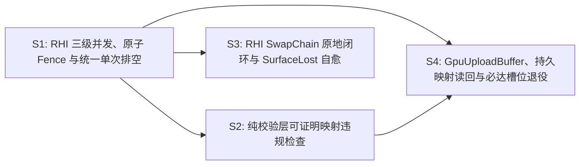

> - 适用: 实施或评审经 grill 对齐与两轮调用路径复审收敛后的 RadRay RHI 并发分层、确定性映射校验、交换链原地自愈与 Runtime 读回闭环方案
> - 权威: 经用户确认对齐并完成两轮静态路径审阅修订的架构与分阶段实施计划，不作为当前已实现契约；当前已实现行为与约束见 [RHI 与后端](../architecture/render-rhi.md) 与 [Rendering runtime](../architecture/runtime.md)
> - 锚点: `docs/architecture/render-rhi.md`, `docs/architecture/runtime.md`, `modules/core/include/radray/intrusive_ptr.h`, `modules/gpu/include/radray/gpu/types.h`, `modules/gpu/src/types.cpp`, `modules/gpu_impl/include/radray/gpu_impl/sampler_cache.h`, `modules/gpu_impl/include/radray/gpu_impl/backend/d3d12_impl.h`, `modules/gpu_impl/include/radray/gpu_impl/backend/vulkan_impl.h`, `modules/gpu_impl/src/d3d12/d3d12_impl.cpp`, `modules/gpu_impl/src/vk/vulkan_impl.cpp`, `modules/gpu_impl/src/rhi_validation.cpp`, `modules/gpu_impl/tests/test_buffer.cpp`, `modules/gpu_impl/tests/test_swapchain.cpp`, `modules/gpu_impl/tests/test_vulkan_swapchain.cpp`, `modules/runtime/include/radray/runtime/gpu_env.h`, `modules/runtime/include/radray/runtime/gpu_resource.h`, `modules/runtime/include/radray/runtime/frame_pipeline.h`, `modules/runtime/include/radray/runtime/frame_scheduler.h`, `modules/runtime/include/radray/runtime/rdg.h`, `modules/runtime/include/radray/runtime/readback_queue.h`, `modules/runtime/include/radray/runtime/render_graph_pipeline.h`, `modules/runtime/tests/test_fakes.h`

# RHI 并发分层、确定性映射校验、交换链原地自愈与 Runtime 读回闭环实施计划

## 状态、基线与已确认决策

- **记录日期**：`2026-11-25`（含同日 `/grill-me` 对齐及两轮调用路径审阅收敛）
- **基线状态**：`2026-11-25` 主干最新状态（已包含 `2026-11-24` VMA 3 `VMA_MEMORY_USAGE_AUTO` 与 `UploadArena` `Staging`/`Dynamic` 双池重构，以及 `2026-11-25` 合入的非持久 `ReadBack` 映射失败返空与首次创建 Vulkan 交换链设备丢失锁存修复）
- **状态**：完成架构边界收缩与全调用路径细节闭合后的定稿实施方案（`S1`～`S4`），归档时未改动生产代码；后续按 TDD 实施并在同一提交中同步更新 [RHI 与后端](../architecture/render-rhi.md) 与 [Rendering runtime](../architecture/runtime.md)。
- **工程硬约束对齐**：严守根 [AGENTS.md](../../AGENTS.md) 与 [C++ 约定](../guide/cpp-conventions.md)——全部改动在既有头文件与同名 `.cpp` 内闭合（**零新增头文件**），`runtime` 公开头仅纯数据记录使用 `struct`、含行为类型使用 `class`，**不引入任何 `try`/`catch`/`throw`、不引入任何全局或函数内 `static` 共享状态、不重命名已有枚举成员、不在生产后端实现中添加校验或测试统计字段**。

### 核心架构决策与明确排除项

1. **精确切分 RHI 三级并发范围：独立设备对象自由线程，命令分配器子对象与队列操作归属队列串行**：
   - 放开跨线程的目标是消除资源/PSO 创建屏障、支撑后台编译管线以及允许外部线程直等硬件 `Fence`；
   - **独立设备对象**（`Buffer`、`Texture`、`TextureView`、`Shader`、`BindingGroupLayout`、`PipelineLayout`、`ShaderParameterSet`、`PipelineCache`、`GraphicsPipelineState`、`ComputePipelineState`、`Sampler`、`QueryPool`、`Fence`）的创建与无活跃依赖析构支持自由线程并发；
   - **`CreateCommandBuffer(allocator)` 及其 `CommandBuffer` 销毁明确归入所属 `CommandAllocator` / `CommandQueue` 的队列串行域**（避免后台线程与录制/重置线程并发访问同一 `VkCommandPool` 或校验层 `Allocator->Children`），且不开放同队列多线程并行录制；暂缓跨线程构图 `RDGGraphMemory`。
2. **收缩 `S2` 至可证明的非持久映射违规检查，保留合法部分写入/部分刷新**：
   - `rhi_validation.cpp` 不对 `PersistentMap` 做裸指针影子猜测；对非持久 `Upload` 缓冲，仅对**可证明的违规**（仍处于 `Mapped` 态即提交、整次 `Map..Unmap` 未执行任何 `FlushMappedRange` 即提交读取，或带精确范围的拷贝/间接命令读取了本次映射窗口内未刷新的子区间）做硬拒绝，**允许 `Map(0, 8192)` 后仅写入并刷新 `[0, 4096)` 再拷贝前 `4096` 字节的合法部分上传**；
   - 对非持久 `ReadBack` 缓冲，在 `Real()->Submit` 发出信号**之前**预登记待失效区间（提交失败则回滚），以缓冲级锁与等待线程的 `Map -> Invalidate -> Unmap` 严格定序；具体后端 `d3d12_impl` / `vulkan_impl` **零相干性校验开销**。
3. **不新增 `FenceUploadRing`，在 `gpu_resource.h/.cpp` 新增独立 `GpuUploadBuffer` 并公开缓存原子隔离粒度**：
   - 保持 `GpuBuffer` 纯 `MemoryType::Device` 语义不变；新增 `GpuUploadBuffer` 专职管理持久映射 `Upload` 缓冲，并在 `RDGBuilder::UploadBuffer` 显式拒绝 `GpuUploadBuffer` 句柄以防 `RDG::Prepare` 二次 `Map`/`Unmap` 破坏持久映射地址；同时在 `gpu::DeviceLimits` 公开 `HostCoherentAtomSize`（D3D12 为 `1`，Vulkan 为 `nonCoherentAtomSize`），供宿主切分并发不重叠区间时对齐。
4. **直接在 RHI `gpu::SwapChain` 原地闭环修复并自愈 `SurfaceLost`，不新增 `Runtime` `PresentationSurface`**：
   - 补齐 `SwapChainStatus` 枚举成员；明确健康 Vulkan 设备在 `AcquireNext` 返回 `Suboptimal`（携带有效 `Frame`）时**仍须完成提交与 `Present`**（`DiscardAcquiredFrame` 在 Vulkan 下仅限 `DeviceLost` 终态）；修复 D3D12 重建失败 `ABORT` 与空 `_frames` 越界；支持 `SwapChainVulkan::Recreate` 重建坏 `VkSurfaceKHR` 原地自愈。
5. **内部读回缓冲统一改用创建期 `PersistentMap`，打通 `FrameScheduler` 丢失态单次必达退役链路**：
   - `AsyncReadbackQueue`（扩充通用 `Buffer` 读回）与 `RenderGraphFramePipeline` 内部 `ReadBack` 缓冲均改为创建期 `PersistentMap` 前置映射失败，并通过 `FrameScheduler::WaitSlot -> FramePipeline::OnSlotRetired` 保证正常与丢失态均精确通知 1 次。
6. **Vulkan 每队列独立锁 + 统一单次排空标志，闭环全部销毁与健康排空路径**：
   - 单队列操作仅锁所属 `QueueVulkan::_mutex`；全设备 `vkDeviceWaitIdle` 走按序锁定全部队列的 `WaitDeviceIdleSerialized()`；健康 `DrainAndClear` 若首次检出 `VK_ERROR_DEVICE_LOST` 同步标记已排空，且丢失态下任意原生对象（含 `FenceVulkan`、`SwapChainVulkan`、`CommandAllocatorVulkan`、`DeviceVulkan`）销毁前均共享同一单次排空保证。

---

## 一、现状源码根因与调用路径核查

对照当前主干代码，各待闭环路径的精确源码定位如下：

1. **RHI 并发共享状态与 Vulkan 排空边界**：
   - [`gpu_env.cpp`](../../modules/runtime/src/gpu_env.cpp) 以 `_owner = std::this_thread::get_id()` 限制线程归属；
   - [`d3d12_impl.h`](../../modules/gpu_impl/include/radray/gpu_impl/backend/d3d12_impl.h) 与 [`d3d12_impl.cpp`](../../modules/gpu_impl/src/d3d12/d3d12_impl.cpp) 中：`CpuDescriptorAllocator`、`GpuDescriptorAllocator` 及 [`sampler_cache.h`](../../modules/gpu_impl/include/radray/gpu_impl/sampler_cache.h) 无锁；第 4082 行 `SamplerD3D12` 构造直接执行非原子 `device->_nextSamplerId++`（`CreateSampler` 直调路径不受 `SamplerCache` 锁保护）；第 2107 行 `FlushSamplerTable` 内部嵌套调用 `ReleaseSamplerTable`（若两处各锁同一非递归互斥量会自锁）；`FenceD3D12` 仅持单个 `Win32Event _event`；
   - [`d3d12_impl.cpp`](../../modules/gpu_impl/src/d3d12/d3d12_impl.cpp) 第 2579 行与 [`vulkan_impl.cpp`](../../modules/gpu_impl/src/vk/vulkan_impl.cpp) 第 3217 行在 `Submit` 写入普通 `uint64_t _fenceValue`，与跨线程 `GetLastSignaledValue()` / 无参 `Wait()` 竞争；
   - [`vulkan_impl.cpp`](../../modules/gpu_impl/src/vk/vulkan_impl.cpp) 第 1292 行 `CreateCommandBuffer` 与 [`rhi_validation.cpp`](../../modules/gpu_impl/src/rhi_validation.cpp) 第 637 行均读写所属 `CommandAllocator` 的 `VkCommandPool` 与 `Children` 列表；[`rhi_validation.cpp`](../../modules/gpu_impl/src/rhi_validation.cpp) 第 838 行 `BindShaderParameterSet` 写普通 `bool Sealed = true`（跨队列并发绑定同一已封口参数集存在写竞争）；
   - [`vulkan_impl.cpp`](../../modules/gpu_impl/src/vk/vulkan_impl.cpp) 第 5195 行 `MarkDeviceLost` 当场调 `vkDeviceWaitIdle` 违反队列宿主同步；而 [`test_vulkan_swapchain.cpp`](../../modules/gpu_impl/tests/test_vulkan_swapchain.cpp) 第 46～60 行明确要求：在丢失态销毁 `FenceVulkan`（`vkDestroySemaphore`）、`SwapChainVulkan` 与 `DeviceVulkan` 前必须恰好执行过 `1` 次 `vkDeviceWaitIdle`（含健康 `DrainAndClear` 的 `vkDeviceWaitIdle` 首次返回 `VK_ERROR_DEVICE_LOST` 的路径，不得重复执行第二次）。
2. **非持久映射相干性定序与部分写入语义**：
   - [`rhi_validation.cpp`](../../modules/gpu_impl/src/rhi_validation.cpp) 第 1605 行 `QueueValidation::Submit` 在 `Real()->Submit(converted)` 发出硬件围栏信号之后才执行包装层收尾——若在此之后无锁登记 `ReadBack` 写入区间，等待线程可能已先醒来执行完 `Map -> Invalidate -> Unmap`；同时 `Map` 返回裸指针，部分写入并部分 `FlushMappedRange` 后若仅拷贝已刷新前缀属于合法用法。
3. **交换链枚举、D3D12 空帧越界与 Vulkan `DiscardAcquiredFrame` 限制**：
   - [`d3d12_impl.cpp`](../../modules/gpu_impl/src/d3d12/d3d12_impl.cpp) 第 3775 行 `Recreate` 失败后 `_frames` 为空导致第 3697 行 `AcquireNext` 越界，且 `ResizeBuffers` 非丢失失败直接 `ABORT`；
   - [`vulkan_impl.cpp`](../../modules/gpu_impl/src/vk/vulkan_impl.cpp) 第 4662 行 `SwapChainVulkan::DiscardAcquiredFrame` 在健康设备上直接 `RADRAY_ABORT`，且第 4670 行 `Recreate` 未在 `VK_ERROR_SURFACE_LOST_KHR` 下重建 `_surface`。
4. **Runtime `GpuUploadBuffer` 与 RDG `HostWrite` 二次映射冲突及 `WaitSlot` 漏回调**：
   - [`rdg.cpp`](../../modules/runtime/src/rdg.cpp) 第 1947～1956 行对导入的 `Upload` 缓冲执行 `UploadBuffer`（`RDGPassKind::HostWrite`）时会调用 `Map` 并在写完后 `Unmap`，若对已持有映射的 `GpuUploadBuffer` 调用该入口，开校验会因重复 `Map` 被拒、关校验会在 D3D12 下 `Unmap` 使持久指针失效；
   - [`types.h`](../../modules/gpu/include/radray/gpu/types.h) 第 1261 行 `DeviceLimits` 未暴露非相干原子行大小；[`frame_scheduler.cpp`](../../modules/runtime/src/frame_scheduler.cpp) 第 115 行在 `DeviceLost` 时跳过槽位完成回调。

---

## 二、分阶段详细设计（`S1`～`S4`）

---

### S1：RHI 三级并发分层、跨线程 `Fence` 与统一单次丢失排空

涉及文件：
- [`modules/runtime/include/radray/runtime/gpu_env.h`](../../modules/runtime/include/radray/runtime/gpu_env.h)、[`modules/runtime/src/gpu_env.cpp`](../../modules/runtime/src/gpu_env.cpp)
- [`modules/gpu/include/radray/gpu/types.h`](../../modules/gpu/include/radray/gpu/types.h)、[`modules/gpu/src/types.cpp`](../../modules/gpu/src/types.cpp)
- [`modules/gpu_impl/include/radray/gpu_impl/sampler_cache.h`](../../modules/gpu_impl/include/radray/gpu_impl/sampler_cache.h)、[`modules/gpu_impl/src/sampler_cache.cpp`](../../modules/gpu_impl/src/sampler_cache.cpp)
- [`modules/gpu_impl/include/radray/gpu_impl/backend/d3d12_impl.h`](../../modules/gpu_impl/include/radray/gpu_impl/backend/d3d12_impl.h)、[`modules/gpu_impl/src/d3d12/d3d12_impl.cpp`](../../modules/gpu_impl/src/d3d12/d3d12_impl.cpp)
- [`modules/gpu_impl/include/radray/gpu_impl/backend/vulkan_impl.h`](../../modules/gpu_impl/include/radray/gpu_impl/backend/vulkan_impl.h)、[`modules/gpu_impl/src/vk/vulkan_impl.cpp`](../../modules/gpu_impl/src/vk/vulkan_impl.cpp)
- [`modules/gpu_impl/src/rhi_validation.cpp`](../../modules/gpu_impl/src/rhi_validation.cpp)

具体改动：

1. **解除 `Environment` 线程限制并精确界定三级并发契约**：
   - 移除 `Environment::_owner` 线程归属限制（`Environment` 须晚于借用它的 `DeviceContext` 销毁）；
   - **自由线程层**：`Device` 的独立对象创建接口（`CreateBuffer`、`CreateTexture`、`CreateTextureView`、`CreateShader`、`CreateBindingGroupLayout`、`CreatePipelineLayout`、`CreateShaderParameterSet`、`CreatePipelineCache`、`CreateGraphicsPipelineState`、`CreateComputePipelineState`、`CreateSampler`、`GetOrCreateSampler`、`CreateQueryPool`、`CreateFence`、`CreateCommandAllocator`、`CreateExternalResourceExtension`）及只读能力查询、无活跃依赖的上述独立对象 `Destroy()` / 析构、跨队列共享绑定**已封口（`FlushWrites` 完成）**的只读 `ShaderParameterSet`、以及 `Fence` 的全部接口（`Poll`、`WaitForStatus`、`GetCompletedValue`、`GetLastSignaledValue`、`Wait`、`WaitFor`）支持多线程并发调用；
   - **实例串行层**：单个 `Buffer` 的 `Map/Unmap/FlushMappedRange/InvalidateMappedRange`、单个未封口 `ShaderParameterSet` 的 `Set/FlushWrites/ResetBindingsForReuse` 按实例串行；
   - **队列/分配器串行层**：同一 `CommandAllocator` 上的 **`CreateCommandBuffer(allocator)`、`CommandBuffer` 录制与销毁、`CommandAllocator::Reset/Destroy`**，以及同一 `CommandQueue` 的 `Submit`/`Wait` 与绑定该队列的 `SwapChain` 操作保持串行（不同队列及其专属 `CommandAllocator` 之间可并发）。
2. **双后端内部池细粒度锁与原子采样器 ID**：
   - **D3D12**：`CpuDescriptorAllocator`、`GpuDescriptorAllocator` 与 `SamplerCache` 内部各增 `std::mutex _mutex`；**将 `DeviceD3D12::_nextSamplerId` 改为 `std::atomic<uint64_t>{1}`**（在 `SamplerD3D12` 构造处用 `fetch_add(1, std::memory_order_relaxed)` 统一保护 `CreateSampler` 与 `GetOrCreateSampler` 两条路径）；在 `DeviceD3D12` 增非递归 `std::mutex _samplerTableMutex`，提取不加锁私有辅助 `ReleaseSamplerTableLocked`，由公开入口 `FlushSamplerTable`、`ReleaseSamplerTable`（析构路径）与 `ResetBindingsForReuse` 各自加锁一次，杜绝嵌套自锁。
   - **Vulkan**：`DescriptorSetAllocatorVulkan` 内增 `std::mutex _mutex` 保护 `Allocate`、`Destroy` 与 `Clear`；`DeviceVulkan` 增 `std::mutex _samplerMutex` 保护 `GetOrCreateSamplerInternal`。
3. **跨线程安全 `Fence`（原子 `_fenceValue` + D3D12 `Win32Event` 池）**：
   - 新增 `enum class FenceStatus : uint8_t { Completed, NotReady, Timeout, DeviceLost }` 与 `struct FencePollResult { FenceStatus Status{FenceStatus::NotReady}; uint64_t CompletedValue{0}; }`（含 `format_as`）；
   - 将 `FenceD3D12::_fenceValue` 与 `FenceVulkan::_fenceValue` 改为 `std::atomic<uint64_t>`：`Submit` / `Queue::Wait` 在信号排入后按单调 CAS `std::max`（`release`）更新，`GetLastSignaledValue()` 与无参 `Wait()` 以 `acquire` 读取；
   - `gpu::Fence` 新增 `Poll()` 与纳秒级 `WaitForStatus(uint64_t value, uint64_t timeoutNs)`：`FenceD3D12` 以 `std::mutex _eventPoolMutex` + `vector<Win32Event> _eventPool` 借还独立事件句柄，并完整保留 `while (GetCompletedValue() < value)` 唤醒复查与剩余超时计算；`FenceVulkan` 基于线程安全 `vkGetSemaphoreCounterValue` 与 `vkWaitSemaphores` 实现。
4. **Vulkan 每队列独立锁与共享单次排空状态（闭合全部销毁与健康排空路径）**：
   - 每个 `QueueVulkan` 实例独立持有 `std::mutex _mutex`，`Submit`、`Wait`、`Present` 仅锁单队列 `_mutex`；
   - `DeviceVulkan` 提供 `VkResult WaitDeviceIdleSerialized() noexcept`（按固定 `(type, slot)` 顺序锁定全部 `QueueVulkan::_mutex` 后执行 `_ftb.vkDeviceWaitIdle(_device)`）与统一排空状态 `std::mutex _lostDrainMutex` + `std::atomic<bool> _lostDrained{false}`：
     - `MarkDeviceLost(VkResult result, std::string_view operation, bool deviceIdleAlreadyCalled = false)`：若 `result != VK_ERROR_DEVICE_LOST` 返回 `false`；若 `deviceIdleAlreadyCalled` 为真（例如健康 `SwapChainVulkan::DrainAndClear` 调用 `WaitDeviceIdleSerialized()` 首次返回 `VK_ERROR_DEVICE_LOST`），在置 `_deviceLost = true` 的同时直接置 `_lostDrained.store(true, std::memory_order_release)`，**避免后续重复执行第二次 `vkDeviceWaitIdle`**；非 `deviceIdleAlreadyCalled` 路径仅原子置 `_deviceLost = true` 并记录一次日志，**绝不当场调用 `vkDeviceWaitIdle`**；
     - 新增 `DeviceVulkan::EnsureLostDeviceDrained() noexcept`：快路径 `!IsDeviceLost() || _lostDrained.load(std::memory_order_acquire)` 无锁直返；慢路径在 `_lostDrainMutex` 下若仍 `!_lostDrained` 则调用一次 `WaitDeviceIdleSerialized()` 并置 `_lostDrained.store(true, std::memory_order_release)`；
     - 在 `CommandAllocatorVulkan::Reset` 及 **`DeviceVulkan` 下属全部原生对象（含 `FenceVulkan` / `TimelineSemaphoreVulkan`、`CommandAllocatorVulkan`、`SwapChainVulkan::DrainAndClear`、`BufferVulkan`、`ImageVulkan`、`QueryPoolVulkan` 及 `DeviceVulkan::DestroyImpl`）销毁原生句柄前**统一先调用 `_device->EnsureLostDeviceDrained()`，严格保证任意销毁顺序（含先销毁 `Fence` 再销毁 `Device`）前恰好完成 `1` 次全设备排空。
5. **`DeviceValidation` 并发闭合**：
   - 将 `ObjectRecord::Live` 与 `ShaderParameterSetValidation::Sealed` 均改为 `std::atomic<bool>`，确保跨线程对象存活检查及不同队列并发绑定同一已封口 `ShaderParameterSet` 零数据竞争。

---

### S2：纯校验层的可证明非持久映射违规检查与错误收敛

涉及文件：
- [`modules/gpu/include/radray/gpu/types.h`](../../modules/gpu/include/radray/gpu/types.h)
- [`modules/gpu_impl/src/rhi_validation.cpp`](../../modules/gpu_impl/src/rhi_validation.cpp)
- [`modules/gpu_impl/src/d3d12/d3d12_impl.cpp`](../../modules/gpu_impl/src/d3d12/d3d12_impl.cpp)、[`modules/gpu_impl/src/vk/vulkan_impl.cpp`](../../modules/gpu_impl/src/vk/vulkan_impl.cpp)
- [`modules/gpu_impl/tests/test_buffer.cpp`](../../modules/gpu_impl/tests/test_buffer.cpp)、[`modules/runtime/tests/test_fakes.h`](../../modules/runtime/tests/test_fakes.h)

具体改动：

1. **具体后端零相干性校验，收敛非持久映射 OOM 与丢失态返回**：
   - `d3d12_impl.cpp` 与 `vulkan_impl.cpp` 不添加任何相干性跟踪；非持久 `MemoryType::Upload` 的 `Map` OOM 对齐为记录 `RADRAY_ERR_LOG` 并返回 `nullptr`；`BufferVulkan::FlushMappedRange` / `InvalidateMappedRange` 失败先调 `_device->MarkDeviceLost` 安全退场。
2. **在 `rhi_validation.cpp` 对非持久映射（`!PersistentMap`）实施可证明违规硬拒绝**：
   - 在 `GpuValidationOptions` 新增 `bool CheckHostCacheCoherency = true;`，`BufferValidation` 内增 `mutable std::mutex CoherencyMutex` 同步跨线程提交登记与主机 `Map/Unmap` 检查：
   - **非持久 `Upload`（兼容合法的部分写入与部分刷新）**：
     - 每次 `Map(offset, size)` 记录当前映射窗口 `[offset, offset + size)` 并将 `FlushedAnyInSession = false`、将该窗口记入 `UnflushedWindowRanges`；`FlushMappedRange(range)` 置 `FlushedAnyInSession = true` 并从 `UnflushedWindowRanges` 扣除 `range`；
     - `CommandBufferValidation` 分别记录本命令缓冲引用的缓冲集合，以及**具有确定字节范围的读取区间**（`CopyBufferToBuffer` 源区间、`CopyBufferToTexture` / `CopyBufferToTextureRegion` 源区间、`DrawIndirect` / `DrawIndexedIndirect` / `DispatchIndirect` 参数区间、绑定集中非动态或带固定动态偏移的 `CBuffer` 区间）；
     - `QueueValidation::Submit` 仅在以下**可 100% 证明违规**的情形调用 `Context->Reject("Submit", ...)`：① 被引用的非持久 `Upload` 缓冲当前仍处于 `Mapped` 态；② 缓冲曾被 `Map` 但最近一次映射会话 `FlushedAnyInSession == false`（整次映射零刷新即提交 GPU 消费）；③ 具有确定字节范围的读取命令访问了仍留在 `UnflushedWindowRanges` 内的未刷新字节（例如 `Map(0, 8192)` 仅 `Flush(0, 4096)` 却拷贝 `[0, 8192)` 被拒绝，而仅拷贝 `[0, 4096)` 或用于动态索引绘制则合法通过）。
   - **非持久 `ReadBack`（提交前预登记定序 + 兼容丢弃不读）**：
     - 在 `QueueValidation::Submit` 调用 `Real()->Submit(converted)` **之前**，先在各目标 `ReadBack` `BufferValidation::CoherencyMutex` 下为本次拷贝/解析写入生成递增批次号并预登记目标区间至 `GpuWrittenRanges`；若 `Real()->Submit(converted)` 返回 `false`，当场按批次号回滚撤销本次预登记，**绝不晚于等待线程观察到硬件围栏信号，也不在失败提交后残留脏记录**；
     - 宿主不读直接再次 `Submit` 覆写或销毁缓冲不报错；在非 `Mapped` 态调用 `InvalidateMappedRange` 继续按“拒绝未映射调用”拦截（注：RHI 校验层不追踪硬件围栏完成时序，围栏完成前过早 `Map -> Invalidate` 仍属调用方同步前置责任）；一旦宿主调用 `Map(offset, size)` 且映射窗口与 `GpuWrittenRanges` 相交，则必须在 `Unmap()` 前调用覆盖该交集的 `InvalidateMappedRange`，否则在 `Unmap()` 报错。

---

### S3：RHI `gpu::SwapChain` 原地闭环修复与 `SurfaceLost` 自愈

涉及文件：
- [`modules/gpu/include/radray/gpu/types.h`](../../modules/gpu/include/radray/gpu/types.h)、[`modules/gpu/src/types.cpp`](../../modules/gpu/src/types.cpp)
- [`modules/gpu_impl/src/d3d12/d3d12_impl.cpp`](../../modules/gpu_impl/src/d3d12/d3d12_impl.cpp)
- [`modules/gpu_impl/src/vk/vulkan_impl.cpp`](../../modules/gpu_impl/src/vk/vulkan_impl.cpp)
- [`modules/gpu_impl/src/rhi_validation.cpp`](../../modules/gpu_impl/src/rhi_validation.cpp)
- [`modules/gpu_impl/tests/test_swapchain.cpp`](../../modules/gpu_impl/tests/test_swapchain.cpp)、[`modules/gpu_impl/tests/test_vulkan_swapchain.cpp`](../../modules/gpu_impl/tests/test_vulkan_swapchain.cpp)

具体改动：

1. **补齐 `SwapChainStatus` 枚举成员并明确健康 Vulkan `Suboptimal` 呈现契约**：
   - 在 `enum class SwapChainStatus` 末尾新增 `Suboptimal`、`SurfaceLost`、`DeviceLost`（更新 `format_as`）；
   - **明确帧消费与升级契约**：`AcquireNext` 在 `Success` 与 `Suboptimal` 下均交付有效 `result.Frame`；**在健康 Vulkan 设备上取得 `Suboptimal` 帧后，调用方仍须完成命令提交并调用 `Present` 消费该帧（随后再按需 `Recreate`），不得对健康 Vulkan 设备调用 `DiscardAcquiredFrame`**（Vulkan 的 `DiscardAcquiredFrame` 仅适用于 `DeviceLost` 终态回收）；下游升级须同步适配新增枚举值。
2. **修复 `SwapChainD3D12` 窗口关联、重建失败返回与空帧越界**：
   - `MakeWindowAssociation` 设为 `DXGI_MWA_NO_WINDOW_CHANGES | DXGI_MWA_NO_ALT_ENTER`；`SwapChainD3D12::Recreate` 的 `ResizeBuffers` 非丢失失败记录日志并返回 `false`；`SwapChainD3D12::AcquireNext` 补齐 `if (_frames.empty())` 返回 `SwapChainStatus::RequireRecreate`。
3. **支持 `SwapChainVulkan::Recreate` 原地自愈 `VK_ERROR_SURFACE_LOST_KHR`**：
   - 当 `_terminalResult == VK_ERROR_SURFACE_LOST_KHR` 或 `_surface == nullptr`（且未 `DeviceLost`）时，经 `DrainAndClear()` 排空旧链后释放失效 `_surface`，用 `_nativeHandler` 重建 `SurfaceVulkan` 并复位 `_terminalResult = VK_SUCCESS` 后创建新交换链。

---

### S4：Runtime `GpuUploadBuffer`、创建期 `PersistentMap` 读回与必达槽位退役

涉及文件：
- [`modules/gpu/include/radray/gpu/types.h`](../../modules/gpu/include/radray/gpu/types.h)
- [`modules/gpu_impl/src/d3d12/d3d12_impl.cpp`](../../modules/gpu_impl/src/d3d12/d3d12_impl.cpp)、[`modules/gpu_impl/src/vk/vulkan_impl.cpp`](../../modules/gpu_impl/src/vk/vulkan_impl.cpp)
- [`modules/runtime/include/radray/runtime/gpu_resource.h`](../../modules/runtime/include/radray/runtime/gpu_resource.h)、[`modules/runtime/src/gpu_resource.cpp`](../../modules/runtime/src/gpu_resource.cpp)
- [`modules/runtime/include/radray/runtime/frame_pipeline.h`](../../modules/runtime/include/radray/runtime/frame_pipeline.h)、[`modules/runtime/src/frame_pipeline.cpp`](../../modules/runtime/src/frame_pipeline.cpp)
- [`modules/runtime/include/radray/runtime/frame_scheduler.h`](../../modules/runtime/include/radray/runtime/frame_scheduler.h)、[`modules/runtime/src/frame_scheduler.cpp`](../../modules/runtime/src/frame_scheduler.cpp)
- [`modules/runtime/include/radray/runtime/rdg.h`](../../modules/runtime/include/radray/runtime/rdg.h)、[`modules/runtime/src/rdg.cpp`](../../modules/runtime/src/rdg.cpp)
- [`modules/runtime/include/radray/runtime/readback_queue.h`](../../modules/runtime/include/radray/runtime/readback_queue.h)、[`modules/runtime/src/readback_queue.cpp`](../../modules/runtime/src/readback_queue.cpp)
- [`modules/runtime/include/radray/runtime/render_graph_pipeline.h`](../../modules/runtime/include/radray/runtime/render_graph_pipeline.h)、[`modules/runtime/src/render_graph_pipeline.cpp`](../../modules/runtime/src/render_graph_pipeline.cpp)

具体改动：

1. **公开 `DeviceLimits::HostCoherentAtomSize` 与独立 `GpuUploadBuffer` 包装**：
   - 在 `gpu::DeviceLimits` 新增 `uint64_t HostCoherentAtomSize{1};`（D3D12 填 `1`，Vulkan 填 `std::max<uint64_t>(1, _properties.limits.nonCoherentAtomSize)`）；
   - `GpuBuffer` 与 `GpuTexture` 升级为 `ThreadSafeRefCountedBase<T>`（`GpuTexture::GetOrCreateView` 加细粒度锁）；
   - 在 `gpu_resource.h/.cpp` 新增独立 `GpuUploadBuffer`（创建期即完成 `Map(0, size)` 并持有至析构 `Unmap`）：
     - 提供 `AlignSliceSize(uint64_t size)` / 基于设备 `HostCoherentAtomSize` 的切片对齐查询；宿主可向按 `HostCoherentAtomSize` 隔离的不重叠切片写入 `GetMappedData()`，而对同一 `GpuUploadBuffer` 实例的 `FlushMappedRange` / `WriteAndFlush` 遵守 `S1` 实例串行契约（例如统一在封包线程或提交前渲染线程串行刷新）；
     - 新增 `ImportPersistentBorrowed(GpuUploadBuffer&)` / `ImportPersistentOwned(const IntrusivePtr<GpuUploadBuffer>&)`（固定 `HostWrite -> Reads -> HostWrite` 导入并保活）；**在 `RDGBuilder::UploadBuffer` 中显式拒绝 `GpuUploadBuffer` 导入句柄**（记录错误并置图编译失败），防止 `RDG::Prepare` 对其执行二次 `Map` 与 `Unmap`。
2. **`AsyncReadbackQueue` 创建期 `PersistentMap` 化与通用 `Buffer` 读回**：
   - 内部暂存缓冲创建期启用 `ResourceHint::PersistentMap` 并持久保存 `MappedData`，根除事后 `Map` 失败；对称新增 `ReserveBuffer`、`EnqueueReservedBuffer` 与 `EnqueueBuffer`。
3. **`FrameScheduler::WaitSlot` 与 `RenderGraphFramePipeline` 全状态单次必达退役**：
   - `FramePipeline` 新增 `virtual void OnSlotRetired(FrameSlot& slot, bool deviceLost) noexcept;`（默认在 `!deviceLost` 时转发 `OnSlotCompleted`），`FrameScheduler::WaitSlot` 在清零 `_inFlight` 前无条件调用一次；
   - `RenderGraphFramePipeline` 内部时间戳读回缓冲改为创建期 `PersistentMap`，重写 `OnSlotRetired` 向派生类 `OnFrameSlotRetired(slot, userSequence, snapshot)` 精确投递单次结果（含 `Valid`、`Off`、`Unavailable`、`AllocationFailed`、`DeviceLost`），丢失态不触碰读回缓冲并清零当轮 `UserSequence`。

---

## 三、分阶段验收矩阵

| 阶段 | 核心覆盖场景与可判定验收条件 |
| --- | --- |
| **`S1`** | 1. 双后端并发测试（开启/关闭 `RADRAY_ENABLE_PROFILER`、`GpuValidationOptions{.IsEnabled = true}` 与驱动校验）：多线程并发直接调用 `CreateSampler`（断言生成的 D3D12 `_samplerId` 互不重复且 `FlushSamplerTable` 更新采样器表不自锁）、`CreateBuffer`/`Texture`/`TextureView`/`ShaderParameterSet`/`PSO`，双队列各自绑定同一个已封口 `ShaderParameterSet` 并发提交，外部线程并发调用 `Fence::Poll`、`WaitForStatus`、`WaitFor`、`GetLastSignaledValue()` 与无参 `Wait()`，零竞争、零校验报错； 2. Vulkan 双队列等待信号测试：队列 A `Wait()` 等待跨队列 Timeline 信号的同时，队列 B 并发 `Submit` 发出信号正常完成； 3. Vulkan 单次排空顺序测试：用 probe 分别覆盖① `Fence` 查询首次检出丢失后**先销毁 `Fence` 再销毁 `Device`**、② 健康 `SwapChainVulkan::DrainAndClear` 的 `vkDeviceWaitIdle` 首次返回 `VK_ERROR_DEVICE_LOST` 后继续销毁对象两条路径，断言全程 `vkDeviceWaitIdle` 调用次数均严格等于 `1`。 |
| **`S2`** | 1. 非持久 `Upload` 精确与部分写入测试：① `Map(0, 8192)` 写入并 `FlushMappedRange({0, 4096})`、`Unmap` 后执行 `CopyBufferToBuffer(..., 0, 4096)` 或动态绘制，**合法通过**；② 同一状态下执行 `CopyBufferToBuffer(..., 0, 8192)` 或 `CopyBufferToBuffer(..., 4096, 4096)`，**被精确拒绝**；③ `Map` 后零次 `FlushMappedRange` 即 `Submit`（含未 `Unmap` 或已 `Unmap`），**被精确拒绝**； 2. 非持久 `ReadBack` 定序与三路径测试：① 渲染线程连续 `Submit` 写出、等待线程紧盯 `Fence` 完成后立即并发执行 `Map -> Invalidate -> Unmap` 循环压测，零数据竞争且不残留已消费区间；② 不 `Map` 直接下一轮 `Submit` 覆写（丢弃结果），合法通过；③ `Map` 后漏 `InvalidateMappedRange` 即 `Unmap` 被拒绝，未 `Map` 调 `InvalidateMappedRange` 被拒绝。 |
| **`S3`** | 1. D3D12 交换链：注入 `ResizeBuffers` / 缓冲刷新非丢失失败，`Recreate` 返回 `false` 不 `ABORT`，紧接 `AcquireNext` 返回 `RequireRecreate` 不越界，再次 `Recreate` 恢复呈现； 2. Vulkan 交换链：① 注入 `VK_SUBOPTIMAL_KHR`，`AcquireNext` 返回 `Suboptimal` 与有效 `Frame`，健康设备上完成录制提交与 `Present`（不走 `DiscardAcquiredFrame`）并随后 `Recreate` 成功；② 注入 `VK_ERROR_SURFACE_LOST_KHR` 返回 `SurfaceLost`，直接调用 `SwapChain::Recreate` 原地重建 `VkSurfaceKHR` 并恢复呈现。 |
| **`S4`** | 1. `GpuUploadBuffer` 测试：核对双后端 `DeviceLimits::HostCoherentAtomSize` 有效（`>= 1`）；跨线程创建 `GpuUploadBuffer` 写入并刷新后经 `ImportPersistentOwned` 绘制，读回一致；对导入的 `GpuUploadBuffer` 句柄调用 `RDGBuilder::UploadBuffer`，断言构图期明确拒绝并令 `Compile()` 返回空指针（不触发二次 `Map` 或 D3D12 `Unmap`）； 2. `AsyncReadbackQueue`：双后端验证 `EnqueueBuffer` 与 `EnqueueTexture` 创建期持久映射零事后 `Map`、数据一致； 3. 槽位退役：覆盖 `Off`/`Valid`/`Unavailable`/`AllocationFailed` 单次回调，以及 `Submit` 成功后 `Wait` 期 `DeviceLost` 再连续两次 `WaitIdle()` 仅触发 1 次 `DeviceLost` 回调且不读时间戳；同步更新 `render-rhi.md` 与 `runtime.md` 并通过 `check_docs.py`。 |
