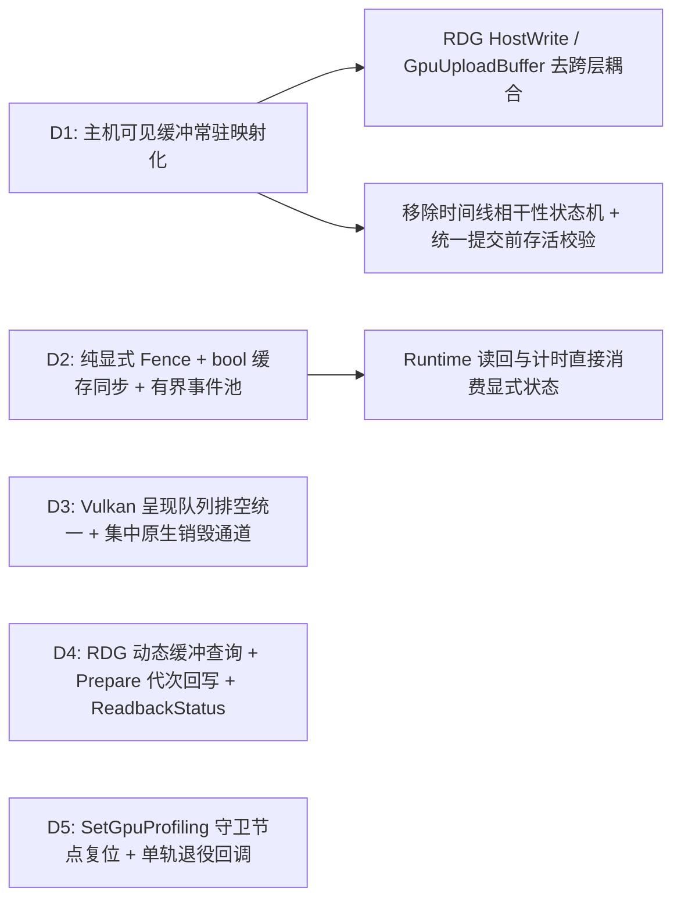

> - 适用: 复盘 `b3f38b3a` 并发与异步读回落地暴露的结构性问题，实施或评审经 `/grill-me` 对齐与静态复审收敛的 RHI 创建期常驻映射、显式同步与 Runtime 阶段契约收敛方案
> - 权威: 基线 `b3f38b3a` 上经用户确认对齐的复盘与分阶段演进计划，状态为待实施；不作为当前已实现契约，现行契约见 [RHI 与后端](../architecture/render-rhi.md) 与 [Rendering runtime](../architecture/runtime.md)
> - 锚点: `docs/architecture/render-rhi.md`, `docs/architecture/runtime.md`, `modules/gpu/include/radray/gpu/types.h`, `modules/gpu/src/types.cpp`, `modules/gpu_impl/include/radray/gpu_impl/backend/d3d12_impl.h`, `modules/gpu_impl/include/radray/gpu_impl/backend/vulkan_impl.h`, `modules/gpu_impl/src/d3d12/d3d12_impl.cpp`, `modules/gpu_impl/src/vk/vulkan_impl.cpp`, `modules/gpu_impl/src/vk/external_resource_vulkan.cpp`, `modules/gpu_impl/src/rhi_validation.cpp`, `modules/runtime/include/radray/runtime/gpu_resource.h`, `modules/runtime/include/radray/runtime/frame_pipeline.h`, `modules/runtime/include/radray/runtime/frame_scheduler.h`, `modules/runtime/include/radray/runtime/rdg.h`, `modules/runtime/include/radray/runtime/readback_queue.h`, `modules/runtime/include/radray/runtime/render_graph_pipeline.h`

# RHI 创建期常驻映射、显式同步与 Runtime 阶段契约收敛计划

## 状态、基线与工程约束

- **记录日期**：`2026-11-25`
- **基线提交**：`b3f38b3a`（承接 [RHI 并发与异步读回实施记录](2026-11-25-rhi-async-runtime-implementation.md) 与 [Fence 等待阈值与直接索引读取的复核](2026-11-25-rhi-fence-threshold-and-index-range-review.md)）
- **当前状态**：完成全局架构审视、`/grill-me` 五项决策（`D1`～`D5`）对齐及边界复审收敛的**待实施计划**；归档时未改动生产代码。实施完成时须在同一提交同步更新 [RHI 与后端](../architecture/render-rhi.md) 与 [Rendering runtime](../architecture/runtime.md)。
- **硬规则对齐**：严守根 [AGENTS.md](../../AGENTS.md) 与 [C++ 约定](../guide/cpp-conventions.md)——**不重命名已有枚举成员**（废弃旧标志仅停止生产消费，保留枚举成员名兼容 `magic_enum` 与序列化），保持 `.h`/`.cpp` 同名一一对应及非内联函数实现归位，`runtime` 公开头仅纯数据记录用 `struct`、含行为类型用 `class`，不新增全局或函数内 `static` 共享状态，不引入 `try`/`catch`/`throw`，不在生产代码中添加测试专用统计字段。

---

## 一、基线 `b3f38b3a` 实现复盘与架构成因

复盘上一轮实施及复核过程中连续衍生的补丁，核心根因在于 **64 位显式 API 底座上残留了会话式 `Map/Unmap` 模型、隐式排空兜底与跨阶段可变旁路状态**：

### 1. RHI 校验层职责失守：伪时间线因果追踪与 `Map` 意图缺失
- **暴露现象**：计划阶段假定 `ReadBack` 只需登记 `GpuWrittenRanges`，实施与复核时连续撞上“同队列多代写入不同 Fence”、“跨队列 `Wait -> Signal` 传递”、“跳值 Fence 首次跨过等待阈值（`FirstValue <= value <= Value`）”、“录制引用阻塞 `Queue::Wait` 后立即销毁缓冲”，以及“`DrawIndexed` 漏检未刷新索引区间”。
- **架构成因**：
  1. [RHI 与后端](../architecture/render-rhi.md) 规定校验层“不跟踪完整 GPU 在途依赖、跨队列同步”，但 [`rhi_validation.cpp`](../../modules/gpu_impl/src/rhi_validation.cpp) 为实现非持久 `ReadBack` 失效校验，内置了 `ReadbackQueueProgress`、`ReadbackFenceProgress` 与 `BufferHostAccess` 多队列偏序图。同时校验层只能被动观察宿主显式调用的 `Fence`/`Queue` 等待接口；一旦宿主经外部共享句柄或呈现同步确认完成，`Observed()` 无法成立，迫使 `ConsumeWrites` 回退消费未观测代次。
  2. `Buffer::Map(offset, size)` 返回裸指针，无法表达只读、`WriteDiscard` 或局部修改意图。`NeedsSessionFlush` 要求每次 `Map` 至少在窗口内 `Flush` 一段字节（未修改直接 `Unmap` 复用旧数据也会被拒），而一旦 `Flush` 任意 1 字节，其余字节又按历史 `Published` 放行；同时 `TrackDrawInputs` 对同样具备确定字节范围的非索引 `Draw` 顶点流与实例流仍传入空区间 `{}`，且提交前存活检查也仅顺带覆盖非持久 `Upload`/`ReadBack` 缓冲（`Device` 缓冲与 `Texture` 录制后、提交前销毁并未统一拦截）。

### 2. 上层所有权反向泄漏进底层 RHI（`OwnerMapped`）与双后端 `PersistentMap` 分裂
- **暴露现象**：为防止裸 `ImportBuffer(upload->GetBuffer(), ...)` 触发 `RDG::Prepare` 二次 `Map`/`Unmap`，在底层 [`types.h`](../../modules/gpu/include/radray/gpu/types.h) 新增了 `ResourceHint::OwnerMapped`。
- **架构成因**：
  1. `OwnerMapped` 在 D3D12 后端、Vulkan 后端与 `validation.cpp` 中均无执行语义，仅由 `runtime` 的 `GpuUploadBuffer` 写入、由 `RDGBuilder::UploadBuffer` 读取；若外部直接对 `upload->GetBuffer()` 调 `Map`/`Unmap`，RHI 校验层并不拦截。
  2. 全仓 `modules/runtime/src/` 中，`UploadArena`、`GpuUploadBuffer`、`AsyncReadbackQueue` 与时间戳读回已全部迁至 `PersistentMap`，仅剩 [`rdg.cpp`](../../modules/runtime/src/rdg.cpp) 外部裸导入 `Upload` 缓冲的 `HostWrite` 仍走会话式 `Map/Unmap`。同时双后端对 `PersistentMap` 实现分裂：Vulkan 在 `CreateBuffer` 即完成映射且 `Unmap()` 为空操作；D3D12 在 `CreateBuffer` 未映射，且 `BufferD3D12::Unmap()` 会无视 `PersistentMap` 直接解除底层映射并清空 `_mappedData`。

### 3. RDG 构图期擦除动态缓冲尺寸，迫使 `AsyncReadbackQueue` 堆分配旁路状态并延迟报错
- **暴露现象**：`AsyncReadbackQueue::EnqueueReservedBuffer` 在构图期只能看到动态缓冲的 `MaxSize`，至 `Prepare` 才知真实切片可能短于请求。
- **架构成因**：`RDGBuilder::GetBufferDescriptor` 将动态缓冲的 `MaxSize` 伪装为普通 `BufferDescriptor::Size`；[`readback_queue.cpp`](../../modules/runtime/src/readback_queue.cpp) 未利用 `AddCopyPass` 的 `Prepare` 回调，而是每次入队执行 `make_shared<bool>(false)` 并在 `Record` 回调内经 `const Copy&` 旁路写回，最终在 GPU Fence 完成后由 `Poll` 返回无法区分原因的笼统 `false`。

### 4. Vulkan 交换链排空随队列数量分叉，丢失态排空散落于 20 余处叶子析构
- **暴露现象**：`DeviceVulkan::WaitPresentationIdle` 在 `count > 1` 时调 `vkQueueWaitIdle`、`count == 1` 时调 `vkDeviceWaitIdle`；`_device->EnsureLostDeviceDrained()` 手工散落在 [`vulkan_impl.cpp`](../../modules/gpu_impl/src/vk/vulkan_impl.cpp) 与 [`external_resource_vulkan.cpp`](../../modules/gpu_impl/src/vk/external_resource_vulkan.cpp) 的 20 余处对象销毁与创建失败回滚路径中。
- **架构成因**：D3D12 交换链要求调用方前置等待，而 Vulkan `DrainAndClear` 内部代劳排空，为同时迁就多队列跨线程 timeline 信号活性与旧单队列测试断言而引入拓扑分叉；同时因 `FrameScheduler::BeginFrame() -> FrameSlot&` 在检出丢失后仍继续重置槽与销毁资源，且未在 `DeviceVulkan` 内部收口原生句柄释放通道，导致叶子析构散落手工调用。

### 5. 当帧配置滞留管线跨帧状态、冗余双轨回调与 D3D12 事件池退化
- **暴露现象**：
  1. `RenderGraphFramePipeline::SetGpuProfiling` 将未提交帧的 `Profiling` 与 `UserSequence` 写入持久 `_slotStates`（`RunFrame` 因设备丢失提前返回 `false` 时甚至漏复位 `UserSequence`），迫使 `FramePipeline` 新增 `OnFrameCancelled`；且 `OnSlotCompleted`/`OnSlotRetired` 与 `OnGpuTimingCompleted`（全仓零覆写）/`OnFrameSlotRetired`（重复传入 `snapshot` 已含的 `userSequence`）形成双轨重叠回调。
  2. `Buffer::FlushMappedRange` / `InvalidateMappedRange` 返回 `void`，迫使各调用点事后手写 `if (device.IsDeviceLost())`。
  3. [`d3d12_impl.cpp`](../../modules/gpu_impl/src/d3d12/d3d12_impl.cpp) 的 `FenceD3D12::WaitForStatus` 无条件 `pop_back()` 事件池，当高目标值短等待超时归还池顶后，后续等待较低未完成值的线程既无法重新 `SetEventOnCompletion` 也无法 `WaitForSingleObject`，直接退化为 `::Sleep(1)` 轮询；`gpu::Fence` 同时暴露 7 个重叠接口且每次 `Submit` 维护原子 `_fenceValue`。
  4. 注：[`d3d12_diagnostics.cpp`](../../modules/gpu_impl/src/d3d12/d3d12_diagnostics.cpp) 对 `IDXGIInfoQueue` 的 `Discarded` 检查经核实属于针对低频生命周期 DXGI 消息队列的既定保守策略，本次保持不变。

---

## 二、已确认的架构收敛决策（`D1`～`D5`）

### `D1`：主机可见缓冲全量收敛为创建期常驻映射（Persistent-First）
- **决策**：
  - `MemoryType::Upload`（须声明 `BufferUse::MapWrite`，禁止 `MapRead`）与 `MemoryType::ReadBack`（须声明 `BufferUse::MapRead`，禁止 `MapWrite`）统一在 `CreateBuffer` 内完成整缓冲映射，映射失败或设备丢失记录错误并返回 `nullptr`；`MemoryType::Device` 禁止 `MapRead | MapWrite`；`CreateBuffer` 的 `Hints` 仅接受 `ResourceHint::Dedicated`（`PersistentMap` 与 `OwnerMapped` 保留枚举成员名，生产代码与 `CreateBuffer` 不再消费）。
  - `gpu::Buffer` 移除 `Map(offset, size)` 与 `Unmap()`，改为 `Nullable<void*> GetMappedData() noexcept`（`Device` 返空，`Upload`/`ReadBack` 返回常驻基址；`BufferD3D12` 在 `CreateBuffer` 按读写属性映射一次，仅在 `Destroy()` 解映射一次）。
  - 移除 [`rhi_validation.cpp`](../../modules/gpu_impl/src/rhi_validation.cpp) 的 `ReadbackQueueProgress`、`ReadbackFenceProgress`、`BufferHostAccess`、录制字节区间跟踪及 `GpuValidationOptions::CheckHostCacheCoherency`。
  - **统一录制对象提交前存活校验**：在 `ObjectRecord` 分配单调递增 `ObjectId`，`CommandBufferValidation` 以轻量 `(const GpuObject*, uint64_t)` 列表记录录制期间引用的资源（不递增 `Dependents`），`QueueValidation::Submit` 统一校验全部被引用对象仍存活（拒绝提交前已销毁的资源，防止 ABA），并在 `Submit` 返回或 `ResetLogical` 时清空该列表——使全部 `Buffer`/`Texture`/`QueryPool` 在 `Queue::Wait()` 完成后均可无需等待 `CommandAllocator::Reset()` 即独立销毁。
  - `RDG::Prepare` 对外部裸导入 `Upload` 缓冲的 `HostWrite` 直接向 `GetMappedData() + offset` 写入并调用 `FlushMappedRange`；`ImportPersistentBorrowed/Owned(GpuUploadBuffer)` 在 `RDGBuffer` 内部置位禁止图内 `HostWrite` 标志，并在 `RDGBuilder::UploadBuffer` 与 `Compile()` 中双向核验（覆盖“先裸 `ImportBuffer` + `UploadBuffer`、再类型化导入同一物理缓冲”与反向两种顺序），解除对底层 `ResourceHint::OwnerMapped` 的依赖。
- **取舍记录**：放弃会话式 `Map/Unmap` 后，CPU 校验层不再感知裸指针写入窗口边界（非相干内存漏 `Flush`/`Invalidate` 由 `UploadArena`、`GpuUploadBuffer`、`AsyncReadbackQueue` 等封装保证），换取根除双后端行为分裂、运行期 `Map` OOM、`OwnerMapped` 跨层污染及 ~300 行易误报的校验状态机。

### `D2`：纯显式时间线 `Fence`、`bool` 缓存同步与 D3D12 有界事件池修复
- **决策**：
  - `gpu::Fence` 移除后端 `_fenceValue` 原子状态及无参 `Poll()`、`GetLastSignaledValue()`、无参 `Wait()`、毫秒布尔版 `WaitFor`（同步移除仅服务于无参 `Poll()` 的 `struct FencePollResult`，保留 `enum class FenceStatus` 成员不变），收敛为纯显式目标值契约：
    - `uint64_t GetCompletedValue() const noexcept`
    - `FenceStatus WaitForStatus(uint64_t value, uint64_t timeoutNs) noexcept`（`timeoutNs == 0` 为单次非阻塞查询）
    - `void Wait(uint64_t value) noexcept`（30s 超时致命等待）
  - 本地信号单调递增校验收归 `FenceValidation`；`CmdQueueD3D12::Wait()` 自持私有递增序号，Release 后端 `Submit` 零原子 CAS 开销。
  - 修复 `FenceD3D12::WaitForStatus` 事件池并设未完成注册上限：借用时扫描选取 `ArmedValue <= initial` 的空闲事件；若池中事件均挂有更高未完成值（`ArmedValue > value`）且该 Fence 累计创建的事件总数未达上限（如 `kMaxFenceWaitEvents = 16`），新建 `Win32Event` 注册内核等待；当达到事件总数上限、新建句柄失败或 `SetEventOnCompletion` 返回 `E_OUTOFMEMORY` 时，统一保留带剩余超时上界的 `::Sleep(1)` 轮询回退路径（遵守原超时契约并避免极端倒序短等待无限增长内核句柄）。
  - `Buffer::FlushMappedRange` 与 `InvalidateMappedRange` 签名由 `void` 改为 `bool`（校验拒绝或设备丢失返回 `false`），上层直接依据返回值判错，消除事后旁路 `IsDeviceLost()` 检查。

### `D3`：Vulkan 健康交换链清理统一仅等待呈现队列 + 集中原生销毁通道收拢丢失排空
- **决策**：
  - 删除 `DeviceVulkan::WaitPresentationIdle` 按设备队列总数 `count > 1` 的分叉：健康 surface 上正常成功的 `SwapChainVulkan::Recreate` 继续通过退休代（`_retiredGenerations`）无停顿回收、**不执行任何队列或设备 idle 等待**；而在 `Destroy`、`SurfaceLost` 重建前清理及 `Recreate` 失败清理（`DrainAndClear`）时，无论单队列或多队列，健康设备统一只锁所属呈现队列执行 `vkQueueWaitIdle` 并等待 `_pendingAcquires`（调用方按既有契约先等待旧后备缓冲自有 GPU 工作；若 `vkQueueWaitIdle` 首次返回 `VK_ERROR_DEVICE_LOST` 则锁存丢失并衔接丢失排空）。
  - 在 `DeviceVulkan` 内部提供统一的原生句柄销毁与池重置辅助入口（内部统一调用 `EnsureLostDeviceDrained()`），收拢 `vulkan_impl.cpp` 与 `external_resource_vulkan.cpp` 中 20 余处散落的手工排空前置调用。
- **取舍记录**：不采用“移除对象析构排空、要求宿主丢失后手动 `Device::WaitIdle()`”方案，因为多步 `Create*` 内部半途遭遇 `VK_ERROR_DEVICE_LOST` 的栈内回滚以及工作线程局部 RAII 句柄析构无法保证主线程已先完成全局排空。

### `D4`：RDG 动态缓冲显式查询、`Prepare` 期零分配代次回写与结构化 `ReadbackStatus`
- **决策**：
  - `RDGBuilder` 新增 `bool IsDynamicBuffer(RDGBufferHandle buffer) const noexcept`，与 `GetBufferDescriptor` 配合显式区分静态缓冲固定尺寸与动态缓冲 `MaxSize` 上界。
  - **所有权与生命周期契约对齐**：与 `RDGTransientResourcePool`、`UploadArena` 及几何池一致，`AsyncReadbackQueue` 以 `unique_ptr<gpu::Buffer>` 独占内部暂存缓冲；**调用方须在已提交读回图的 GPU 工作完成（如 `FrameScheduler::WaitIdle()`）后再销毁 `AsyncReadbackQueue`**，不为“在途 GPU 拷贝未结束就提前销毁队列”维护跨层 `shared_ptr` 伪保活（手动使用 `CompiledRDG` 时 `PassData` 在 `Record` 后即可释放，本就不能代表 GPU 完成）。
  - **`Prepare` 期代次回写（防取消后悬垂）**：`AsyncReadbackQueue` 维护单调递增的批次代次 `_batchEpoch`（每次 `CancelUnsubmitted()` 或 `MarkSubmitted()` 推进）；`EnqueueReservedBuffer` 在 `AddCopyPass` 的 `Data` 中仅按值保存 `{AsyncReadbackQueue* Queue, uint64_t RequestId, uint64_t Epoch, RDGBufferHandle Source, RDGBufferHandle Destination, uint64_t Offset, uint64_t Size}`（不保存请求节点裸指针，零 `make_shared` 堆分配）：
    - `Prepare` 回调解析源/目标 `RDGBufferSlice` 缓存于 `Data` 内，并调用队列私有辅助按 `(Epoch, RequestId)` 记录 `SourceInBounds`（若调用方已在构图后调用 `CancelUnsubmitted()` 放弃该图，`Epoch` 不匹配即安全忽略，绝不解引用已擦除节点）；
    - `Record` 回调严格只读消费 `Data` 中已解析的切片，越界时跳过拷贝命令。
  - 因构图期 `dst` 已声明 `.WriteBuffer(dst)`，RDG 在 `Record` 仍会对 `dst` 录制屏障，越界请求的 `Staging` 缓冲保持在途直至所属帧 Fence 完成后再归还 `_free` 池。
  - `AsyncReadbackQueue::Poll` 返回显式枚举 `enum class ReadbackStatus : uint8_t { Pending, Ready, SourceOutOfRange, DestinationTooSmall, InvalidRequest, DeviceLost }`（提供 `format_as`）。

### `D5`：当帧剖析配置经 `FrameSlot` 守卫节点自动复位 + 单轨帧槽退役回调
- **决策**：
  - **保持 `FrameSlot` 下层纯净且零悬垂指针**：不在底层 `frame_slot.h` 引入上层 RDG 剖析类型。`RenderGraphFramePipeline::SlotState` 保存当帧待提交字段 `PendingProfiling`、`PendingUserSequence` 与 `HasPendingProfiling`；首次在当前帧调用 `SetGpuProfiling(FrameSlot& slot, RDGGpuProfilingMode mode, uint64_t userSequence)` 时，向 `slot.Emplace` 登记一个**非平凡析构**的 `ProfilingResetGuard{Nullable<SlotState*> Target}`（进入 `FrameSlot::_objects` 析构链）：
    - `PrepareTiming` 读取待提交字段，`Submit` 成功返回后固化至在途状态、清零待提交字段并将守卫置空；
    - 若帧在 `BeginFrame` 后未提交即遭遇 `WaitIdle()` 取消，或在 `Extract`/`Prepare`/`Record`/`Submit` 因设备丢失失败，槽在 `ResetFrameData()` 执行析构链时由 `~ProfilingResetGuard()` 自动将 `SlotState` 的待提交模式与序号清零（即使下一帧复用同一帧号也不会泄漏，管线亦不持有任何指向已重置帧内存的指针）。
  - `FramePipeline` 移除 `OnSlotCompleted` 与 `OnFrameCancelled`（同步移除 `FrameScheduler::WaitIdle` 中的 `OnFrameCancelled` 调用），仅保留唯一退役钩子 `virtual void OnSlotRetired(FrameSlot& slot, bool deviceLost) noexcept`。
  - `RenderGraphFramePipeline` 移除无覆写的 `OnGpuTimingCompleted` 及冗余的 `userSequence` 形参，仅保留唯一结果出口 `virtual void OnFrameSlotRetired(FrameSlot& slot, const RDGGpuTimingSnapshot& snapshot) noexcept`（由 `snapshot.Status` 与 `snapshot.UserSequence` 承载全部五态结果）。

---

## 三、分阶段实施方案与涉及文件

### 阶段 1：RHI 常驻映射、显式 `Fence` 与 Vulkan 排空收口（`D1` + `D2` + `D3`）
- **核心文件**：
  - [`modules/gpu/include/radray/gpu/types.h`](../../modules/gpu/include/radray/gpu/types.h)、[`modules/gpu/src/types.cpp`](../../modules/gpu/src/types.cpp)
  - [`modules/gpu_impl/include/radray/gpu_impl/backend/d3d12_impl.h`](../../modules/gpu_impl/include/radray/gpu_impl/backend/d3d12_impl.h)、[`modules/gpu_impl/src/d3d12/d3d12_impl.cpp`](../../modules/gpu_impl/src/d3d12/d3d12_impl.cpp)、`modules/gpu_impl/src/d3d12/external_resource_d3d12.cpp`
  - [`modules/gpu_impl/include/radray/gpu_impl/backend/vulkan_impl.h`](../../modules/gpu_impl/include/radray/gpu_impl/backend/vulkan_impl.h)、[`modules/gpu_impl/src/vk/vulkan_impl.cpp`](../../modules/gpu_impl/src/vk/vulkan_impl.cpp)、[`modules/gpu_impl/src/vk/external_resource_vulkan.cpp`](../../modules/gpu_impl/src/vk/external_resource_vulkan.cpp)
  - [`modules/gpu_impl/src/rhi_validation.cpp`](../../modules/gpu_impl/src/rhi_validation.cpp)
  - `modules/gpu_impl/tests/*`（`gpu_test_fixture`、`test_buffer`、`test_device`、`test_compute_binding`、`test_render_pass`、`test_vulkan_swapchain`）
- **实施要点**：
  1. 替换 `Buffer::Map/Unmap` 为 `GetMappedData()`，变更 `FlushMappedRange`/`InvalidateMappedRange` 返回 `bool`；D3D12 在 `CreateBuffer` 对 `Upload`/`ReadBack` 立即映射（处理 OOM 与丢失返空），Vulkan 对 `Upload`/`ReadBack` 默认附加 `VMA_ALLOCATION_CREATE_MAPPED_BIT`（移除对 `ResourceHint::PersistentMap` 的依赖）。
  2. 精简 `gpu::Fence` 为三方法显式契约，迁移本地单调性检查至 `FenceValidation`；更新 `FenceD3D12::WaitForStatus` 事件池空闲筛选、有界新建（`kMaxFenceWaitEvents`）以及句柄满额/创建失败/`SetEventOnCompletion` `E_OUTOFMEMORY` 时的超时轮询回退。
  3. 统一 `SwapChainVulkan::DrainAndClear` 为呈现队列等待，提取 `DeviceVulkan` 集中原生销毁/重置辅助替换散落的 `EnsureLostDeviceDrained()`。
  4. 清理 `rhi_validation.cpp` 中的主机缓存相干性与围栏进度追踪结构，补齐基于 `(const GpuObject*, ObjectId)` 的录制资源提交前统一存活校验。

### 阶段 2：Runtime / RDG 常驻接入、零分配读回裁决与单轨退役（`D4` + `D5`）
- **核心文件**：
  - [`modules/runtime/include/radray/runtime/gpu_resource.h`](../../modules/runtime/include/radray/runtime/gpu_resource.h)、`modules/runtime/src/gpu_resource.cpp`
  - `modules/runtime/include/radray/runtime/upload_arena.h`、`modules/runtime/src/upload_arena.cpp`
  - [`modules/runtime/include/radray/runtime/rdg.h`](../../modules/runtime/include/radray/runtime/rdg.h)、`modules/runtime/src/rdg.cpp`
  - [`modules/runtime/include/radray/runtime/readback_queue.h`](../../modules/runtime/include/radray/runtime/readback_queue.h)、`modules/runtime/src/readback_queue.cpp`
  - [`modules/runtime/include/radray/runtime/frame_pipeline.h`](../../modules/runtime/include/radray/runtime/frame_pipeline.h)、`modules/runtime/src/frame_pipeline.cpp`
  - [`modules/runtime/include/radray/runtime/frame_scheduler.h`](../../modules/runtime/include/radray/runtime/frame_scheduler.h)、`modules/runtime/src/frame_scheduler.cpp`
  - [`modules/runtime/include/radray/runtime/render_graph_pipeline.h`](../../modules/runtime/include/radray/runtime/render_graph_pipeline.h)、`modules/runtime/src/render_graph_pipeline.cpp`
  - `modules/runtime/tests/*`、`examples/mesh_drawing_pipeline/gpu_support.cpp`、`benchmarks/bench_rdg_upload/*`、`benchmarks/bench_transient_parameter_pool/*`
- **实施要点**：
  1. `GpuUploadBuffer`、`UploadArena`、`AsyncReadbackQueue`、`RenderGraphFramePipeline`、样例与基准全部切换至 `GetMappedData()` 与 `bool` 返回值 `Flush`/`Invalidate`；`RDG::Prepare` `HostWrite` 直接写常驻基址偏移并 `Flush`，`ImportPersistentBorrowed/Owned(GpuUploadBuffer)` 与 `Compile()` 双向拒绝任意导入顺序下的 `UploadBuffer` 冲突。
  2. `RDGBuilder` 增加 `IsDynamicBuffer`；重构 `AsyncReadbackQueue` 为 `unique_ptr<gpu::Buffer>` + `Prepare` 回调按 `(Epoch, RequestId)` 裁决切片 + `ReadbackStatus` 返回值。
  3. 重构 `SetGpuProfiling` 经非平凡 `ProfilingResetGuard` 绑定帧清理生命周期，合并 `FramePipeline` 与 `RenderGraphFramePipeline` 退役回调并更新 Fake 与测试。

### 阶段 3：架构文档同步与全量验证
- 同步更新 [RHI 与后端](../architecture/render-rhi.md) 与 [Rendering runtime](../architecture/runtime.md) 中关于常驻映射、`Fence` 显式接口、Vulkan 交换链与丢失排空、异步读回生命周期/状态枚举及帧槽退役回调的当前事实描述。

---

## 四、分阶段验收矩阵

| 阶段 | 可判定验收条件 |
|---|---|
| **阶段 1（RHI）** | 1. 双后端 `Upload`/`ReadBack` 缓冲创建后 `GetMappedData()` 非空、`Device` 缓冲返空；注入映射失败或丢失时 `CreateBuffer` 返空；`CreateBuffer` 拒绝 `PersistentMap`/`OwnerMapped` 标志与不匹配的 `MapRead`/`MapWrite`； 2. 录制拷贝后在 `Submit` 前销毁源或目标缓冲被 RHI 校验层拒绝；`Submit` 并 `Queue::Wait()` 完成后无需 `CommandAllocator::Reset()` 即可合法销毁缓冲；`FlushMappedRange`/`InvalidateMappedRange` 在越界/非法用途及设备丢失下均返回 `false`； 3. `Fence` 并发等待测试通过；D3D12 下先对高目标值短超时 `WaitForStatus` 归还池中，再等待较低未完成值可在信号发出后立即内核唤醒；连续倒序短超时等待时事件池大小受 `kMaxFenceWaitEvents` 约束，且句柄创建失败或 `SetEventOnCompletion` 返回 `E_OUTOFMEMORY` 时均遵守超时返回 `Timeout`； 4. Vulkan 健康 surface 上正常 `SwapChain::Recreate` 保持 `0` 次队列/设备 idle 等待；健康设备 `Destroy`、`SurfaceLost` 重建前清理与 `Recreate` 失败清理在单队列与多队列下均仅等待所属呈现队列及未完成 acquire；丢失态任意销毁顺序（含创建中途失败回滚与先销毁 `Fence`）前恰好执行 `1` 次 `vkDeviceWaitIdle`。 |
| **阶段 2（Runtime）** | 1. 同一 `GpuUploadBuffer` 无论“先类型化导入再 `UploadBuffer`”还是“先裸 `ImportBuffer` + `UploadBuffer` 再类型化导入”，`Compile()` 均拒绝且无 `ResourceHint::OwnerMapped` 依赖；普通外部 `Upload` 缓冲 `ImportBuffer` + `UploadBuffer` 正常写入并保留常驻映射有效； 2. `RDGBuilder::IsDynamicBuffer` 准确区分静态与动态缓冲；`AsyncReadbackQueue` 稳态复用零堆分配，`CancelUnsubmitted()` 后旧图即便误调 `Prepare` 也不触发悬垂写，`Poll` 精确返回 `Pending`、`Ready`、`SourceOutOfRange`、`DestinationTooSmall`、`InvalidRequest`、`DeviceLost` 六种状态，越界暂存缓冲在 Fence 完成后安全复用； 3. `BeginFrame` 后调用 `SetGpuProfiling` 再遭遇 `WaitIdle` 取消或 `RunFrame` 丢失失败，下一帧自动恢复 `Off` 与序号 `0` 且无悬垂指针；单轨 `OnSlotRetired` 与 `OnFrameSlotRetired` 在全部五种计时状态下精确触发 1 次。 |
| **阶段 3（全量门禁）** | 在独立目录分别启用与关闭 `RADRAY_ENABLE_PROFILER`，设置 `RADRAY_TEST_REQUIRED_BACKENDS=d3d12,vulkan` 运行完整套件 `ctest --output-on-failure`（零失败，且核对多队列并发与交换链用例均实际执行未跳过，跳过项仅限已知适配器不支持的跨 API 导出路由与 D3D12 根签名预算的 Vulkan 参数），`radray_mesh_drawing_sample` 双后端通过，`python tools/check_docs.py` 与 `git diff --check` 零错误通过。 |
