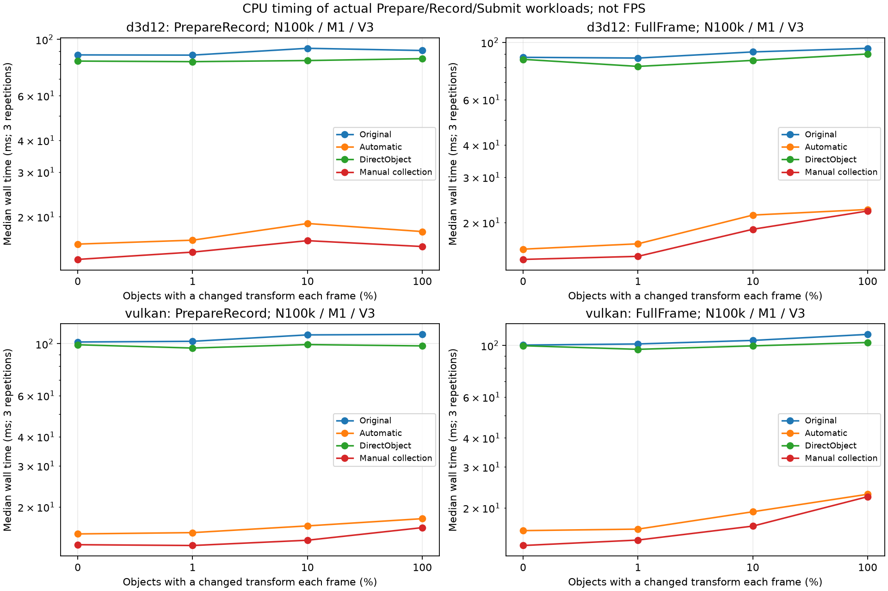
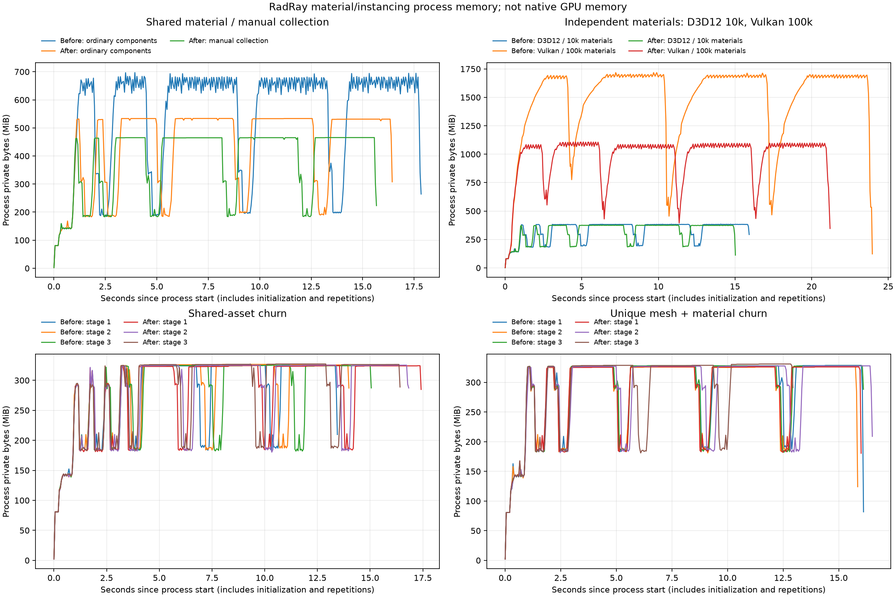

> - 适用: 本轮材质、增量同步和实例化的功能与性能验收
> - 权威: 本机实测；以保存的 benchmark JSON、Tracy trace 和验证日志为证据，不作为跨机器性能保证
> - 锚点: `benchmarks/bench_material_scene/bench_material_scene.cpp`, `benchmarks/bench_material_scene/material_scene_workload.cpp`, `tools/run_material_scene_benchmark.py`

# 材质和实例化验收

状态：P0–P6 已实施并完成最终测量。基线为 `b63c14d571c10fcbc7b519bd80b218b6541fe5e7`，
分支为 `refactor/render-framework-reset`；当前结果对应本轮未提交工作树，源码快照保存在本机 perf 目录。
最初的 benchmark 和 Tracy 基线在任何行为修改之前完成。修正 workload 后另用原提交源码重建对照，原始数据保留。

在 N=100k、M=1、V=3、无变换更新时，CPU 准备和录制从 D3D12 86.90 ms 降到 15.61 ms，
Vulkan 101.74 ms 降到 15.33 ms。每帧 300,000 draw 变为 3 draw；手动集合保留 100k 渲染 Shape，但只创建 1 个 Actor/Component。
不可合并的独立材质场景 CPU 收益较小，部分 Vulkan 配置的 GPU 时间存在约 32–49% 回退，详见后文。
真实新资产 churn 的总成本基本没有明显下降；本轮收益主要来自批次准备、录制和材质绑定复用。

## 实施结果

| 阶段 | 当前交付 |
|---|---|
| P0 | 异步材质 ready 后补 materials capture；只检查所选 pass 参数；旧 ObjectSlot 与通用 push 映射分别验证，reflection cache 区分两种模式 |
| P1 | Material/native/fallback 所有者持有 MaterialGpuState；共享 reflection plan；64 KiB 持久常量页；纯材质 SPS 一次初始化；混合组与 override 使用帧版本；安全复用点回收临时容量 |
| P2 | span writer/capture；不可变 binding 数组共享；schema 一次登记；pending packed bytes 覆盖与 Seal 冻结；参数 CPU 页和相邻 GPU 上传合并 |
| P3 | VisibleSlots、显式 push uint 字段、FirstInstance=0；CPU/GPU 帧实例 helper；返回 schema 自有存储，复制结果也重绑自己的 schema 指针 |
| P4 | bounds/mask/pass 剔除、稳定 SortGroup/Order、完整兼容分组、按 batch 准备 draw；透明顺序屏障；scene/revision cache 与失效回收；明确失败诊断 |
| P5 | InstancedStaticMeshComponent：共享配置、连续数据、稳定业务 handle、连接 Shape 映射、独立 batch domain；native producer 使用相同底层路径 |
| P6 | 两后端完整自动压力矩阵、Direct/Manual/ManualTint 对照、两种 churn×三时序、分阶段 Tracy、19 条内存曲线、GPU 回归、长期文档与示例 |

使用示例见[实例绘制](../guide/instancing.md)，所有权与缓存契约见[Runtime 架构](../architecture/render-framework.md)。
压力测试发现并修复了精确 reserve(size+count) 在重复单对象入口中导致反复搬移的问题，Writer 与集合现采用几何增长。
全量回归还发现单线程 modal/vblank 回调的输入交付顺序问题，已将输入派发放在相应 Update 之前并完成回归。
这些修补已进入本报告的最终二进制；中间版本数据保留在 `build_release/perf/intermediate-exact-reserve/`，未混入结论。

## 环境、方法与有效性

Windows，i7-13700K（16 核 / 24 逻辑线程），RTX 4080，驱动 32.0.16.1714，32 GB RAM；
ClangCL 22.1.3，CMake 4.4.4，Release，AVX2/FMA/LTO、mimalloc、Tracy 0.14.1 开启。会话结束时确认活动电源计划为「高性能」。
固定 F=2、单线程、原生验证关闭、GPU 帧时间探针开启、256×256 离屏无深度目标；所有对象均在视锥内。
构建、测试与性能负载分阶段串行，采样时不并行运行其他测试或 GPU 压力进程。
普通路径立即创建 N 个 Actor/StaticMeshComponent；集合路径为 1 个 Actor/组件。

Google Benchmark 每配置三次重复，最小计时 0.1s；表中 CPU 取三次 real_time 中位数，单位 ms，CV 为标准差/均值。
`PrepareRecord` 排除 flight 等待、GT 修改/同步、Apply、Submit，包含 SceneGpu、SceneDraw 准备与真实命令录制；
`FullFrame` 包含上述全部步骤。初始化和八帧预热排除于计时。GPU 列由完成 flight 的时间戳统计，和 CPU 表分别解释，不能相加为 FPS。
Host 写入字节为 frame host-write arena 的实际 committed bytes 差值，不等于 PCIe 总流量或显存占用。

原始修改前采样为 103 个配置×三次重复、两份 Tracy trace，保存在 `build_release/perf/baseline/`。
复核发现原旋转更新集合会再次写入相同变换，低脏比例在长采样后退化；不能用其 dirty 结果证明持续更新成本。
最终 workload 固定选择同一组实例并交替写入不同值。`baseline-corrected` 是从 git archive 导出的原提交，
只加入同一 workload 修正、benchmark 和 PrepareMaterial zone，原 runtime/render 不变；与最终版重新做等负载对照。
静止 100k/M1/V3 的原始 D3D12 PrepareRecord 为 88.59 ms，重建对照为 86.90 ms，约 1.9% 差异。

原版注册矩阵 294 个配置，270 成功、24 个 D3D12 descriptor 超预算；最终版 582 个配置，566 成功、16 个超预算。
自动矩阵为两个后端×N=1k/10k/100k×M=1/100/N×V=1/3×dirty=0/1/10/100%×两种计时范围，共 288 个。
另含 6 个 churn、96 个 Direct、192 个 Manual/ManualTint；后两者只测一个共享材质集合。
270 个成功配置可前后直接比较。成功配置均有三次有效样本；CV 中位数原版/最终均约 1.27%，最大分别为 7.66% / 19.60%。
小差异不能解释为稳定收益，尤其是 unique asset churn；完整逐项 CV 与原始来源位于 `performance-summary.json` 和 `comparison.csv`。

D3D12 默认 shader-visible resource descriptor heap 为 65,536 个，见 `modules/render/src/d3d12/d3d12_impl.cpp`。
原压力 shader 约需要 6×M×V，最终纯材质持久组和共享帧组约需 M+6×V。
原版 10k 独立材质/3 视图实际耗尽 heap，并在未注册上传 command 的提交处终止；失败日志和未完成 JSON 保留。
56 个已完成配置仅补 JSON 结束括号到单独 recovered 副本，余下配置重新运行，未修改原始文件。
后续 benchmark 在初始化前报告超预算；原版 10k 独立材质/3 view 不支持，最终版支持。
100k 独立材质的 D3D12 两版都不支持，未扩大 RHI heap，不给这些配置生成数值成绩或速度比。
容量守卫发生在计时外；后续带守卫二进制的有效 workload 与主要采样一致。

## CPU 与 GPU 对照

100k 对象、共享材质、3 个视图、静止场景：

| 后端 | 计时范围 | 原版 ms | 最终 ms | 速度比 | CV 原版 / 最终 |
| --- | --- | --- | --- | --- | --- |
| d3d12 | PrepareRecord | 86.90 | 15.61 | 5.57× | 2.11% / 1.30% |
| d3d12 | FullFrame | 87.52 | 15.78 | 5.55× | 1.01% / 3.60% |
| vulkan | PrepareRecord | 101.74 | 15.33 | 6.64× | 0.88% / 0.80% |
| vulkan | FullFrame | 100.35 | 15.97 | 6.28× | 2.23% / 2.71% |

同规模自动合批的材质分布与密集变换更新：

| 后端 | 材质数 | dirty | FullFrame ms 原版 → 最终 | 速度比 | draw/frame 原版 → 最终 | GPU ms 原版 → 最终 |
| --- | --- | --- | --- | --- | --- | --- |
| d3d12 | 1 | 0% | 87.52 → 15.78 | 5.55× | 300,000 → 3 | 1.317 → 0.748 |
| d3d12 | 1 | 100% | 94.87 → 22.48 | 4.22× | 300,000 → 3 | 1.596 → 1.030 |
| d3d12 | 100 | 0% | 89.47 → 18.26 | 4.90× | 300,000 → 300 | 1.474 → 0.732 |
| d3d12 | 100 | 100% | 102.11 → 25.59 | 3.99× | 300,000 → 300 | 1.759 → 1.042 |
| vulkan | 1 | 0% | 100.35 → 15.97 | 6.28× | 300,000 → 3 | 4.614 → 0.733 |
| vulkan | 1 | 100% | 111.56 → 22.90 | 4.87× | 300,000 → 3 | 4.629 → 0.753 |
| vulkan | 100 | 0% | 105.16 → 18.22 | 5.77× | 300,000 → 300 | 4.631 → 0.745 |
| vulkan | 100 | 100% | 120.95 → 28.55 | 4.24× | 300,000 → 300 | 4.740 → 0.749 |



10% 的均匀稀疏变换会产生多个上传范围，100% 相邻变化可以合并；Prepare/record 与 GPU 时间不必随上传字节严格单调。

大量独立材质不能互相合并，下表 N=M，dirty=0，计时 FullFrame，draw 数保持 N×V：

| 后端 | 对象 / 材质数 | 视图 | CPU ms 原版 → 最终 | 速度比 | GPU ms 原版 → 最终 | GPU 变化 |
| --- | --- | --- | --- | --- | --- | --- |
| d3d12 | 1,000 | 1 | 1.30 → 0.95 | 1.36× | 0.050 → 0.053 | +6.2% |
| d3d12 | 1,000 | 3 | 3.60 → 2.78 | 1.30× | 0.065 → 0.068 | +3.2% |
| d3d12 | 10,000 | 1 | 14.87 → 10.78 | 1.38× | 0.175 → 0.138 | -21.0% |
| vulkan | 1,000 | 1 | 1.15 → 0.97 | 1.19× | 0.028 → 0.031 | +11.7% |
| vulkan | 1,000 | 3 | 3.48 → 2.81 | 1.24× | 0.055 → 0.076 | +38.4% |
| vulkan | 10,000 | 1 | 14.28 → 11.82 | 1.21× | 0.187 → 0.247 | +32.1% |
| vulkan | 10,000 | 3 | 45.95 → 34.33 | 1.34× | 0.486 → 0.725 | +49.2% |
| vulkan | 100,000 | 1 | 193.01 → 167.42 | 1.15× | 1.590 → 2.277 | +43.2% |
| vulkan | 100,000 | 3 | 567.97 → 487.46 | 1.17× | 4.605 → 6.678 | +45.0% |

Vulkan 10k 独立材质/3 view 的 CPU 从 45.95 降到 34.33 ms，但 GPU 从 0.486 升到 0.725 ms（+49.2%）。
100k 独立材质/3 view 从 567.97 降到 487.46 ms，GPU 从 4.605 升到 6.678 ms（+45.0%）。
这里仍有每实例一次 draw；VisibleSlots 增加了列表生成、上传和 shader 的槽位间接读取，无法用批次缩减抵消。
这是与实现相符的解释，未用逐项 A/B 实验隔离所有 GPU 回退来源，不把推断当成唯一根因。

DirectObject 使用同一旧 shader 和单实例 draw 契约。100k/M1/V3/dirty0 的 FullFrame：
D3D12 原版 87.52 ms、最终 Direct 85.96 ms；Vulkan 100.35 ms、99.73 ms。GPU 约 1.32 / 4.64 ms，仍为 300k draw。
该对照改善较小且接近离散度；新增缓存与持久常量并不能单独消除逐对象 record 的主成本。

Host 写入量也不是一律下降。100k/M1/V3/dirty0 原版每帧 240 B，最终 1,200,192 B，主要是三个视图的可见槽位表。
Vulkan 100k/M100k/V3/dirty0 则从 24,000,000 降到 1,200,192 B：材质/view 默认值不再按材质反复写入。
预热后静止矩阵/参数零上传，与每帧必要的 view 常量和 VisibleSlots 更新区分。

## 手动集合与参数流

以下均为 N=100k、M=1、V=3，Actor/Component=1、draw/frame=3；Manual 改矩阵，ManualTint 仅改 16-byte tint：

| 后端 | 模式 | dirty | PrepareRecord ms | FullFrame ms | GPU ms | Host B/frame |
| --- | --- | --- | --- | --- | --- | --- |
| d3d12 | Manual | 0% | 13.58 | 14.40 | 0.749 | 1,200,192 |
| d3d12 | Manual | 100% | 15.27 | 22.19 | 1.034 | 7,600,192 |
| d3d12 | ManualTint | 100% | 15.44 | 23.86 | 0.834 | 2,800,192 |
| vulkan | Manual | 0% | 13.78 | 13.78 | 0.722 | 1,200,192 |
| vulkan | Manual | 100% | 16.31 | 22.35 | 0.746 | 7,600,192 |
| vulkan | ManualTint | 100% | 15.18 | 23.40 | 0.737 | 2,800,192 |

手动集合在静止时比普通组件自动路径减少约 9–14% 的 FullFrame 时间，但全量变换更新时两者约为 22 ms，
没有消除逐 Shape 的最终矩阵、Apply、剔除与分组工作。1 个组件减少业务侧对象和共享配置开销，不保证常数时间。

不同脏比例的 Host 字节（两个后端一致；N=100k、V=3）：

| dirty | Manual transform B/frame | ManualTint B/frame |
| --- | --- | --- |
| 0% | 1,200,192 | 1,200,192 |
| 1% | 1,264,192 | 1,216,192 |
| 10% | 1,840,192 | 1,360,192 |
| 100% | 7,600,192 | 2,800,192 |

零脏值中的 1,200,192 B 为可见列表与 view 常量；全量 tint 只增加 1,600,000 B 参数 payload，未增加 6,400,000 B 矩阵上传。
一项更新、删除/压缩、断连重连与 sparse 参数寻址的精确 delta 和像素等价由下方 GTest 验证。

## Tracy 阶段测量

主 trace 固定 N=10k、M=100、V=3、dirty=1%，每后端最小采样 4s。
每个 warmup complete 消息前八个 PrepareAndRecord 事件都剔除，且排除首个标记前的初始化。
原版/最终稳态帧数分别为 D3D12 879 / 4,457，Vulkan 736 / 4,545。
下表为 zone inclusive 时间之和除以稳态帧数，单位 µs/frame；多 view/material 调用按同帧相加。
父子 zone 重叠，不能再相加；「—」表示原版没有独立 zone，不代表原版没有该项工作。

| 阶段 | D3D12 原版 | D3D12 最终 | Vulkan 原版 | Vulkan 最终 |
| --- | --- | --- | --- | --- |
| GT mutation | 6.19 | 2.29 | 10.97 | 2.35 |
| GT Finalize | 0.88 | 0.33 | 1.47 | 0.26 |
| Transform evaluate | 3.23 | 1.56 | 5.44 | 1.69 |
| Collect | 2.25 | 1.05 | 3.88 | 1.03 |
| Writer Flush / Seal | 0.97 | 0.56 | 1.37 | 0.31 |
| RenderScene Apply | 11.12 | 5.40 | 17.45 | 5.51 |
| SceneGpu prepare / upload record | 55.96 | 43.57 | 28.50 | 15.15 |
| Cull / select | — | 810.57 | — | 793.81 |
| Build batches | — | 467.72 | — | 482.01 |
| Prepare material | 136.73 | 70.22 | 96.93 | 67.11 |
| Prepare bindings | — | 78.68 | — | 84.38 |
| Prepare draws | — | 115.93 | — | 119.34 |
| Draw command record | 2196.54 | 26.29 | 4368.87 | 45.97 |
| All prepare / record | 7094.29 | 1573.86 | 9321.60 | 1563.30 |
| Submit | 153.95 | 98.27 | 108.65 | 42.22 |
| Flight fence wait | 1.52 | 0.35 | 4.98 | 0.74 |

纯材质 `RasterDraw::InitializeStaticGroup` 与 `PersistentCBufferArena::Allocate` 在最终稳态均为零调用，
只出现在冷路径；frame group writes 为每帧三个视图共享的 3 次，不随 M=100 增为 300 次。
PrepareMaterial 本身仍做查找、计划与帧版本准备，约 67–70 µs/frame，不能描述成材质准备成本为零。
GTest probe 另外验证静态组 Created/Set/FlushWrites 各一次、后续 100 帧为零、跨 3 flights×3 views 不复制版本，及 owner 退出后的 Live=0。

100k/M1/V3、全量真实变换更新的补采（最小 1s），单位 ms/frame；每后端三列为原版 / 最终普通组件 / 最终手动集合：

| 阶段 | D3D12 原版 | D3D12 自动 | D3D12 手动 | Vulkan 原版 | Vulkan 自动 | Vulkan 手动 |
| --- | --- | --- | --- | --- | --- | --- |
| GT mutation | 2.210 | 2.190 | 2.595 | 2.536 | 2.068 | 2.626 |
| Transform evaluate | 0.754 | 0.745 | 0.737 | 0.845 | 0.770 | 0.775 |
| Collect | 0.542 | 0.554 | 1.608 | 0.597 | 0.558 | 1.701 |
| RenderScene Apply | 2.780 | 2.904 | 3.039 | 3.200 | 2.989 | 3.212 |
| SceneGpu prepare / upload record | 1.478 | 1.543 | 1.499 | 1.975 | 1.920 | 1.840 |
| Cull / select | — | 9.798 | 7.978 | — | 9.954 | 8.209 |
| Build batches | — | 5.264 | 5.039 | — | 5.296 | 5.025 |
| Prepare material | 0.045 | 0.040 | 0.041 | 0.019 | 0.019 | 0.018 |
| Draw command record | 22.250 | 0.011 | 0.010 | 39.117 | 0.011 | 0.012 |
| All prepare / record | 89.026 | 17.506 | 15.403 | 108.399 | 17.994 | 16.007 |

最终普通组件路径的 CullAndSelect 与 BuildBatches 约占 15 ms，成为剩余主成本；O(N) 必要遍历仍存在。
手动集合的 mutation 与 Collect 并非始终更快，密集批量更新仍有校验、矩阵计算和 span payload 准备。

首次帧单独观察：N=100k/M1/V3/dirty0；包含首次 capture/Apply/PSO/存储准备，排除设备、shader 编译和 World 对象创建。
以下为 trace 中首次帧的平均值，单位 ms；原版 D3D12/Vulkan 为 3 / 2 个 fixture，最终两后端均 3 个，包含 benchmark 校准 fixture：

| 阶段 | D3D12 原版 | D3D12 最终 | Vulkan 原版 | Vulkan 最终 |
| --- | --- | --- | --- | --- |
| First Collect | 22.10 | 17.82 | 22.96 | 11.76 |
| First Apply | 25.36 | 24.03 | 26.00 | 15.10 |
| First Prepare / Record | 107.63 | 27.88 | 126.28 | 17.73 |

这些冷路径数据不混入稳态中位数。旧 exact-reserve 中间版本的严重冷启动回退已修复，不用修复前数据代替最终结果。

## 生命周期 churn 与内存

固定 1,000 个常驻普通对象，每轮 100 个短命对象，D3D12，计时完整迭代。
stage1=capture 前销毁；stage2=capture 后、Seal 前销毁；stage3=Seal 后销毁。
UniqueAssetChurn 每轮真实创建独立新 GPU mesh/material 并提交上传，采用实际 flight 保活和 AssetManager 回收；不是只换 asset id。

| 负载 | stage | CPU ms 原版 → 最终 | 速度比 | CV 原版 / 最终 |
| --- | --- | --- | --- | --- |
| Churn | 1 | 0.302 → 0.153 | 1.97× | 4.64% / 2.09% |
| Churn | 2 | 0.303 → 0.151 | 2.01× | 6.95% / 4.56% |
| Churn | 3 | 0.347 → 0.200 | 1.73× | 3.38% / 8.00% |
| UniqueAssetChurn | 1 | 18.280 → 17.420 | 1.05× | 7.66% / 0.88% |
| UniqueAssetChurn | 2 | 18.357 → 18.192 | 1.01× | 2.81% / 0.87% |
| UniqueAssetChurn | 3 | 18.534 → 17.831 | 1.04× | 2.00% / 2.62% |

共享资产 churn 的整体迭代约快 1.73–2.01 倍，包含 draw 合并等收益，不能归为纯生命周期 API 收益。
独立新资产约 17–18 ms，改善仅 0.9–4.9%，接近原始离散度，不能据此宣称资源创建/销毁已明显加速。

每个内存负载在独立进程运行，最小计时 2s×三次重复，50ms 采样 working set/private bytes；曲线包含初始化、校准、预热、迭代和 teardown。
数据是进程内存，包含 allocator、driver 与框架，不等于原生显存或 SPS pool 自身字节。

| 负载 | Private peak MiB 原版 → 最终 | Working set peak MiB 原版 → 最终 | 观察秒数 原版 / 最终 |
| --- | --- | --- | --- |
| D3D12 100k / M1 / V3 | 697.1 → 533.6 | 473.7 → 332.8 | 17.8 / 16.4 |
| D3D12 10k / M10k / V1 | 384.5 → 375.2 | 229.3 → 220.2 | 15.9 / 15.0 |
| Vulkan 100k / M100k / V1 | 1717.9 → 1107.7 | 989.0 → 754.4 | 24.0 / 21.2 |
| Shared churn / stage1 | 325.2 → 325.0 | 171.7 → 171.9 | 13.4 / 17.4 |
| Shared churn / stage2 | 326.6 → 325.4 | 172.4 → 171.3 | 14.0 / 16.8 |
| Shared churn / stage3 | 325.2 → 327.3 | 172.1 → 172.2 | 15.1 / 16.4 |
| Unique asset churn / stage1 | 328.6 → 326.2 | 172.6 → 172.1 | 16.1 / 16.0 |
| Unique asset churn / stage2 | 326.5 → 327.8 | 173.0 → 173.3 | 15.9 / 16.5 |
| Unique asset churn / stage3 | 328.2 → 330.9 | 173.8 → 175.7 | 16.1 / 12.9 |
| D3D12 manual 100k / M1 / V3 | — → 465.5 | — → 274.8 | — / 15.7 |



100k 共享材质的普通路径 private 峰值约降 23.4%；集合路径相对原版约降 33.2%。Vulkan 100k 独立材质约降 35.5%。
churn 两版峰值接近，独立资产最终约 326–331 MiB；重复 fixture 回到较低平台，未观察到随迭代持续增长。
这只证明本次 13–24 秒量级观测的有限峰值，不是无限时间无泄漏证明；最后一次 GPU 使用及 owner 清理另有延迟 fence/probe 回归。

## 证据与复现

本机结果根目录为 `build_release/perf/`，长期源码与文档保留在仓库，原始大文件和构建快照未加入 Git：

| 目录 / 文件 | 内容 |
|---|---|
| baseline/ | 行为修改前原始 103 个配置、两份 trace、日志/调用/配置/冻结 exe |
| baseline-corrected/ | 原提交重建对照；主要/extended-recovered/extended-remaining/churn JSON；两份主 trace 与两类 large trace；9 条 memory 曲线 |
| baseline-corrected/extended/ | 原 D3D12 超预算中止日志与未完成 JSON，不直接参与分析 |
| final/ | 主要/extended/direct/manual/churn JSON；主 trace、large-trace-0/100、manual-dense-trace；10 条 memory 曲线 |
| performance-summary.json、comparison.csv | 270 个逐项对照、全部配置样本与 CV、Tracy 稳态/冷路径统计、内存峰值与原始来源 |
| analyze_material_scene.py、measure_remaining.py、prepare_original_benchmark.py | 本轮分析、串行采样矩阵与原提交 benchmark 移植脚本 |
| final/source-snapshot.zip、final/source-manifest.json、final/implementation.patch | 最终修改文件快照、base/二进制/文件 hash、相对原提交补丁；包含 Git 未跟踪的新源码 |

冻结 exe SHA256：

| 版本 | SHA256 |
|---|---|
| 原始修改前基线 | `F3389A09F953C018CDFC52390B41EB0F73B23B81B5C842FFA7C91C96E04736B6` |
| 修正 workload 的原版，主矩阵 / 主 trace | `0C4224DF79C37198AD369209A2A917CA03DF941DED96E152259A6952C60E6072` |
| 最终主矩阵 / 主 trace | `09C9F9C9E35C35F0B24EF9880DF52AB9D4298655F92E371714C85AD47E4E0C98` |
| 带 quota 守卫的原版，后续扩展 | `F785F2E3D310CAB70729D47F5603E6571A674D37C665075CD820EA294AE6FD84` |
| 带 quota 守卫的最终版，后续扩展 | `F06603E47AFC054FBB01A0338DA2C2315E5A3E656409868933A1440EAB61F3BD` |

主采样命令：

```powershell
cmake --build build_release --config Release --target bench_material_scene --parallel
python tools/run_material_scene_benchmark.py --exe build_release/_build/Release/bench_material_scene.exe --output build_release/perf/new-run --tracy F:/program/tracy
```

每个目录的 invocation/profile-invocation/memory invocation JSON 保存真实完整 argv。
扩展自动矩阵用 --filter 选择 dirty10/100 或 M=N；--filter='MaterialScene/Direct/'、
--filter='MaterialScene/(Manual|ManualTint)/' 和 --filter='MaterialScene/(Churn|UniqueAssetChurn)/' 为其余模式。
--traces-only --trace-filter 使用 {backend} 占位符；--memory-only --memory-case 每次启动独立进程。
使用新输出目录避免覆盖原始数据。二进制 hash 和完整 CMakeCache 随采样保存；有效样例的编译器与优化设置一致。

## 适用边界

结果覆盖本机双后端、单线程、F=2、轻量无光照 shader 和离屏目标，不能外推到游戏帧率、多线程吞吐、复杂 shader 或窗口 Present。
benchmark 全部对象可见，CullAndSelect 计入实际 bounds/mask/pass 检查，但不量化大量不可见对象的加速；正确剔除由 GPU/GTest 验证。
Manual/ManualTint 只覆盖共享材质集合；M=100/独立材质由普通组件自动矩阵覆盖。
参数 GPU buffer 仍由最高 global slot×stride 决定，每流 64 MiB 上限，CPU 分页未压缩 GPU 寻址；超限或设备分配失败明确报错。
持久常量页在 RT prepare/allocate 回收无 owner 页，保留至多一页闲置 64 KiB；临时 SPS pool 在安全 reset、连续 60 次低使用量后裁剪。
没有新增 HISM、GPU culling/LOD、bindless 或 GPU 生成间接命令，本轮不承诺消除必要的 O(N) 场景存储和遍历。

## 正确性验证

Release 全仓 676 项曾全部通过；最终新增 push 契约测试及相关 GPU 回归 6/6 通过。
容量增长修复后 Release runtime 再次完整运行，406/406 通过。
Debug runtime 完整运行 406/406 通过，最终容量修复后相关回归再次运行 39/39 通过。
关闭 shader compiler/JIT 的独立 Debug 构建成功；全仓 557 通过、20 个依赖 JIT 的 SceneDraw 用例跳过，
最终容量修复后相关回归 33/33 通过。
构建、测试与性能负载分阶段串行，采样时不并行运行其他测试或 GPU 压力进程。

原始验证日志：`build_release/final-release-tests.log`、`build_release/final-contract-tests.log`、
`build_release/material-growth-release-tests.log`、`build_debug/material-final-tests.log`、
`build_debug/material-growth-tests.log`、`build_runtime_only/final-tests.log`、`build_runtime_only/material-growth-tests.log`。

主要验收映射如下。标注 RasterDraw/SceneDraw 的 GPU 用例均运行 D3D12 与 Vulkan。

| 编号 | 证据与边界 |
|---|---|
| M01、M02 | ProbeShowsNoStaticGroupWritesAfterWarmupAndSafeServiceReplacement：100 帧、3 flights×3 views；纯材质组 Created/Set/Flush 总计各 1，owner 释放后 Live=0；PersistentPureDefaults GPU 回读 |
| M03 | PersistentConstantsInMixedGroupsSurviveViewsFlightsAndTemporaryOverride GPU 回读 |
| M04 | PersistentPureDefaults、PersistentConstantsInMixedGroups 与 PrecompiledMixedGroups 覆盖 tint/texture/sampler override 恢复 |
| M05 | Probe 的同设备多 pass、不同 layout；GeneralPushDoesNotInheritTheCachedLegacyObjectSlotMapping |
| M06 | LastNativeMaterialReferenceRetiresAfterItsRealGpuUse；SharedMaterialRetainsTextureUntilBothScenesRetire |
| D01、D02 | DestroyBeforeCollectionCancelsCreateAndAllowsGenerationGap；RepeatedWorldCapturesAndRemovalBeforeSealKeepOnlyFinalValues；ManualCollectionCaptureCancellationAndLateMaterialUseTheFinalState |
| D03 | SameBatchRemovesOldGenerationBeforeCreatingReplacement；SealedCreateSurvivesSourceDestructionUntilOrderedRemoval |
| D04 | BulkBindingsAndPackedParametersKeepOnlyFinalValuesAndFreezeAtSeal：257 行、10000 次覆盖，共享 binding/schema/packed storage，Seal 后值不变 |
| D05 | UniqueAssetChurn 三种时序的真实新 mesh/material 上传、flight 保活和进程内存曲线；此项经验结果在最终测量部分解释 |
| I01、I02、I03 | CompatibleBatchesRespectSectionsWindingCullingAndTransparentOrder：10000 实例 1 draw；半数负缩放拆为 2 PSO；不同 section 范围/VertexOffset 拆批 |
| I04、I05 | SparseVisibleSlotsUseNonzeroMappedBaseAfterSourceArraysAreReleased：slot=[8,41,207]、不同 transform/tint、非零映射字段与 VisibleBase、复制返回数据后释放原数据 |
| I06 | InstancedMaterialThreeFlights、InstancedDepthThreeFlights、ManualMaterial/DepthMatchesOrdinaryPixelsAcrossReconnect 的多视图像素/深度回读 |
| I07 | DirectObject 保留单实例路径；CompatibleBatches 的显式 Unsupported 统计与 native helper 状态检查 |
| I08、I09 | CompatibleBatches 的 A/B/A 顺序、SortGroup/Order、bounds/mask 剔除；DepthOnly 未选 pass 参数回归 |
| H01、H02 | ManualCollectionKeepsOneComponentAndStableHandlesAcrossCompactionAndReconnect：100k、1 Actor/Component、中间删除、单项更新、旧业务 handle 重连、父变换全量必要更新 |
| H03 | section/winding/显式 domain 拆批实际验证；uint32 范围守卫存在，未物理分配超过 2^32 实例来触发极限批次拆分 |
| H04 | SparseVisibleSlots 与 IndependentNativeProducerReadsTypedSparseInstanceParametersOnTheGpu；CPU 输入在 Prepare 内复制，源数组释放后 GPU 输出正确 |
| F01 | SceneGpuAllocation、SceneGpuParameters、ReadbackFlightIsolationAndGenerationReuse：分配失败、录制未执行、跳帧重试、flight/generation 隔离 |
| F02 | CompatibleBatches 的多 scene、销毁/复用 generation、零输出；SceneDraw LateDropRetriesLatest 与既有 multi-window/swapchain 生命周期测试 |

测试源码为 `modules/runtime/tests/test_raster_draw.cpp`、`test_scene_draw.cpp`、`test_scene_updates.cpp`、
`test_pipeline.cpp`、`test_scene_gpu.cpp` 与既有 runtime foundation/window 测试；计数由 fixture/probe 持有。


